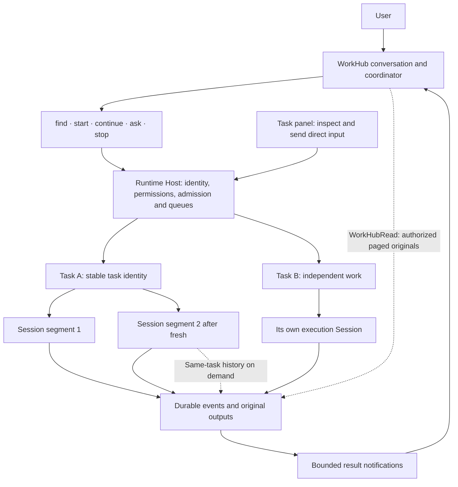

<!--
  Licensed to the Apache Software Foundation (ASF) under one
  or more contributor license agreements.  See the NOTICE file
  distributed with this work for additional information
  regarding copyright ownership.  The ASF licenses this file
  to you under the Apache License, Version 2.0 (the
  "License"); you may not use this file except in compliance
  with the License.  You may obtain a copy of the License at

      http://www.apache.org/licenses/LICENSE-2.0

  Unless required by applicable law or agreed to in writing,
  software distributed under the License is distributed on an
  "AS IS" BASIS, WITHOUT WARRANTIES OR CONDITIONS OF ANY
  KIND, either express or implied.  See the License for the
  specific language governing permissions and limitations
  under the License.
-->

# Baka · WorkHub

**One conversation to move work forward. Stable tasks, replaceable Sessions.**

[简体中文](./README.zh-CN.md) · [Architecture](./docs/architecture/workhub-current.zh-CN.md) · [Validation](./docs/eval/workhub-validation-2026-10-23.md) · [Upstream RFC draft](./docs/rfcs/workhub-task-centric-coordination.md)

Baka is an independently maintained experimental fork of [Apache Maka (Incubating)](https://github.com/apache/maka). Its focus is **WorkHub**: task-centric coordination built on Maka's existing Runtime Host, Sessions, tools, permissions and event log. It is not a new coding harness, an official Apache distribution, or an accepted upstream design.

## What WorkHub changes

In a Session-first workflow, you remember where earlier work happened and decide where to continue. WorkHub makes the **task** the persistent unit:

- Describe work in the main conversation. The coordinator can answer, find an existing task, clarify, or start independent work.
- Follow up naturally. The AI decides which task is meant; the task preview does not silently redirect the main conversation.
- Inspect a task in the right panel and send corrections directly to that task.
- Continue in the current Session (`reuse`), or in a new Session (`fresh`) without changing task identity. The AI chooses; there is no fixed context-size switch.
- Retrieve old requirements, corrections and visible tool output on demand, instead of copying the entire old context.

Sessions and working directories still exist. WorkHub makes them secondary in its interface; it does not remove their execution, ownership or security boundaries.

## Architecture



The coordinator interprets intent. The Host validates the specific target and operation; it does not certify that the model understood the user's intent. Workers remain ordinary Maka executions with their own configuration, approvals, tools and recovery.

| Situation | Execution contract |
| --- | --- |
| Queued | Supplement pending input in place; retain the queue position. |
| Running | Deliver Steering at the next consumable model boundary without interrupting a running tool. Admission is not consumption. |
| Ended | Admit a new Turn through the existing queue. |
| `fresh` requested | Keep task identity and inherit the current segment's persistent settings. Reject while busy, queued or awaiting an interaction; no delayed switch. |
| Approval pending | Answer the original interaction. A chat correction is not permission. |

The model-facing surface is five task actions plus `WorkHubRead`. It does not add a pre-routing model, correction transaction, question relay, dependency-wait protocol or general memory service.

### Long-running coordination

WorkHub uses the **same native history compactor** as an ordinary Session:

- Short result notifications retain task and exact result references, rather than repeatedly copying transcripts.
- A small recent-task reference block is rebuilt from successful user-associated actions. It is a hint, not a routing decision or complete memory. Older work still needs `find`.
- `/compact` compacts only the coordinator. Its optional threshold applies only there; blank inherits the model configuration, with no invented fallback.
- Original events remain stored. `WorkHubRead` follows verified task lineage and pages through permitted history and archived output.

There is no independent sliding tool-result cleaner or extra handoff-summary model call. Compaction has a model cost and can rebuild the provider's prompt cache.

## Validation snapshot

Baka [`04281faee`](https://github.com/sunrioa/baka/commit/04281faee875d381d7f5d6a13e7408888ae9ba27), 2026-10-23. Live tests used Command Code `deepseek/deepseek-v4.1-flash` on macOS.

| Evidence | Observed result | Boundary |
| --- | --- | --- |
| Real coding and routing | Independent A/B tasks, natural follow-ups, preview/main-topic disagreement, same-Turn corrections, FIFO and queued cancellation exercised. | Case-based evidence, not a routing-accuracy benchmark. |
| Same-task fresh history | Six fragments reconstructed prior 21,322-byte stdout; SHA-256 matched, with no new `not_found` in that retest. | Native ai-sdk path, not executor fresh. |
| Recovered abnormal tool history | Real isolated Host crash/restart no longer blocked compaction; coverage advanced from 9 to 13 content events, then an immediate repeat returned `unchanged`. | Host/native SDK and real model; not a Desktop UI test. |
| Latest focused regressions | 562 compaction/budget/replay tests + 226 recovery/interaction/policy tests passed; workspace typecheck passed. | 788 targeted tests, not a fresh whole-repository run. |

The [dated report](./docs/eval/workhub-validation-2026-10-23.md) separates earlier suite results, failures, model usage and controlled `reuse`/`fresh` comparisons. Different revisions and overlapping windows are not added into one score. These observations do not establish monetary savings or superiority over another harness.

### Current limits

- Executor tasks can be created and continued where supported, but **executor `fresh` is rejected** until a native history bridge exists.
- Natural-language task association remains fallible. Uncertain targets should be searched or clarified, not guessed from the preview or a similar title.
- Long-history routing used a labelled fixture, not nine days of natural aging. The macOS DeepSeek runs do not establish cross-provider or cross-platform behavior.
- An ended execution is not independent verification that its goal or artifacts are correct.
- Threshold/window reasonableness validation remains deferred; configuration is not a measured service-side limit.
- Existing React/ResizeObserver diagnostics are outside these completion claims.

## Try the development build

Use Node.js 24, npm 11.19.0, Git and `ripgrep`. Platform dependencies are in [CONTRIBUTING](./CONTRIBUTING.md).

```sh
git clone https://github.com/sunrioa/baka.git
cd baka
npm ci
npm run dev:worktree
```

Configure a model in Settings, enable WorkHub under General settings, and open WorkHub. Each checkout defaults to a separate persistent profile; it does not import another installation's keys or history.

To reuse a profile, first back it up and quit its owning App/Host, then pass the exact Electron user-data path, **not** its `workspaces/default` child:

```sh
npm run dev:worktree -- --user-data-dir="/absolute/path/to/existing-user-data"
```

Do not run two instances against the same profile. App and package names still use Maka; this README does not rename binaries or data roots.

## Documentation and upstream

- [Current architecture](./docs/architecture/workhub-current.zh-CN.md): ownership, task/Session identity, input, history and compaction.
- [Validation and usage](./docs/eval/workhub-validation-2026-10-23.md): passed cases, failures and exclusions.
- [Task-centric ADR](./docs/architecture/workhub-task-centric-adr.zh-CN.md): the agreed design and its evolution.
- [RFC draft](./docs/rfcs/workhub-task-centric-coordination.md): a small upstream proposal, alternatives and open questions; not yet submitted.
- [Documentation index](./docs/README.md), [underlying Maka architecture](./ARCHITECTURE.md), [security](./SECURITY.md), [Desktop development](./apps/desktop/README.md) and [CLI](./packages/cli/README.md).

Upstream's [WorkHub simplification discussion](https://github.com/apache/maka/issues/5745) is a related starting point, not acceptance of Baka's implementation. Discuss the design before preparing implementation PRs.

## License and attribution

Apache License 2.0; see [LICENSE](./LICENSE) and [NOTICE](./NOTICE). Existing notices and third-party licenses remain applicable. Apache Maka, Maka and Apache marks belong to their respective owners, including The Apache Software Foundation. Baka is an independent fork, not an ASF-endorsed release. See the inherited [incubation disclaimer](./DISCLAIMER-WIP).
