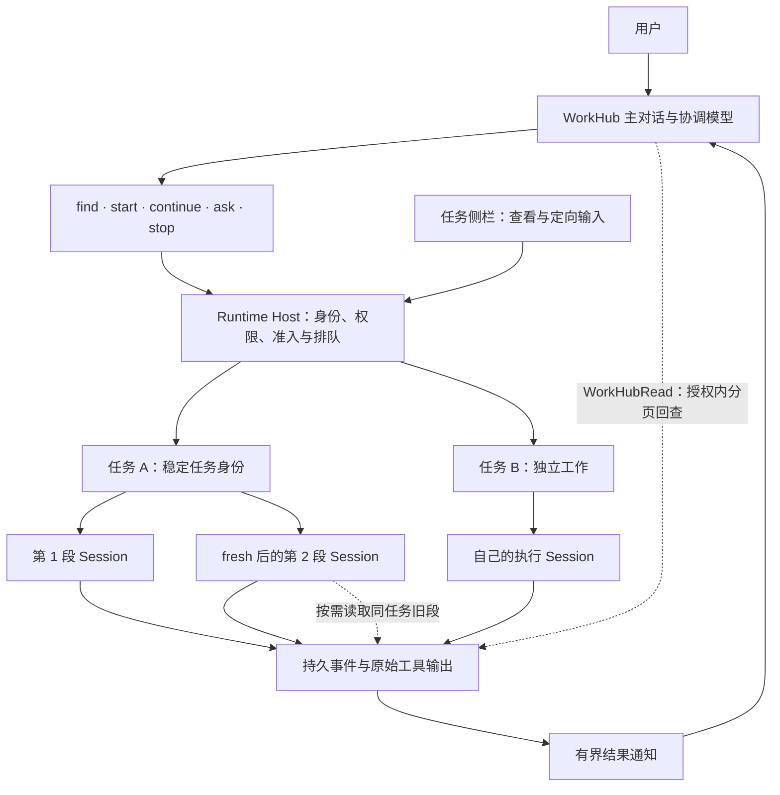

<!--
  Licensed to the Apache Software Foundation (ASF) under one
  or more contributor license agreements.  See the NOTICE file
  distributed with this work for additional information
  regarding copyright ownership.  The ASF licenses this file
  to you under the Apache License, Version 2.0 (the
  "License"); you may not use this file except in compliance
  with the License.  You may obtain a copy of the License at

      http://www.apache.org/licenses/LICENSE-2.0

  Unless required by applicable law or agreed to in writing,
  software distributed under the License is distributed on an
  "AS IS" BASIS, WITHOUT WARRANTIES OR CONDITIONS OF ANY
  KIND, either express or implied.  See the License for the
  specific language governing permissions and limitations
  under the License.
-->

# Baka · WorkHub

**用一个对话推进工作，以任务为中心，不必围着 Session 转。**

[English](./README.md) · [当前架构](./docs/architecture/workhub-current.zh-CN.md) · [测试与用量](./docs/eval/workhub-validation-2026-10-23.md) · [上游 RFC 草稿](./docs/rfcs/workhub-task-centric-coordination.md)

Baka 是基于 [Apache Maka（孵化中）](https://github.com/apache/maka) 独立维护的实验分支，重点探索 **WorkHub 的任务中心形态**：复用 Maka 的 Runtime Host、Session、工具、权限和事件日志，让用户主要面对任务，而不是手动管理一组会话。它不是新的 coding harness，不是 Apache 官方发行版，也不代表该设计已被上游接受。

## WorkHub 改变了什么

传统会话式使用中，你需要记住“这件事在哪个 Session 做过”，再决定去哪里追问。WorkHub 把**任务**作为持续身份：

- 在主对话描述需求，协调模型可以直接回答、查找旧任务、澄清，或创建独立任务。
- 自然追问，由 AI 判断接到哪件事上；右栏正在预览什么，不会悄悄改变总输入的派发目标。
- 在右栏查看某个任务，并直接向它补充要求或纠正方向。
- 同一任务可以复用当前 Session（`reuse`），也可以换新 Session 继续（`fresh`），任务身份不变。由 AI 判断，不按固定 token 数强制换窗。
- 新段需要旧信息时，按需读取原要求、纠正和可见工具输出，而不是复制整份旧上下文。

Session 和工作目录依然存在。WorkHub 只是弱化它们在用户界面的地位，没有取消底层执行、归属或安全边界。

## 架构



**AI 负责理解和选择，Host 负责验证和执行。** Host 校验具体目标与操作，不声称能证明 AI 理解了用户意图。真正执行仍由普通 Maka Session 承担，使用自己的模型、目录、权限、审批和恢复机制。

| 场景 | 实际处理 |
| --- | --- |
| 任务还在排队 | 原位补充待执行内容，不重新排到队尾。 |
| 任务正在执行 | 在下一次可消费输入的模型边界交付 Steering，不打断正在运行的工具；受理不等于 Agent 已读到。 |
| 任务已结束 | 在原 Session 受理新一轮，仍走既有队列。 |
| AI 选择 `fresh` | 保留任务身份，继承当前段的持久设置；忙碌、排队或有未决交互时拒绝，不建立延迟换窗队列。 |
| 有审批待处理 | 回答原始审批；普通聊天纠正不代表授权。 |

模型入口是五个任务动作加 `WorkHubRead`，没有额外的预路由模型、纠正事务、问题转发、依赖等待协议或通用记忆系统。

### 主协调对话变长时

WorkHub 与普通 Session **共用原生压缩器**，额外补上任务定位线索：

- 结果通知保留任务和精确结果引用，不默认反复复制执行全文。
- 从用户相关的成功操作重建一小段近期任务引用。它不是派发决定，也不是所有旧任务的完整记忆；更早的工作仍需 `find`。
- `/compact` 只压缩主协调；可选阈值仅覆盖主协调，留空继承模型配置，不自动填一个固定值。
- 原始事件仍在。`WorkHubRead` 按经过核验的任务关系读取旧段，必要时分页回源到工具原文。

没有独立的滑动回包清理器，没有额外的交接摘要模型调用。压缩会产生开销，也可能让供应商缓存重建，不能承诺无成本。

## 已验证到哪里

文档快照：Baka [`04281faee`](https://github.com/sunrioa/baka/commit/04281faee875d381d7f5d6a13e7408888ae9ba27)，2026-10-23。真实模型测试使用 macOS 上的 Command Code `deepseek/deepseek-v4.1-flash`。

| 证据 | 观察结果 | 边界 |
| --- | --- | --- |
| 真实 coding 与派发 | 已覆盖独立 A/B、自然追问、预览与总对话主题不一致、同轮纠正、FIFO 和排队取消。 | 是具体用例证据，不是路由准确率基准。 |
| 同任务跨 Session 读取 | 6 段历史片段拼回原来的 21,322 字节 stdout，SHA-256 一致；该次复测没有新的 `not_found`。 | 原生 ai-sdk 路径，不代表 executor fresh 已支持。 |
| 异常恢复后的压缩 | 隔离 Host 真实崩溃 / 重启后，压缩能越过旧异常调用，覆盖从 9 条推进到 13 条；立即重复返回 `unchanged`。 | 真实 Host、原生 SDK 和模型；该项不是桌面 UI 测试。 |
| 最新定向回归 | 压缩 / 预算 / 回放 562 项，加恢复 / 交互 / 策略 226 项通过；全仓类型检查通过。 | 共 788 项相关测试，不等于最新提交重跑了全仓所有测试。 |

[验证报告](./docs/eval/workhub-validation-2026-10-23.md) 分开列出更早的套件、失败记录、模型用量与受控 `reuse` / `fresh` 对照。不同版本和重叠窗口不累计成一个“总分”；这些观察也不证明实际费用降低或优于其他 harness。

### 当前限制

- 支持范围内可以新建、继续 executor 任务；在原生历史桥接接通前，**executor `fresh` 明确拒绝**。
- 自然语言任务关联仍可能出错。不确定时应检索或澄清，不能依赖预览或相似标题硬猜。
- 长历史路由使用了明确标记的夹具，不冒充自然老化九天；macOS DeepSeek 实测不代表所有模型和平台。
- “执行结束”不等于目标或产物已经独立验收。
- 压缩阈值与模型窗口的合理性校验仍待处理；配置值不是已测得的供应商硬上限。
- 既有 React / ResizeObserver 诊断不在本轮完成声明内。

## 本地试用

推荐 Node.js 24、npm 11.19.0，需要 Git 和 `ripgrep`。平台依赖见[贡献指南](./CONTRIBUTING.md)。

```sh
git clone https://github.com/sunrioa/baka.git
cd baka
npm ci
npm run dev:worktree
```

在设置中配置自己的模型连接，在通用设置里启用 WorkHub，然后打开 WorkHub。每个开发 checkout 默认使用独立且可持续使用的数据目录，不会自动导入其他安装的密钥或历史。

如需沿用已有开发数据，先备份并退出占用它的 App / Host，再明确指定 Electron 的 userData 根目录，**不是**下面的 `workspaces/default`：

```sh
npm run dev:worktree -- --user-data-dir="/absolute/path/to/existing-user-data"
```

不要同时启动两个实例使用同一份数据。应用与启动脚本仍沿用 Maka 名称；此次 README 不重命名二进制、包或数据目录。

## 文档与上游讨论

- [当前架构](./docs/architecture/workhub-current.zh-CN.md)：职责、任务与 Session、输入交付、历史和压缩。
- [验证报告](./docs/eval/workhub-validation-2026-10-23.md)：通过项、失败、未覆盖项和用量。
- [任务中心 ADR](./docs/architecture/workhub-task-centric-adr.zh-CN.md)：已确认设计与演变。
- [RFC 草稿](./docs/rfcs/workhub-task-centric-coordination.md)：最小提案、替代方案与开放问题，尚未发布。
- [文档索引](./docs/README.md)、[底层 Maka 架构](./ARCHITECTURE.zh-CN.md)、[安全策略](./SECURITY.md)、[桌面开发](./apps/desktop/README.md)、[CLI](./packages/cli/README.md)。

上游 [WorkHub 精简讨论](https://github.com/apache/maka/issues/5745) 是相关出发点，不代表 Baka 的实现已经获上游接受。RFC 先讨论设计，再决定是否、以多小的补丁贡献实现。

## 许可与归属

采用 Apache License 2.0，见 [LICENSE](./LICENSE)、[NOTICE](./NOTICE)。保留现有声明和第三方许可。Apache Maka、Maka、Apache 等名称及标识的权利归相应所有者，包括 Apache 软件基金会。Baka 是独立分支，不是 ASF 认可的发行版；继承项目的孵化状态说明见 [DISCLAIMER-WIP](./DISCLAIMER-WIP)。
