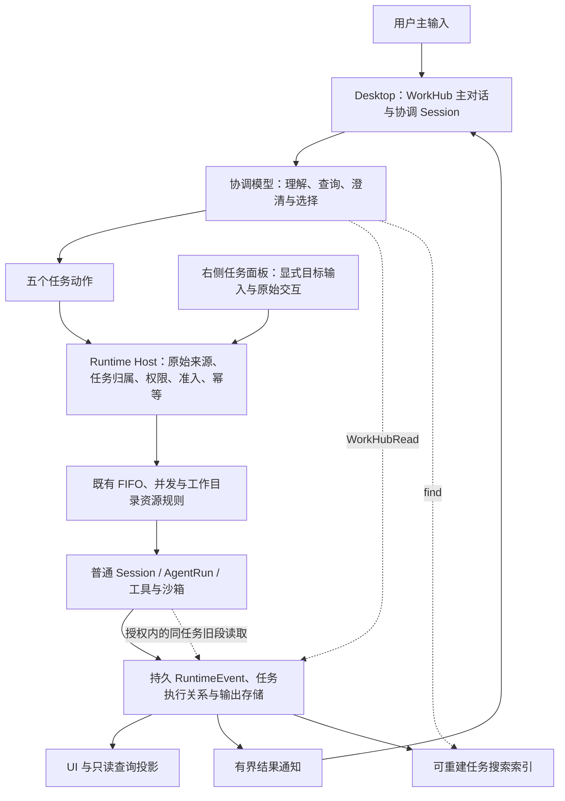
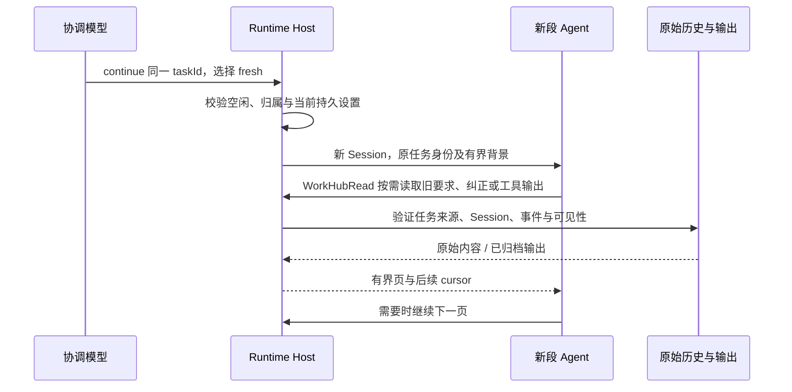

<!--
  Licensed to the Apache Software Foundation (ASF) under one
  or more contributor license agreements.  See the NOTICE file
  distributed with this work for additional information
  regarding copyright ownership.  The ASF licenses this file
  to you under the Apache License, Version 2.0 (the
  "License"); you may not use this file except in compliance
  with the License.  You may obtain a copy of the License at

      http://www.apache.org/licenses/LICENSE-2.0

  Unless required by applicable law or agreed to in writing,
  software distributed under the License is distributed on an
  "AS IS" BASIS, WITHOUT WARRANTIES OR CONDITIONS OF ANY
  KIND, either express or implied.  See the License for the
  specific language governing permissions and limitations
  under the License.
-->

# WorkHub 当前架构

代码快照：Baka `04281faee875d381d7f5d6a13e7408888ae9ba27`，核对日期 2026-10-23。本文描述当前实现；[ADR](./workhub-task-centric-adr.zh-CN.md) 记录设计决策，[验证报告](../eval/workhub-validation-2026-10-23.md) 记录证据，[RFC](../rfcs/workhub-task-centric-coordination.md) 是尚未提交的上游提案，三者不能互相替代。

## 1. 产品单位是任务，执行单位仍是 Session

WorkHub 是一个持续的协调对话，加一份可搜索、可展开的任务列表。它弱化的是用户对项目和 Session 的日常管理，不是删除底层 Session，也不是重新实现 coding harness。

```text
一个 Runtime Host
├─ 一个 WorkHub 协调 Session：主对话、模型决策、派发和结果接收
├─ 任务 A：稳定 taskId
│  ├─ 第 1 段：普通 Session，多次 reuse 可产生多个 Turn
│  └─ 第 2 段：fresh 后的新普通 Session，仍属于任务 A
└─ 任务 B：另一项独立目标，独立任务身份与执行
```

- `start` 是独立工作；也可以显式接入 `find` 返回的合格手动 Session。
- `continue + reuse` 是同任务、当前段续作；`continue + fresh` 是同任务换段，不是新建另一个任务。
- 标题、目录和相似主题都不是归属证明。Host 按持久任务关系、执行段、Turn 和 Run 解析真正目标。
- 工作目录是任务执行属性。普通会话和项目界面保留，WorkHub 不要求先选一个“项目”才能表达工作。

## 2. 分层与权威



| 层 | 负责什么 | 不负责什么 |
| --- | --- | --- |
| Renderer / 任务面板 | 展示、选中、草稿、发送显式目标输入、呈现原始审批 | 不持有执行权威；选中预览不决定总输入路由 |
| 协调 Session 与模型 | 主对话、判断是否同任务、选择 reuse / fresh、调用任务工具 | 不能自行声明用户来源、权限或执行身份；模型选对意图不是 Host 能证明的事 |
| Runtime Host | 校验真实来源、具体目标与当前执行、持久准入、队列、权限和幂等 | 不增加第二个意图模型，不因 token 数强制换段 |
| 普通 Session / Runtime | 模型与工具执行、Steering、原审批、沙箱、终态与恢复 | 不把协调默认值当作覆盖已有任务的授权 |
| 持久记录与投影 | 原始事实、来源关系、可回源输出；供 UI、搜索和模型回放使用 | 搜索摘要和 UI 状态不是新的执行授权，也不等于原文证据 |

协调者使用固定的内部协调 Session。它拥有自己的对话，不接管 worker 的工具执行和恢复；任务执行仍归目标 Session。首次启用、Desktop 能力绑定与本机 Host 的既有生命周期保持原边界。

## 3. 模型工具与一次主输入的流程

| 工具 | 当前含义 |
| --- | --- |
| `find` | 搜索任务和可接入的手动 Session，返回有界候选页；不是派发或权限 |
| `start` | 新建独立任务，或有意接入候选手动 Session；新建设置由 Host 读取 |
| `continue` | 对稳定 taskId 续作，自主选择 reuse / fresh；与任务面板输入共用 Host 桥接 |
| `ask` | 用户选择任务 / 手动 Session，始终有新建选项；选择本身不派发、不审批 |
| `stop` | 具体任务停止 / 排队撤回；按真实来源和目标数量走原确认规则 |
| `WorkHubRead` | 按授权读取状态、回复、结果、要求、历史和结果目录；正文可分页 |

主输入先进入真实协调轮次。模型可以直接回答；需要推进工作时，先查询或澄清，再提议具体动作。Host 校验原始用户 / 自动反馈来源与真实目标，通过后形成准入或拒绝回执。准入成功不等于 worker 已开始，更不等于用户要求已完成。

旧的 Jev / Intent / Recall 预路由、多操作 `tasks`、纠正替换事务、问题转发、任务级追加授权、依赖等待与 peer 问答生产入口已退役。旧数据仍可读；未完成的旧操作走已实现的最小兼容收尾，不重新交给协调模型处理。旧调用、取消事实等模型回放投影不改写原始历史。

## 4. 两种输入，共用执行契约

总输入由模型按总对话解释；右栏输入明确绑定当前任务。右栏选中 A、总对话最近主题是 B 时，总输入中的“继续”不自动指向 A。

| 任务状态 | 普通输入 / reuse | fresh |
| --- | --- | --- |
| 排队中 | 原位补充待执行内容，保留原排队位置 | 拒绝，不替换准入、不创建新段 |
| 执行中 | 通过 Steering 在下一次可消费边界进入本 Turn / Run，不中断当前工具 | 拒绝，不登记延迟换段 |
| 有问题 / 审批待答 | 仍须回答原交互；普通补充不代表批准 | 拒绝，不靠换窗绕过交互 |
| 正在停止 / 恢复 | 按当前执行归属返回暂不可受理 | 等旧执行与资源结清后再判断 |
| 已结束 / 失败 / 停止 | 在当前 Session 受理新 Turn，仍经原队列 | 原生任务可新建下一段，保持任务身份并经原队列 |

“本轮读到”是持久消息在模型边界被消费，不承诺 Bash 正在运行时会即时修改行为。回执区分受理、排队、消费、取消和失败，不能把 `queued` 当成已落实。

活动执行器或附件输入不支持时明确拒绝，不悄悄转换成任务结束后的新一轮。

用户轮次单个明确停止目标可走现有直接停止；自动反馈、已知多目标集合、同轮第二个不同目标需原生确认。`bypass` 不跳过这个任务控制确认。停止协调轮不等于停止已派出的任务，也不回滚已经提交的动作。

## 5. 设置、目录和排队

- 新任务读取 WorkHub 当前默认；未配置的 WorkHub 新任务权限是 `ask`，并发默认 3、可配置 1–8。这是实现默认，不是把某次实测的 `bypass / 1 / 8` 写成通用策略。
- 已有任务 reuse 读取该 Session 当前有效持久设置；fresh 继承当前段的持久配置，包括明确的后续修改，不被今天的新任务默认值覆盖。
- 单轮审批、临时沙箱许可不随 fresh 扩散。连接失效或执行器不可用时明确报错，不静默提高权限或换模型。
- 没有明确任务目录时使用 Host 的私有工作目录；访问请求里的一个文件路径不等于修改 cwd。
- FIFO、并发和同目录串行沿用现有准入与资源规则；没有新的跨任务依赖调度器或子代理总预算。
- executor 新建默认选择已持久化；executor `fresh` 在没有 Host 原生历史桥接时明确拒绝，不把 Host 能查看记录等同于执行器内部模型能调用 `WorkHubRead`。

## 6. fresh 怎么取回旧信息

新段接收当前续作要求、既有有界任务说明和历史入口，不复制旧段全量上下文。既有 Host 说明并非额外 LLM 交接摘要；不能反过来声称 fresh 完全没有任何任务背景。



读取范围包括同任务旧段的原始用户要求、纠正、助手可见回复、工具调用参数与可见输出。若一个旧 Session 曾混有其他任务，按任务执行血缘筛选，不自动放开整份转录；隐藏推理不在读取范围。

工具预览不是全文。对支持的裁剪输出，读取器用已授权的原 Session 与规范事件身份回源，再按游标分页。普通 `Read` 的附件 / 结果资源范围没有因此扩大，新段不应拿旧段资源地址冒充自己可读的地址。

读取范围还取决于实际调用者，不能把新段 worker 的能力套到主协调模型上：

| 调用者与目标 | 当前可读范围 |
| --- | --- |
| 原生 worker 读取自己的任务 | 同任务旧段的原要求、纠正、可见回复及可见工具记录，按来源分页 |
| 主协调读取任务 | 状态、已受理要求和纠正、已提交回复 / 结果；`history` 不是 worker 原始工具转录 |
| 主协调显式查看合格手动 Session | 状态与可见用户 / 助手文字；不含原始工具输出、附件正文或隐藏推理，不因此接入为任务 |
| worker 读取其他任务 | 现有授权允许的结果证据；不是任意跨任务原始转录 |

协调者没有任意读取业务仓库、私有文件或所有 Session 的全局权限。同任务读取能力不自动扩展为跨任务全转录访问。缺失、删除、来源不匹配或不支持时要明确返回限制，不能保证所有情况永远没有 `not_found`。

任务 UI 可以连续展示关联 Session 的完整可见对话；这与模型按任务来源过滤的读取授权是不同边界。

## 7. 主协调长上下文与压缩

### 相同的压缩内核，不同的协调辅助

普通 Session 和 WorkHub 都使用 Runtime 的安全前缀选择、模型摘要、持久检查点和回放投影。原事件不删除；重复压缩可基于旧摘要加新增安全历史推进，不能将“UI 出现分隔线”等同于确实扩大覆盖。

WorkHub 另有三项辅助：

1. 新结果通知减噪：保留 taskId、精确结果来源和短预览。有效 worker 状态块各项分别有界保留；其内容是 worker 自述，不覆盖 Host 真实终态或变成独立验收。
2. 近期任务引用：从用户发起的成功 start / continue 和 ask 任务选择重建，只含 taskId 与短标题，最多 8 条、1,536 UTF-8 字节；每个用户协调 Root 固定采样一次。回查有界，最多 4 页、每页 32 条记录；自动通知、预览和失败动作不改变主题。它不是完整记忆，缺少旧任务时仍须 `find`。
3. 独立入口与配置：`/compact` 是本地命令，进入固定的 `workhub.coordination.compact`；不作为用户任务发给模型，不进入 Steering 或追问队列。主协调忙碌时拒绝并保留草稿，不压缩 / 重启 worker。

```text
持久原文 → 公共压缩器 → 摘要检查点 + 未折叠尾部
下一次协调请求 → 稳定提示与工具定义 + 上述投影 + 有界近期任务引用
需要证据 → find / WorkHubRead → 原始记录与分页输出
```

`chatDefaults.workHubCompactionThreshold` 只覆盖协调后端和相应观测，不写回模型目录、不影响任务换段判断。留空继承模型 `compactionThreshold`；两者都没有配置时，不从最大窗口自动填阈值，仍保留手动压缩与既有溢出恢复。没有 AI 请求压缩工具、独立回包清理器或额外交接摘要调用。

压缩会改变后续请求前缀，可能重建供应商缓存；摘要调用本身也有用量。不能根据输入少或压缩分隔线就宣称费用下降。

### 当前公共异常历史修复

`04281faee` 修复的是公共 Runtime，不是 WorkHub 专属算法。只有原账本与调用身份核验一致、被 Host 完整封存为 `failed / outcome_unknown` 的旧异常调用，才允许安全范围越过；摘要输入保留“曾派出、无可靠结果、可能有效果”的事实，不补造工具回包、不自动重试。仍在运行、等待交互、缺可信终态或身份冲突的调用继续保护。

已有检查点覆盖范围没有扩大、有效内容也未改变时，直接返回 `unchanged`，不调用摘要模型、不新增检查点或成功提示；相同范围的有效内容变化，或覆盖扩大但摘要文字相同，分别按真实情况处理。

## 8. 代码导航与文档边界

| 主题 | 入口 |
| --- | --- |
| 模型动作、描述与输入 schema | [workhub-task-tool-schema.ts](../../apps/desktop/src/shared/workhub-task-tool-schema.ts) |
| 协调生命周期与动作准入 | [coordinator](../../packages/runtime-host/src/server/workhub-coordination-coordinator.ts)、[action gate](../../packages/runtime-host/src/server/workhub-coordination-action-gate.ts) |
| 当前任务输入 / 来源解析 | [input runtime](../../packages/runtime-host/src/server/workhub-task-input-runtime.ts)、[task source](../../packages/runtime-host/src/server/workhub-task-source.ts) |
| 原文、归档与分页 | [read tool](../../packages/runtime-host/src/server/workhub-read-tool.ts)、[history reader](../../packages/runtime-host/src/server/workhub-task-history-reader.ts) |
| 搜索索引 | [index projection](../../packages/runtime-host/src/server/workhub-task-index-projection.ts)、[SQLite index](../../packages/storage/src/sqlite-workhub-task-index.ts) |
| 通知与近期引用 | [result context](../../packages/core/src/workhub-result-context.ts)、[recent tasks](../../packages/runtime-host/src/server/workhub-recent-task-context.ts) |
| 主协调配置与公共压缩 | [context policy](../../packages/runtime-host/src/server/workhub-context-policy.ts)、[compaction](../../packages/runtime/src/history-compaction.ts)、[SDK compaction](../../packages/runtime/src/ai-sdk-compaction.ts) |
| 界面 | [WorkHub root](../../apps/desktop/src/renderer/features/workhub/ui/workhub-root.tsx) |

本文不承诺通用路由准确率、跨设备调度、全局记忆、executor fresh、独立冷缓存收益或所有平台效果。历史实施记录中的“待完成 / 未合并”必须按当时版本理解；当前状态以本文、对应代码及有日期的验证快照共同判断。
