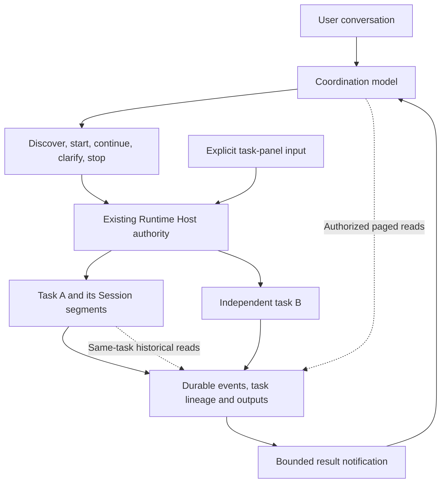

<!--
  Licensed to the Apache Software Foundation (ASF) under one
  or more contributor license agreements.  See the NOTICE file
  distributed with this work for additional information
  regarding copyright ownership.  The ASF licenses this file
  to you under the Apache License, Version 2.0 (the
  "License"); you may not use this file except in compliance
  with the License.  You may obtain a copy of the License at

      http://www.apache.org/licenses/LICENSE-2.0

  Unless required by applicable law or agreed to in writing,
  software distributed under the License is distributed on an
  "AS IS" BASIS, WITHOUT WARRANTIES OR CONDITIONS OF ANY
  KIND, either express or implied.  See the License for the
  specific language governing permissions and limitations
  under the License.
-->

# RFC draft: Task-centric WorkHub on the existing Runtime Host

- Status: **draft for owner review; not submitted or accepted upstream**.
- Prepared: 2026-10-23.
- Reference implementation: Baka [`04281faee`](https://github.com/sunrioa/baka/commit/04281faee875d381d7f5d6a13e7408888ae9ba27).
- Upstream source snapshot reviewed for contribution procedure: Maka [`a509747d6`](https://github.com/apache/maka/commit/a509747d6779b27ee60e4d1ff044bc6ba8fcc5ca). This is not a claim that all fork differences or subsequent upstream work have been audited.
- Related: [WorkHub simplification #5745](https://github.com/apache/maka/issues/5745), [personal assistant architecture #6252](https://github.com/apache/maka/discussions/6252).
- AI assistance: Codex inspected code and existing verification records and helped draft this document. The human contributor decides whether to submit it and owns the final claims and scope.

## Summary

I would like to discuss making the **task**, rather than the Session, WorkHub's stable user-facing unit, while keeping Maka's existing execution authority.

A user describes work and follows up in one conversation. The coordinating model decides whether the request is a local answer, independent work, or a continuation of an existing task. An existing task can reuse its current Session or, when settled, continue in a new native Session without changing its task identity. The Runtime Host validates provenance, ownership, permissions and admission; it does not decide natural-language intent.

This is a proposal for a small coordination layer over ordinary Sessions, not a request to merge Baka's entire branch, replace the runtime, introduce a global memory service, or copy the personal assistant architecture into WorkHub.

## Problem and motivation

A conversation is a useful execution container, but not always a durable identity for a user's objective. A task may need several Turns, receive corrections while running, and outlive its current context window. Users should not need to remember a Session ID or repeat a task title just to ask a follow-up.

Simply hiding the Session selector is not sufficient. Without an explicit task identity and read path, a new Session can lose access to the requirements, corrections or original tool output needed to continue. Conversely, keeping every task transcript in the coordinator makes its own context grow and increases ambiguity.

The boundary suggested here is: **stable task identity, replaceable execution segments, original evidence available on demand**. Projects and directories remain runtime properties rather than mandatory conversational routing choices. Outside WorkHub, the ordinary Session and project interfaces need not change.

## Proposed model

```text
one Runtime Host
  one WorkHub coordination Session
  task A: stable taskId
    segment 1: ordinary Session, possibly several Turns
    segment 2: new ordinary Session after fresh
  task B: independent identity and execution
```



The diagram summarizes responsibilities, not a new process topology. The coordinator and workers run on the existing Agent Runtime. The Host is not another scheduling LLM. A task index is rebuildable discovery data, not an execution or permission authority.

### 1. Model choice, Host enforcement

The reference implementation exposes five task actions—`find`, `start`, `continue`, `ask`, `stop`—and the native reader `WorkHubRead`. These names describe the experiment, not a requirement that upstream adopt the same spelling or transport.

- `find` returns bounded task/manual-Session candidates; summaries are not original evidence.
- `start` creates independent work, or explicitly adopts a discovered eligible manual Session.
- `continue` targets a stable task; the model selects `reuse` or `fresh`.
- `ask` records a target selection and includes a new-task option. Answering it does not dispatch or grant permission.
- `stop` uses exact task ownership and existing origin/multi-target confirmation rules.
- `WorkHubRead` retrieves permitted status, requirements, visible history and result originals.

There is no pre-routing model or bound intent decision. User input and automatic result feedback retain different provenance. A late result must not become a new user request or silently change the current conversational topic. The Host can enforce identities and confirmation rules; it cannot prove that the model chose the semantically correct task.

### 2. One task-input contract

The coordinator's task continuation and direct task-panel input should use the same Host-owned path:

| Task condition | Reuse / ordinary input | Fresh |
| --- | --- | --- |
| Queued | Supplement in place; retain FIFO position. | Reject; do not replace the admission. |
| Running | Steering at a consumable boundary in the same Turn/Run; do not interrupt a tool. | Reject; no delayed switch. |
| Pending question or approval | Use the original interaction to answer or approve; ordinary text is not authorization. | Reject while unresolved. |
| Stopping or recovering | Report the current unavailable condition. | Wait for execution and resource settlement. |
| Settled | Admit an ordinary next Turn through the existing queue. | Create a new native segment of the same task through existing admission. |

Admission, queueing, consumption and completion must remain distinguishable. A successful submission is not proof that the Agent read or followed a correction.

Unsupported active-backend or attachment input is rejected, not silently converted into a later Turn.

The main conversation follows its own topic. Selecting task A in the preview does not redirect a vague main-input follow-up from task B to A. Direct panel input, by contrast, explicitly targets the displayed task.

### 3. Fresh preserves identity, not the full context

Fresh inherits the current segment's effective persistent model/connection, permissions, thinking settings and working directory, including explicit later edits. It does not replace them with today's defaults for new tasks. One-Turn approvals and temporary allowances do not propagate.

The new segment receives the new instructions, bounded existing Host task context and a historical read entry. It does not receive the full old transcript or require an additional LLM handoff-summary call. Bounded Host context still exists; this is not a claim that the new segment starts with no background.

For an owned native worker reading its established task, historical reads include original user requirements, corrections, visible assistant responses, tool arguments and visible output. They are filtered by verified task/execution lineage. Reusing a Session for multiple tasks must not grant each task the entire Session's history.

This is not a universal coordinator read grant. In the reference implementation, coordinator task-history queries expose accepted requirements/corrections, with committed replies/results available separately; they do not expose the worker's raw tool transcript. Explicit inspection of an eligible manual Session is limited to status and visible user/assistant text. Other-task workers retain only existing result-evidence access.

Archived output needs a task-authorized source read and pagination, not an old Session-local URL that the new Session cannot use. Hidden reasoning and unrelated history remain excluded. Missing, deleted, mismatched or unsupported sources must be explicit, not silently treated as empty history.

Executor providers currently lack this Host-native tool bridge in Baka. The implementation therefore rejects executor fresh. This is a capability boundary, not a feature to advertise as complete.

### 4. Keep the coordinator's context bounded and reconstructible

The coordinator is itself a long-lived Session. The minimal approach is to reuse Maka's existing mechanisms:

- Keep new notifications short: task identity, exact result source, real Host status and a bounded preview. Worker status claims are not independent verification.
- Rebuild a small recent-task reference block from successful user-associated actions. Automatic notifications and preview selection do not reorder the topic. This is a hint, not a memory database or a route binding; absent older work still requires search or clarification.
- Use existing output archival and pagination. Do not add an independent sliding result cleaner that repeatedly rewrites old request prefixes.
- Offer a local coordinator `/compact` entry and, optionally, a coordinator-only configuration override. Leave thresholds configurable, do not derive a hard-coded switch from model window size, and do not conflate compaction with task fresh.

The same native compactor and checkpoints serve ordinary Sessions and WorkHub. Compaction changes replay, not the original event log. It can rebuild prompt caches and incurs summarization cost. The coordinator and task still need tools, system instructions and an uncovered tail, so a successful compaction need not reduce input to the summary's size.

## Preserved boundaries and non-goals

- One coordination Session per Host; ordinary Sessions retain execution and recovery ownership.
- Existing sandbox, approvals, FIFO, concurrency, directory serialization, stop and idempotency rules. No forced YOLO conversion of existing tasks.
- No generic intent classifier, correction replacement transaction, copied question/answer relay, peer inbox protocol or dependency scheduler.
- No global filesystem/history grant, memory network, proactive discovery loop, cross-Host task placement or automatic artifact acceptance.
- Existing questions/approvals can still be pending in the original task and consume existing resources. Removing relays does not mean all waiting workers become nonblocking.
- Historical data remains readable; obsolete pending operations require deliberate, minimal settlement rather than pretending they never existed. Do not transplant the fork's migrations or protocol epochs wholesale.

This deliberately does not resolve every product policy in #5745. In particular, it preserves existing per-Session permissions and native pending interactions, rather than making all reuse YOLO or treating every missing-input condition as a completed worker response. Those choices need explicit upstream agreement.

## Reference implementation and evidence

The implementation is in the independently maintained [Baka fork](https://github.com/sunrioa/baka/tree/04281faee875d381d7f5d6a13e7408888ae9ba27). Its [architecture](../architecture/workhub-current.zh-CN.md) and [dated verification report](../eval/workhub-validation-2026-10-23.md) distinguish current contracts from historical stages.

All live observations below used macOS and Command Code `deepseek/deepseek-v4.1-flash`. Earlier tests are not retroactively counted as runs of the latest revision.

| Observation | Evidence and limit |
| --- | --- |
| Follow-up routing | Fixed J07, revised J12 and T02 passed in real Desktop model loops. T02 separates preview A from main-topic B. These are cases, not a measured general accuracy rate. |
| Stale cancelled follow-up | An initial T13 failed by sending old work during a later request. A lifecycle-fact projection fix was followed by a passing real retest; the original failure remains recorded. |
| Steering and queueing | Same-Turn consumption, FIFO, in-place queued supplementation and pre-delivery cancellation were observed through native records; not merely worker self-report. |
| Fresh historical output | Six fragments reconstructed the original 21,322-byte stdout with matching SHA-256, without regenerating it or introducing a new not_found in the retest. Native path only. |
| Latest shared compaction repair | 562 compaction/budget/replay tests and 226 recovery/interaction/policy tests passed. A real isolated Host crash/restart no longer blocked safe coverage; an immediate repeat returned unchanged. This was an SDK/Host test, not a Desktop UI crash test. |

The shared compaction defect is tracked separately in [#6254](https://github.com/apache/maka/issues/6254). Its fork fix is not an implementation PR requested by this RFC; check current upstream work before offering any duplicate patch.

Costs are still a tradeoff. In one controlled, fully specified coding comparison, fresh used fewer total input tokens but slightly more cache-miss input; reuse also required a generated-test repair. The arms were sequential and neither worker needed historical reads. They do not establish lower monetary cost, a cold-cache result or a generally better harness. Connection pricing was unknown. The dated report retains all counted attempts and failed verification work.

## Tradeoffs and alternatives

| Alternative | Benefit | Cost or reason not chosen for this experiment |
| --- | --- | --- |
| Keep Session as the sole identity | Fewer concepts and minimal new storage/compatibility work. | Users still track context containers; fresh can fragment one objective. |
| Copy all old context into fresh | Easy immediate access to prior text. | Recreates the context problem and risks copying unrelated data. |
| Add an LLM handoff summary or global memory system | Potentially richer recall. | Another prompt, cost, maintenance and lossy authority surface; not necessary for original on-demand reads. |
| Use a fixed token threshold for task switching | Deterministic automatic action. | Models and tasks differ; context size alone does not decide whether reuse is useful. |
| Bind main input to the selected preview | Deterministic visible target. | Changes the established main-conversation semantics; direct panel input already provides explicit targeting. |

The proposal adds durable identity and historical-source checks, which have real maintenance costs. Coordination also adds model latency and feedback requests compared with going directly to a Session. These costs should be justified by user value and evidence, not by the number of new tools or test assertions.

## Suggested upstream path, subject to agreement

1. Agree on task identity, provenance, input-state semantics and the relation to existing WorkHub/Bot durable work. No implementation PR is a prerequisite for the discussion.
2. If accepted, review a small contract/input slice using existing Host authority, with focused queue, permission and retry tests. Remove superseded producers only with explicit old-data handling.
3. Review native fresh plus source-bound historical reading as a separate slice. Advertise capability limits and keep executor fresh closed until separately implemented and verified.
4. Treat UI refinements and coordinator context maintenance as separable work. Reuse ongoing upstream compaction repairs rather than bundle them into a large WorkHub patch.

Each accepted slice should land or be revised before dependent changes pile up into another stack of draft PRs. The fork is a reference and counterexample source, not a proposed one-shot merge.

## Open questions for maintainers

1. Is a task identity distinct from Session identity useful enough to justify its persistence and compatibility cost? Can an existing upstream durable-work identity serve it?
2. Should WorkHub and the Bot/Matter direction share a task/read contract while keeping conversational scheduling and proactive memory/discovery separate? #6252 explicitly describes an experimental variant, not all of main.
3. Are the queued/running/settled input rules above the right minimum contract, including rejection of busy fresh?
4. What is the narrowest historical-read authorization for native fresh, manual Session adoption and any future executor bridge?
5. Which real-user routing, correction, history-integrity, latency and metered-cost cases should gate adoption? What would make a simple direct-Session workflow preferable?

## Submission notes — remove or adapt before posting

Maka's [contribution guide at the reviewed snapshot](https://github.com/apache/maka/blob/a509747d6779b27ee60e4d1ff044bc6ba8fcc5ca/CONTRIBUTING.md) directs exploratory proposals to Discussions and material product direction to public `dev@maka.apache.org` discussion before implementation. It does not define a separate RFC file template. Choose the appropriate public venue with the contributor; do not open a bug report just to publish this design.

Before submission: obtain human review, recheck current upstream overlap, replace local relative evidence links with the reviewed public Baka document commit, retain AI attribution, and keep private transcripts/keys/reasoning out. No Issue, Discussion, mailing-list message or PR has been posted as part of preparing this draft.

<details>
<summary>中文审阅摘要</summary>

这份 RFC 只提议：在 Maka 现有 Runtime Host 上，让 WorkHub 以稳定任务身份组织工作。不是换基座、重构 sandbox，也不是复制 Bot 的完整个人助手架构。

- 用户在一个总对话中推进工作；AI 自主判断新任务、原任务续作及 reuse / fresh，Host 校验真实来源、身份、权限、排队和幂等。
- 任务与 Session 分开：fresh 是原任务的新执行段，继承当前段持久设置，不全量复制旧历史、不额外调用模型写交接摘要。
- 排队原位补充、执行中同轮 Steering、结束后新轮；忙碌或有未决交互时拒绝 fresh，不建立新的延迟换窗队列。
- 新段按任务来源读取原要求、纠正和工具输出，支持回源分页；不是任意 Session 全文或文件系统授权。executor fresh 仍关闭。
- 主协调沿用公共压缩器，加短通知、可重建近期任务引用、手动压缩和可选独立阈值；不增加全局记忆或独立回包清理器。
- 桌面派发、纠正、排队、跨段原文与压缩已有个案证据，但不宣称通用准确率、全平台支持或美元费用更低。最新 788 项是定向回归，不是全仓总分。
- 与 #5745 并非全部政策相同：保留已有任务权限和原始问题 / 审批等待。与 #6252 的共享点是 Runtime、任务和原文读取，不把主动发现、记忆索引和持续循环一起引入 WorkHub。

先请求上游对最小边界和共享任务概念给意见；若方向获认可，再拆成可审阅的小变更。当前只是草稿，没有向上游发布，也不要求把 Baka 整个分支合进去。

</details>
