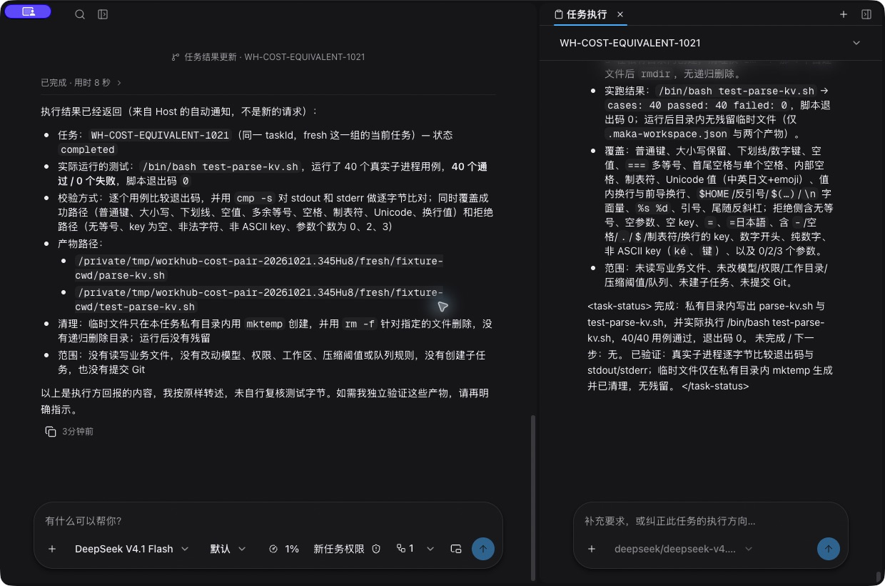
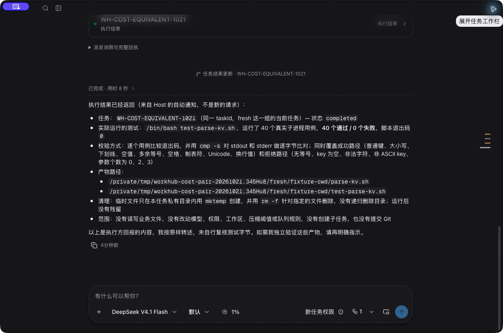

<!--
  Licensed to the Apache Software Foundation (ASF) under one
  or more contributor license agreements.  See the NOTICE file
  distributed with this work for additional information
  regarding copyright ownership.  The ASF licenses this file
  to you under the Apache License, Version 2.0 (the
  "License"); you may not use this file except in compliance
  with the License.  You may obtain a copy of the License at

      http://www.apache.org/licenses/LICENSE-2.0

  Unless required by applicable law or agreed to in writing,
  software distributed under the License is distributed on an
  "AS IS" BASIS, WITHOUT WARRANTIES OR CONDITIONS OF ANY
  KIND, either express or implied.  See the License for the
  specific language governing permissions and limitations
  under the License.
-->

# WorkHub 任务中心改造：实施与验证记录

- 依据：[已确认 ADR](architecture/workhub-task-centric-adr.zh-CN.md)。
- 实施起点：`d43a4d317`，运行时代码基准 `a7f6925`。
- 开始日期：2026-10-19。
- 约束：AI 自主选择 reuse / fresh；不强制换窗、不全量复制上下文、不新增交接总结调用；保留现有权限、FIFO、并发和同目录串行。GitHub Actions 保持停用。

## 阶段进度

| 阶段 | 范围 | 状态 | 验证 / PR |
|---|---|---|---|
| 1 | 删除 Jev / 预路由，兼容旧策略、凭据、准入与用量，修正工具描述 | 已实现，待人工审阅 | [PR #35](https://github.com/sunrioa/baka/pull/35)，未合并 |
| 2 | 配置继承、目录、观测与估计、执行绑定及 stop | 已实现，待人工审阅 | [PR #36](https://github.com/sunrioa/baka/pull/36)，未合并 |
| 3 | 可重建任务索引、六工具、统一输入与历史读取 | 已实现并纳入收敛；真实模糊追问、同轮纠正及历史读取已有实测 | [PR #37](https://github.com/sunrioa/baka/pull/37)–[PR #44](https://github.com/sunrioa/baka/pull/44)、[PR #53](https://github.com/sunrioa/baka/pull/53) 为未合并的历史分段；当前以本轮汇总变更及下列最新验证为准 |
| 4 | 删除旧纠正 / 候选快照 / 转发 / 任务授权 / 依赖等待 / peer 协议 | 已删除生产者；经批准的旧数据最小退役、恢复组合及原实例升级已核验 | 未新增表、恢复服务或意图判定层；原失败记录保留，不自动合并旧 PR |
| 5 | 有界任务说明、历史入口和可选状态块 | 已接入，含只读任务概况；原生 fresh 可按需读取旧段原文 | 自主选择实测与本轮受控等价编码对照分别记录；未验证价格、冷缓存或压缩成本 |
| 6 | 任务界面、原审批、侧栏折叠、默认模型持久化 | 原实例任务列表、A/B 切换、原生问题、同轮侧栏输入及重开历史已复核；关闭高亮残留最小补修通过 | executor 新建默认值持久化；executor fresh 明确拒绝，不在本轮扩展；React / ResizeObserver 警告暂不处理 |
| 7 | 逐阶段回归、真实 coding、长上下文与成本实测 | 核心固定用例、原实例真实编码及受控成本对照完成本轮核验，待人工审阅 | 带标签 T01 不冒充自然九天；未覆盖的目录项、两份真实 home 测试、冷缓存与压缩费用不算通过 |

## 验证规则

- 每阶段单独记录提交、测试命令及结果；删除旧机制时列出删除测试与替代用例。
- 旧数据不只测试解码，还测试 Host 启动和未完成操作的幂等恢复。
- 实机沿用当前实例配置；测试工作文件在独立测试目录，不改业务文件或默认权限。涉及现有持久数据前先保留可恢复副本。
- 真实派发与执行按 Host 记录核对；受理、进入队列、Agent 消费、执行完成分别记录，不能混称成功。
- 未测试、未观测、未知费用均如实标记，不补零值，不用本地夹具代替真实供应商数据。

## 用量采样字段

真实模型用例按任务与请求关联记录：用例编号、时间、代码提交、连接 / 模型标识、执行器、有效窗口 / 输入上限与 `compactionThreshold` 配置、reuse / fresh 选择、任务与阶段、派发及执行状态、请求耗时、输入 / 输出 token、供应商可区分的缓存读取 / 写入 / 未命中用量、压缩或重读历史情况、是否遵守用户纠正。

仅记录必要标识与归一化用量，不记录密钥、认证头或无关业务内容。保留字段来源，缺失值为未知；价格未核实不换算费用，费用估算不称供应商账单。未执行的替代方案没有“实际成本”。

## 当前实测状态

本轮运行实现固定为 `b61eb25cff61145e13253ad85d76e472cf8e6a85`，兼容 epoch 239。2026-10-22 已在原数据 profile 恢复单一开发 App，仍使用 Command Code `deepseek/deepseek-v4.1-flash`；原默认权限、并发 1、FIFO 与配置保留。原实例的真实编码、同轮纠正及最终界面复核，与隔离受控 reuse / fresh 对照分开记录如下；等待人工审阅，不自动合并。以下历史过程中的“待完成 / 未发布”是当时状态，不是当前清单；失败与最初的授权说明错误均原样保留。

## 本轮收尾（2026-10-21–22）

### 原实例界面、执行与最小补修

- 原数据中全新 A / B 使用不同任务、Session 和私有目录。A 通过原生问题等待用户选择，B 因并发 1 等待；侧栏纠正先受理，再在 A **原 Turn / Run** 消费，没有另开 worker 轮。A 完成后 B 才开始。真实 CLI 测试分别 24/24、26/26，读取产物后的独立复跑亦为 50/50。可见导出与独立核验摘要分别为 `e8ac5381fa7f0fc5b11ddbeb40ada7baa558db020c6926d15865befa5e5a12e9`、`14827b895af627033a1d6c2acd7ed05f29c27d34e0965ed44536a2c5d3406460`。
- 原实例发现关闭统一右栏后卡片仍保持选中。`b61eb25cf` 仅将既有 `workbar.collapsed` 纳入任务选中的显示投影和待处理读取的失效条件：隐藏时不高亮，关闭前的异步读取不能重开侧栏；保留原精确选择供显式打开，不修改任务权威、队列、权限或通信协议。新增测试先复现失败，补修后相关 97 项通过；没有改测试超时或断言。首次新夹具把任务状态写成不支持的 `completed` 导致编译失败，修正为既有 `pending_acceptance` 后才运行，失败未计为通过。
- 补修后在隔离真实任务及恢复后的**原实例**分别核验：统一入口先显示任务列表；A/B 选择、历史要求与纠正、真实工具详情和结果可见；输入目标随当前任务固定；手动关闭后四张关联卡片全部未选中；重开仍是列表。既有工具输出预算会明确显示截断及保留资源引用，不能把 AX 摘要当作完整输出字节。原实例最终 UI 记录摘要为 `9c65367de00cf13bea0df400578c4ff07601e978f37dd34c6db06502aa3893b7`。
- 功能通过不等于 Agent 完全遵守目录约定：A 的一条手工探测曾把输出写入 `/tmp/o.txt`、`/tmp/e.txt`，与“仅本任务私有目录”指令不符。保留该偏差，不采信其最终回复“全程仅私有目录”的自述，不擅自清理或补造隔离成功；本轮不改变既有 bypass 默认值。该 smoke 的 20 次请求全有用量报告：input 2,856,385 / output 15,448，cache read 2,527,360 / miss 329,025 / write 0；不是成本对照任一臂。
- 原实例恢复后四份 catalog / vault / policy / settings 与压力实测前备份逐字节一致；52 条 Session metadata、232 条 Root 准入，`quick_check=ok`、外键异常 0。两个收尾任务公开终态均 completed，纠正回执仍指向原 A 执行；获批切换连接的原压力任务仍 ask、沙箱 revision 0，没有继承隔离测试的放行。恢复记录摘要为 `9ed6fc0e56b65cb3f003c76b194cda286a1516c630b162ba63376d47beec34d2`。切换数据根均先正常退出并核对准确 App / Host 进程，不启动第二个开发 App；其他已安装 Maka 未动。

以下是**修复后的打开 → 关闭操作**，不是伪造的修复前后或原用户数据截图；仅含本轮合成编码任务，作为当前界面的长期说明：

### 受控等价编码成本对照

经用户明确批准，只在隔离评测指定两条路径，生产仍由 AI 自主判断。先 fresh、后 reuse，各自官方导入同一份合成历史（854 events / 424 messages），不复制数据库权威或既有授权。两次接管的 baseline 指令、可见回复相同，首次输入均为 1,006,683 token；随后模型提交的编码正文逐字相同（1,711 UTF-8 bytes，SHA-256 `960f3d819da510fc737993a285a068a61d029078567d338ddba731c727e1f396`）。任务是完整指定的 Bash key/value CLI，不是历史依赖任务；两次模型内部输出、协调历史与任务身份不按字节相同，不能称为确定性因果实验。

两边都通过同一组独立的 **27 项字节 / 退出码检查**。fresh 的生成测试首轮 40/40；reuse 首轮 9 通过 / 11 失败，原因为生成测试读取了 `KV_ERROR:` 后多一个空格却与九字符前缀比较，Agent 仅修测试后最终 20/20。所有失败、修复和额外请求均计入，不因外层 shell exit 0 抹去 `TEST_EXIT=1`。

| 编码臂（含协调与最终通知，不含准备） | 物理请求 / 已报告 | input | output | cache read | cache miss | worker 准入至结束 |
| --- | --- | --- | --- | --- | --- | --- |
| fresh | 10 / 10 | 133,195 | 14,878 | 107,136 | 26,059 | 86.556 s |
| reuse | 14 / 14 | 10,209,830 | 13,989 | 10,187,648 | 22,182 | 200.884 s |

- 准备阶段也不丢弃：fresh 4 次请求，input / output 为 1,027,897 / 1,026，cache read / miss 为 1,023,488 / 4,409；reuse 同为 4 次，分别为 1,027,583 / 830、1,025,664 / 1,919。两臂连准备共 **32 次物理请求**，全有用量，未新增模型重试规则。归一化 cache write 均为 0，费用均未知。
- 首个 worker 输入 fresh 为 **7,251**、reuse 为 **1,007,120**；新段实际入站 4,115 bytes，含既有 Host 有界说明与 fresh 指引，不是全量历史复制。没有额外交接摘要或压缩模型请求，两个 worker 都未调用历史读取；不能据此评价需要重读旧证据的任务成本。
- 两臂保持 ask、边界 revision 0、并发 1、相同模型配置；有效输入限额按当前配置读得 1,000,000，主动压缩目标未配置，未改算法或阈值。供应商接受的报告输入可超过此配置值，不能把配置当作已测服务端硬上限。公开查询逐一确认 12 个 Root 结束，物理请求与 canonical 记录对应，末尾无活跃资源。
- 两次 baseline 已有接近全部输入的 cache read，顺序运行不能称为独立冷 / 热缓存实验。input 已包含 cache read，不相加；miss 可为推算、write 的归一化零不代表写缓存免费。fresh 虽输入少、此次结束快，**miss 反而略多**，且 reuse 多了测试修复，不能把全部差异归因于上下文或断言 fresh 更便宜。价格未核实，美元费用 null；本次不覆盖冷缓存和实际压缩成本，也不是固定 T12 检查器或自主路由通过数。
- 私有对照核验摘要为 `4c24ab07e1ea025e083637bcadc024c44ca61af42d5174cf98bef76ec25a6fdb`；原始导出、凭据、合成历史和生成的编码产物不提交到仓库。此前自主选择 fresh 的实测仍单独保留，不用本次指定路径替代。

### 最终校验范围与明确排除

- `b61eb25cf` 全仓 build、typecheck、lint（4,174）、format（2,367）、架构检查（165）、Desktop / UI knip、ASF 与 surface inventory 通过。完整 Desktop 官方 434 文件单次运行 **3,400 通过 / 0 失败 / 0 跳过**，167.6 s；5,894 个编译 / 官方脚本产物前后摘要相同。日志摘要为 `0052956d42aec783ef9848791bda3a0942d58a4d486043f0d054eba646370f01`。
- Host 的 Core / Storage / Runtime / Host 四棵编译依赖树共 4,434 文件，与先前已通过的冻结 Host 2,506 / 12 原有跳过逐字节相同，摘要仍为 `69fcce969ec77c536cb3cce8e6158dbbc5dfcec0ea984f13aa6b0008271e991a`。这是可沿用的相同产物证据，不伪称又跑一次 Host；本轮新增 UI 回归及原生 HTTP 组合均在完整 Desktop 中重跑。
- Core 930、Storage 1,643 / 8 原有跳过、UI 740，以及 Runtime 253/255 文件的 3,756 / 14 原有跳过沿用前文对应代码证据，不把它们重复相加成独立覆盖。两份会写真实 home 的 Runtime 文件仍未运行；Storage 早先并发写租约失败未证明定因或修复，串行通过不抹掉该记录。
- 依用户要求暂不处理 React maximum-update-depth；ResizeObserver 警告及其独立排查不混入本轮。executor fresh 不扩展；自然九天、目录中未实现的检查器、独立冷缓存和压缩费用没有因此标 PASS。GitHub Actions 仍关闭，不读取 CI、不自动合并；汇总 PR 由人类最终审阅。

## 阶段 4–7 并行收敛记录（2026-10-20，未发布）

> 以下为历史过程记录；其中未完成事项应结合上方当前结论阅读，不追溯抹除失败或冒充一次全量通过。

集成分支为 `feat/workhub-adr-convergence`，并行基准为 `5c643a4de`。首批编译与定向回归对应运行时代码 `c2953cd52`；后续每批另记冻结提交，不将此前结果改记为新版本或真实模型通过。

### 已接入的收敛

- 删除旧纠正 / 恢复 writer、候选快照与旧发现 RPC；Gate 只保留新建、接入和 fresh 的原生准入。普通续作与侧栏共用任务输入，fresh 直接调用任务续作命令，不再绕回旧 `coordination.actFromTurn`。原任务 stop 的归属、确认、精确执行绑定和 FIFO 仍保留。
- 删除 B 的模型问题转发、D 的任务授权及 E / F 的新等待、问答、唤醒生产者；子任务交互归属改为独立只读证明。原问题、表单、沙箱和客户端能力审批仍由原交互 lifecycle 处理，不新增任务级授权。历史普通 `permission` schema 没有当前活 continuation，不能伪造成功答复。
- 经用户明确批准，在原 E / F 终态记录中增加 `legacy_protocol_retirement` 来源。Host 先核对原始不可变归属；E 精确停止旧等待 Root 并确认资源释放，F 结清原问答。固定身份保证重复恢复不另写结算；不冒充活跃用户 / Agent、不新增表、恢复服务或模型调用。已提交的旧续作血缘继续可读，迟到答复不唤醒已删除协议。
- 统一读取只保留有授权的纯读路径。executor 的已记录 user / assistant / tool 事件能由 Host 按任务血缘分页读取；这不等于 executor provider 有 Host 工具桥。其 fresh 在创建新段前明确拒绝，原生工具描述说明限制，不宣称端到端支持。
- 任务说明由既有原始目标、用户纠正、可归属 todo、可确认文件工具结果与可选 worker 状态临时拼装，有界且标注省略 / 未知。先在准入锁外读取，再在原有锁内复核源任务、当前设置与记录水位；事实变化则明确冲突，不带旧说明提交，不新增重试循环。worker 状态块只注入有当前任务执行归属的原生请求上下文，严格单行 / JSON 输出仍优先。
- 前端接入索引搜索 / 分页、独立任务标题、完整对话与执行段标记、原交互就地回答和创建来源折叠；预览不改变总对话派发主题。原生协调 / 新任务模型和思考级别使用已有持久配置，旧任务不被新默认值覆盖。
- 合并协议变动统一使用 epoch 238。旧记录继续解码，未删除凭据或原用户配置。旧纯机制测试随功能删除，综合 FIFO、原审批、消费、结果和冷历史测试改走原生任务 API，不延长超时或放宽断言。

### 已运行的集成校验与限制

- 完整 `npm run build`、全仓 typecheck / lint / format、ASF headers、Desktop / UI knip 均通过；renderer architecture 为 165/165。
- Host WorkHub 定向 276 项中 274 通过、2 项在取得测试数据根锁前因账户级注册目录 `EPERM` 失败，未进入业务断言。相关 Core / Storage / Eval 定向 75/75，Desktop WorkHub / 导航定向 188/188，完整 UI 739/739。不同批次和独立审查有重叠，不相加作为独立覆盖率。
- E / F warm/cold 恢复、11 项崩溃恢复及冷历史 fresh 的真实 Host 组合夹具已经迁移并编译，但涉及标准账户级锁目录，尚未取得本轮所需授权完成业务执行。不能把编译、内存测试或旧代码的通过记作这些夹具通过；也不改锁算法、伪装系统用户或绕过目录限制。
- 对原实例只读核对未发现未结清的 E / F 及纠正事务；这不代替带中间状态的升级夹具。原 App、数据与其他 Maka 实例未被本轮测试替换或停止。
- 独立静态审查发现两项待补修：任务原审批会受已加载历史页限制；新 `find` 未进入原 remote-owner 只读 allowlist。补修后须重新记录测试，不以前述结果覆盖新代码。
- `da3f9b35b` 已修审批分页：在既有刷新批次通过精确 action / delegation 查询任务归属，不依赖已加载历史；Host 已证明的子 Agent 请求保留自己的 Session / Turn / Run，不强制与父任务同 Session。旧响应、失联与切 Host 仍不能回答过期请求。补修后完整构建、typecheck / lint / format 与 41 项 Host 原交互 / 授权回归通过；Desktop 定向 196 项通过，另一个综合测试进程在受限沙箱中触发 Node 原生断言，业务测试尚未完成，不能算通过。
- Desktop 原生 HTTP 综合夹具的业务数据使用临时目录。取得工具审批后，两项用例真实失败：夹具仍靠已删除的 `WorkHubResult` 识别协调请求，误把它算作 worker。`3215571bd` 仅改为识别实际协调 profile，两项原测试通过；FIFO、同轮 Steering、原审批、配置继承、fresh 和停止断言及超时均未放宽。
- **测试权限说明更正**：最初误认为该夹具的 `managedDeploymentAuthority` 同时隔离数据根锁，因此工具审批说明错误写成“不访问标准账户 registry”。继续核对调用链才确认：它只隔离部署记录，`tryAcquireRuntimeHostLaunch` 仍调用账户级 `tryAcquireStateRootOwner`。上述两次运行实际接触标准锁 / 控制目录；业务数据库仍是临时目录，不是原实例数据库。已向用户更正、停止相关测试，未再尝试升级或改锁算法 / 系统身份。只读检查发现对应测试时段四个新控制目录及四个 0 字节、0600 普通锁文件，未擅自删除或清理账户目录。此前标准 registry 恢复测试的授权问题仍待用户回答；两项功能通过不能代替这项授权或其他恢复夹具。不能继续使用“所有锁都已隔离”的错误说明。
- 完整 Core 928/928、原生 ToolRuntime 权限 / 工具边界 61/61、完整 UI 739/739 通过。Eval JS 初跑为 114 通过、23 失败、1 原有跳过，含沙箱本地监听与子进程产物失败；取得不涉及账户 registry 的限定工具审批后，模拟 HTTP 用量 5/5、既有生命周期 / 审计 28/28 通过。再以完整 JS 文件集合排除唯一涉及标准 registry 的 `maka-initialization` 文件，136 通过、1 原有跳过、0 失败；未运行的初始化和 Python 测试不能计入这组通过。
- `12ab65ad3` 补齐旧远程凭据兼容：不自动加 grant；只有精确 `find/unauthorized` 且无搜索 / 目录 / 游标的请求，才能由同一 Host 的原 `query` 独立授权读取近期列表。Desktop 明确区分 `recent_only` 与索引结果，禁用未授权的搜索 / 分页，保留原始 action / delegation 并只展示同任务优先的首条记录；查询事实不变。补修后完整构建、Desktop 212 项纯回归、全仓类型 / lint / format、架构 165、knip 通过；独立增量静态复核未发现新增可操作问题。旧连接只保留原近期窗口，不据此宣称获得新索引权限。
- 最后静态核对发现活动结果通知仍推荐已删除的 Result / Evidence 工具。`994fac76e` 只修通知 factory 与其现有历史投影：统一推荐 `WorkHubRead(taskId, view=result, sourceActionId=actionId)`；新通知从 canonical assignment 携带逻辑 taskId，旧通知缺失时不从 actionId 猜测。两项新增回归先失败，修复后相关结果 / 读取 / 历史 56/56，Core 928/928、完整构建及静态检查通过；原 6144 字节预算、通知来源、权限和调度不变，无新增持久 schema 或模型调用。独立增量静态复核未发现新增可操作问题，不替代真实模型或人类审阅。
- 本轮 UI 将旧 TextArea 改为 TextInput 后，surface inventory 曾过期；使用仓库生成器只更新对应一行，路径清单不变，覆盖检查通过。没有混入 ResizeObserver 或其他 Maka 界面改动。
- 前一批运行时代码停在 `994fac76e`：完整构建、全仓 typecheck / lint / format、ASF headers 与 surface inventory 通过；再次运行 Core 928、Desktop 212（明确排除涉及 Host / registry 的 HTTP 综合文件）、UI 739、结果 / 统一读取 / 模型历史 56、原交互 / 授权 41 项均通过。不同批次有重叠，不汇总成独立覆盖数；该批的完整 Host 恢复套件、当前实例 GUI / Command Code DeepSeek 路由和真实用量未完成。原 App 未换代码，也未因这些纯回归重启。

### 已确认范围及后续冻结校验

- 用户随后批准两项最小收尾：原有取消记录新增 Host 退役旧协议的真实原因；标准账户级注册目录仅允许临时测试锁创建与清理。此授权不追溯消除上文早先测试权限说明的错误。测试不修改锁算法、不伪装系统身份、不读写原实例数据库；无法归属本轮测试的残留不清理。
- `e22021b2b`、`c17bdf89e`：启动时按原始任务 / 动作 / Session / 消息和 claim 绑定，只结清尚未派出的旧 replacement 意图。沿用原 `whb_` 固定身份写入 `legacy_protocol_retirement`，不停止、重启或撤销原执行，不回滚已完成的替换。新输入与结果读取只忽略精确匹配的退役意图；不匹配、普通旧取消及未决停止仍保留原阻挡语义。新增错误来源反例先实际失败后补修；丢失提交确认与重开覆盖通过，没有新表或恢复服务。
- `764727157`：经用户确认保留 executor 新建入口，在原 policy schema 4 的可选 `chatDefaults.workHubExecutor` 保存 executorId / executorModel / thinkingLevel。重启不再丢选择，不改变协调者原生模型、权限或队列。切回原生成功后才清除 executor 默认；保存失败如实返回错误，不可用 executor 明确报错、不静默回退。旧 policy 无该字段仍可读；写入后不承诺旧严格二进制降级读取，ADR 已注明。
- 上述生产代码完整构建、typecheck / lint / format / ASF 通过；Core 930/930、UI 740/740，executor 相关纯测试 172 项及 renderer architecture 165 项通过（与完整套件存在重叠）。Host 退役 / 输入 / 结果纯回归 98 项、E/F 恢复 2 项、崩溃恢复 11 项通过；原生 Desktop HTTP 组合 2 项通过。
- 冷历史 fresh 两项夹具先暴露了测试对 Host 资源收尾和原生续作血缘的错误假设。仅修正夹具：观察真实 Root residency 释放、将忙碌拒绝与后续新请求分配不同不可变动作标识、从 canonical reuse assignment 核对新段血缘。未延长超时、加重试或放宽 settling 拒绝。`d720d7059` 两项通过，保留用户要求 / 纠正 / 工具输出按需读取、无关任务隔离、设置继承、FIFO 与重开断言；900,000 字符夹具不计为真实模型自主换窗或费用证明。
- 同批完整 Storage 为 1,637 通过、1 失败、8 跳过。唯一失败是既有 context-offload 同限并发写入 / 不同限拒绝用例的写租约失效。其实现、测试及 root-authority 的源码和产物与基准 `5c643a4de` 六份哈希相同；当前树与原 checkout 单例各运行一次均通过，不能抹去全量失败，也未证明定因或修复。本轮没有改该模块。
- Storage 随后以明确的文件并发 1 单次运行完整集合：1,638 通过、0 失败、8 跳过，81.6 秒。305 个编译 JS 文件逐文件前后哈希一致；这是串行条件下未复现的对照，不是该既有并发失败已修复的证明，首次失败记录仍保留。
- `d720d7059` 完整 Host 单次、文件并发 1：2,478 通过、7 失败、12 跳过，535.0 秒。七项详情对应旧夹具假设：选择结果遗漏上下文观测、原生沙箱回答仍期待旧任务授权语义、手动 Root 被误算入 WorkHub 并发、两项构造停止记录的集合动作标识不匹配、将支持 Steering 的 native fake 当作不支持、工具表仍要求发表已删除的三个旧工具。后续仅修测试夹具并保留精确归属、真实 executor 拒绝与无副作用覆盖；尚未把此运行记为通过，未因此重启原实例。
- `9d9530792` 修正这些夹具，保留审批仅作用于原 Session / 子 Agent、manual 不占 WorkHub 名额、合法停止记录、精确 native Steering 与重开事实，并独立安装真实插件 executor 验证活动输入拒绝且没有受理 / 新 Run / 配置或队列副作用。composer 完整 12/12；执行组合定向旧六项通过，新增 executor 用例因 `/var` 与 `/private/var` 路径别名断言失败，未计为通过。`aa549d4c5` 仅将其期望改为同一目录的规范路径，定向七项单次 7/7。
- `aa549d4c5` 再次完整 Host、文件并发 1：2,485 通过、1 失败、12 跳过，447.2 秒。唯一失败是未改动的同 Session 历史夹具仅观察到 canonical completed 就立即续作，原 Root 尚在释放资源，正确收到 `session_busy / stopping, recovering or settling`。后续只给该夹具原 12 秒条件补真实 residency 归零，不改生产拒绝、超时或重试；将运行整个受影响组合文件核验，不把局部通过冒充这次完整运行全绿。两次完整运行的失败和产物哈希均保留。
- `350895724` 仅修正上述历史夹具的真实资源收尾条件后，单次完整 `execution-composition.test.js` 为 106/106、无跳过，86.1 秒。598 个 Host 编译 JS 的前后清单哈希一致；原模型 / 权限 / 队列生产代码未改。未再重跑全部 232 个 Host 文件，不将这次完整组合文件的通过改写成此前完整 Host 运行全绿。
- `96c9f5b45` 的 Runtime 授权子集单次完成：显式运行 254 个测试文件中的 252 个，3,743 通过、0 失败、14 跳过，84.1 秒。两份 filesystem-worker 测试会在真实家目录创建文件，未运行；这不是完整 Runtime 通过。569 个 Runtime 编译 JS 前后清单哈希一致。本次新增的 42 个 Root 缺完整进程归属证明，连同 52 个 bootstrap 残留均保留，未移动或删除；既有 Root 与受保护原 Root 未缺失。
- 只读任务概况已在独立分支 `feat/workhub-task-overview` 的 `7b7c94a1e` 实现，尚未集成到本分支或原实例。复用有界说明读取和 9,000 UTF-8 字节预算，仅本机 owner 可显式读取；历史、输入和原审批不等待概况。该分支完整构建、静态检查及 Host / Desktop 纯回归通过，独立 AI 静态复核未发现新增可操作问题，不等于人工批准或真实界面通过；待真实派发门槛核验后再集成。
- 截至上述冻结测试批次，原 Mac 于 2026-10-21 锁屏，已请求手动解锁；当时原 App 尚未重启。随后解锁后的升级和真实观察另记如下，不追溯改写上述测试结果。

### 当时尚未完成（历史快照，非当前清单）

- 旧夹具已按真实契约修正并通过受影响完整文件；仍须补原实例真实模型 / 界面验证和人工审阅。Storage 首次全量失败及完整 Host 的历史失败均保留，不宣称一次完整运行全绿。
- 任务顶部只读概况已在独立分支实现，集成与原实例 GUI 核验尚未完成；不为补这一显示复制整段历史。
- 固定评测已有 `plan` / `check`，T01、T02、T13、J07、J12 仍待新分支的真实 Desktop 模型循环执行。T01 的自然九天历史、J07 的空主对话、T13 的真实未投递追问各需满足原前置条件；不能改现场时间戳、清空原历史或伪造消费来计通过。只读采集须保留整个观察窗口的原始事实、意外动作与所有请求，不能仅按预期任务标题筛选。
- 原实例只读核对的首条派发为 2026-10-14，当前没有自然老化九天的任务；其协调对话也非空。可核验本轮 / 历史同主题与预览冲突，但不能把它们冒充 T01 九天条件或 J07 空对话条件已满足。
- 真实模型已完成 A、独立 B 及 B 的具体自然追问，完整观察窗口和用量见下文；尚无接近有效模型窗口时的 AI 自主 reuse / fresh 或复用 / 压缩 / 换窗等价成本对照。没有为本轮改模型窗口、主动压缩目标、权限或并发。
- 历史调用回放目前只把旧 coordinator `tasks` 标为退役事实；旧 Result / Evidence / Inspect 的调用示例仍可能在历史中出现。这不是重新发布工具或新动作授权，但属于待真实模型门槛确认的路由质量风险。暂不为静态风险新增 projection v6、数据库迁移或通用修复层；活动通知推荐已单独修正。
- 本分支未推送、未创建额外叠加 PR、未合并；所有旧 draft PR 保持未合并，GitHub Actions 保持停用。独立 AI 静态审查不能替代仓库要求的独立人类最终审阅。

### 原实例升级与第一批真实观察（2026-10-21，进行中）

- 用户解锁并批准临时隔离评测根。原 App 与 Host 正常退出，原数据根备份的 SQLite `quick_check` 为 `ok`；数据库和模型配置哈希与源一致。原开发目录保留旧分支，切到 `553b68b5e` 后正常重建启动，未强制结束进程。新 Host 身份已变化；Command Code DeepSeek、完全权限、并发 1 和原数据保留，没有同时启动第二个开发实例。
- 经正常 WorkHub 总输入提交编码约定，再提交不含任务标题 / ID 的字符串首尾空格独立工作。模型用原生 `AskUserQuestion` 澄清普通空格与所有空白的语义；截至本次采样尚未回答，只有两个协调 Root、一个待答交互，没有 WorkHub 派发 / 输入事实或动作 claim，不能计为 start 或自然追问通过。
- 整个采样窗口保留所有 Session 的原生事实、可见工具记录与实际请求用量，不按预期任务标题筛选。两次物理请求均为 `commandcode / deepseek/deepseek-v4.1-flash`，用量来源为 `reported`：输入分别 248,716 / 249,122，输出 380 / 1,238，缓存读取 0 / 248,576，未命中输入 248,716 / 546，耗时 14,686 / 18,615 ms。价格均为 `unpriced`、费用未知；只描述这两次观测，不据此推断整体成本、后续命中或换窗收益。
- 隔离评测配置只从已验证备份选取 Command Code 的 catalog / API key 条目，其他连接与凭据不复制；沿用原 chat defaults，其余策略使用新根默认值。不复制数据库、旧历史、Root 标记或客户端授权。私有目录已准备，尚未启动；计划通过普通 Session 创建真实候选，保持 WorkHub 主对话为空。原实例的原生澄清仍待用户决定，隔离模型调用及 J07 尚未执行。

### A / B 与自然追问的后续观察（2026-10-21）

- 用户分别确认 A 只裁剪 U+0020、B 使用分钟累计的 `m:ss`，均通过原生问题界面提交。A 与 B 真实 `start` 的 task、generation、Session 各不相同，模型 / 权限 / 并发保持 Command Code DeepSeek、bypass、1。A 的实现与 23 项测试在 Host 分配的私有目录；B 的 29 项测试通过，但 worker 自行 `mkdir /tmp/... && cd ...` 使用另一私有临时目录，不能把“严格只用分配目录”也计为通过。原 Bash 结果中的初始 `cwd` 仍是 Host 分配目录，不是 Host 设置丢失；未为此扩张沙箱或增加写入拦截。
- 在右栏仍预览 A、总对话最近主题为 B 时，从总输入要求“再补一个反向解析函数，把刚才那种分秒文本转回秒数”，不含 taskId / Session ID 或完整标题。实际只有一次 `continue`，同 B workId / generation / Session，以新 Turn 执行；原始文字与整理后的要求均落在 `task_input`。B 最终 41/41、exit 0；父级另行只读检查并独立重跑 A 23/23、B 41/41，未替 worker 修改文件。此例是 **T02 的具体自然追问变体**，不是固定原文“继续。”已通过。
- A 结束且已报告“下一步：无”后，固定追问“接着做吧。”触发原生澄清，没有误投其他 Session，也没有自动续作；不计 J12 续作通过。这里同时存在“业务已完成、没有新要求”的前置歧义，不能仅凭未派发认定路由选错。随后点击原生停止暴露下述 Runtime 结算缺口，原协调 Turn 是 `failed / outcome_unknown`，不是正常 `cancelled`，因此不满足 T13 的取消前置条件，不能记作 T13 通过。
- 右侧任务执行标签已实际显示 A / B 列表，选择 A 后可打开原 Session 的要求、最终回复及展开的 Bash 执行过程。A 原始派活文字、native user text 与准入的两份输入逐字相同（967 字符 / 1,959 UTF-8 字节），没有原始历史丢失；assignment 元数据的 508 字符 / 1,024 字节则是明确的省略摘要。UI 源码使用完整 native transcript，未发现用户气泡的 1,024 字节截断规则，但实际 AX 为何只见约 1,024 字节仍需现场对照，不先归因于正常折叠或采集工具。A/B 多轮切换、原始消息全文的界面对照、执行中侧栏发送 / FIFO、换段历史及概况仍待实机核验；后续 GUI 控制发生持续截图错误，未盲点发送、未用后台写入冒充 GUI 操作。
- 只读原生窗口 `[1792547866039, 1792556232000)` 包含全部 Session：4 条新 WorkHub 事实、11 条 Root 准入、32 次物理用量记录。A 自动反馈曾错误调用退役的 `WorkHubResult`，随后 `WorkHubRead` 多传一次字段再修正；错误调用也保留，不宣称零工具错误。窗口没有发现自动反馈另起任务或补发旧追问，但这不能补足 T13 的前置条件。九天历史 T01、空主对话 J07 和近窗口 AI 自主换段仍未完成。

以下是该窗口物理用量账本的**已报告部分累计**，不是单次请求窗口、供应商账单或等价成本对照；不与较早子窗口重复相加：

| 范围 | 物理尝试 / 有 token 报告 | 输入 | 输出 | 缓存读取输入 | 未命中输入 |
|---|---|---|---|---|---|
| 协调者 | 19 / 18 | 4,616,172 | 12,876 | 4,340,480 | 275,692 |
| A | 4 / 4 | 29,725 | 2,156 | 20,480 | 9,245 |
| B（含具体追问） | 9 / 9 | 95,627 | 8,646 | 77,184 | 18,443 |
| 合计 | 32 / 31 | 4,741,524 | 23,678 | 4,438,144 | 303,380 |

31 条有 token 报告的记录均报告缓存写入为 0；剩余一次失败尝试的 token / 缓存未知，不补零。32 条费用均未知，不将未知费用合计成 0。完整私有原生观察 `live-window-after-B-followup-20261021.json` 的 SHA-256 为 `2a8dd4b457801e1d66ad872076925d5f4216b35c9f1126a150b93435e8d28978`；隐藏 / reasoning 正文不导出，省略项明确记录。

### 原生问答停止的最小补修（2026-10-21）

- 原实例的 `Stop` 缺口在收敛前已有：Host 先关闭原生问答，`ToolRuntime` 抛 `RuntimeInteractionClosedError(turn_stopped)` 却没有提交已派出工具的 T2，正确的 storage terminal guard 因此拒绝封口并导致 Host drain。保留原失败事实，不伪造正常取消或修写原数据库。
- 集成提交 `3d777817f` 仅在这个异常和捕获的原 `durableAttempt` 存在时提交原工具的取消错误结果，随后仍抛出原关闭异常；不返回成功让模型循环继续。T2 持久化失败与 Invariant / FailStop 仍向外传播，不放宽 storage guard、权限、FIFO 或停止算法，无 schema / epoch 变化。
- 新增纯回归在修复前真实失败（closure-first 缺少 T2）；修复后 8 个相关 Runtime 文件 77/77。`9b2b161ea` 增加真实 AiSdkBackend / ToolRuntime、本地 HTTP、隔离 SQLite 的公开 interrupt 组合测试：唯一原 T2 seq 6 先于 canonical `aborted` terminal seq 7，public Turn 为同 terminal ID 的 `cancelled`；HTTP 实收 2 次（无关完成任务 1、问题 1），停止后没有第二次问题请求。原生问题关闭，Root residency 1→0、Host ready，权限 / 模型 / 目录及无关完成任务的五组事实不变。
- 具名组合用例最终 1/1、0 skip；此前四次夹具入口 / capability offer / Root label / native 与 public 状态命名错误均保留，前三次没有调用 interrupt，不能把它们称作 Host 生命周期 RED→GREEN。测试仅在新临时根以 incognito 抑制启动 metadata 网络请求，确认 skip 后通过公开接口恢复；关闭 bootstrap 导入并使用临时 skillHome，不改变产品默认或全局 HOME。标准账户临时锁确有写入，按精确 native Root / PID / inode 归属可恢复 quarantine，未知条目和原实例 Root 未动。
- 独立 AI 静态复核确认补丁与具名组合证据，无新增可操作问题；不替代人工批准。该组合批次结束时原实例仍为 `553b68b5e`、尚未部署补修；后续实际部署与真实模型验证另记下文，不将具名本地 provider 或较早全量回归改写成新版本全部通过。
- 父级在集成 `9b2b161ea` 重新完成全仓 build、typecheck、lint（4,169 文件）、format（2,364 文件）、ASF headers 与 diff-check，8 个 Runtime 文件再次 77/77、0 skip（4.43 秒）。没有把同一用例两次通过相加为 154 项，也未重跑全套 Host / Runtime；当前 GUI 观察恢复前不重启或替换原实例。

### 补修部署后的原实例回归（2026-10-21）

- 原 App 与 Host 正常退出，未强制结束。离线备份包含 49 个 Session、834 条会话消息、203 条 Root 准入，`quick_check=ok`，数据库及选定配置文件与源哈希相同。原 checkout 保留旧分支，以 detached `cd5182c1b` 全量构建并于 12:46 CST 重新启动；沿用原数据、Command Code DeepSeek、bypass、并发 1。新 Host epoch 为 `880a89ca-7389-4fa2-9324-6c772d11bc42`。其他已安装 Maka 不动，未同时启动第二个开发 App。
- **A 自然续作与侧栏纠正**：总输入不带标题 / ID，要求继续多行清理，回到本轮 A 原 work / generation / Session。侧栏将 CLI 退出码纠正为 64；原生队列、持久 Steering 事件证明在同 Turn / Run 消费，后续工具落实纠正。独立检查产物并重跑 51/51、exit 0。该次纠正受理比当时 Bash 结束晚约 0.7 秒，证明活动轮内消费，**不计严格“工具仍运行时受理”的 T03-direct 通过**。
- **实际 FIFO**：A 真实实现流式模块期间，B 的 CLI 续作处于 admitted；A 完成后约 98 ms，B 才开始执行。A 含一次 `provider_unavailable` 后按原规则重试，失败记录保留。父级独立重跑 A 72/72、B 57/57。第一次 B 补充实际上晚于其开始执行约 14 秒，成为同轮 Steering；随后点击停止时遇到锁屏，B 自然完成。这次不计排队原位追加或取消通过。
- **排队补充与投递前取消**：改用 A 等待真实原生编码方案问题的场景。B 的求和续作仍是原 admitted Turn / Run，补充后 queue revision 0→1，只有一个 current-turn queued entry，没有新 Root。UI 取消 B 后，原生 terminal 为 aborted / user_stop，public 为 cancelled；补充有取消墓碑、没有消费证明。该 B Run 的模型 stream、物理尝试、用量行、工具 operation / journal 均为 0。B 停止后的原生订阅仍显示 A 原 Turn / Run、同一 pending 问题，未误伤 A。不将“待答占用名额”解释成修改了原排队规则。
- **原生问题停止实机通过**：随后仅点击 A 任务侧栏停止。原问题先关闭为 `turn_stopped`；唯一原 operation 的 T2 seq 8 于 13:22:35.458 提交，早于原生 aborted terminal seq 9（13:22:35.490），public cancelled 的 terminal ID 一致。该 Run 只有一次物理模型调用，停止后没有第二次调用或 recovery claim，队列与 pending interaction 清空。13:36:02 的公开诊断为 ready、同 epoch、residencies 为空；同时保留 activeOperations=1、upgradeBlockingActivity=true 的原值，不据此宣称未观测的整个时段绝无 drain。私有只读审计 SHA-256：`34701a20d9377f576b79a42bde2811e1f170ade738aa4da4c7fdf7d3dab42aa1`。
- **同任务 fresh 与原始历史**：总输入要求在 A 换新段补一条真实 CLI 多参数测试，不重复旧退出码答案。新段属于原 work，新增 generation / Session，原模型、connection、bypass 和 cwd 一致，旧段保留。三次 WorkHubRead 返回原用户要求、侧栏纠正及旧工具参数 / 72 项测试结果，均早于实际文件读取；其间一次 Read 为 `maka://read` 工具输出续读，不是文件读取。各历史页仍有游标，旧大输出仍可能是有界预览，不能声称全量历史读完。只有一处测试文件 Edit，实跑及父级独立重跑均为 73/73、exit 0，未接 pipeline。总输入 8,036 字节，其中有界 brief 5,317 字节，未复制全部旧上下文，也未新增交接模型调用。brief 本身也含退出码 64，因此不能把答对该值唯一归因于历史读取。主审计与字段补充 SHA-256 分别为 `535e921084dcaacb759ac893cfbfd60ab2817a5a8b03c18ad5f20428a1242098`、`4e2c9d4e98dbe1b1eb92df025544874a542316a2f41c634e6366f47584194262`。这是明确请求换段的 coding 验证，不冒充近窗口 AI 自主决策或混合同 Session 血缘用例全部通过。
- **模糊追问分阶段变体**：总对话重新安排 B，但先只列求和实现计划，明确等下一条“继续”再落地；计划结束后没有原生问题或审批待答，右栏仍预览 A。从总输入只发“继续。”，实际续办 B，未被 A 预览带偏。B 产物独立重跑 72/72、exit 0。此输入不是原固定创建步骤，保留为变体，不追溯改记固定 T02 已通过。
- **评测前提修正**：经用户于 2026-10-21 明确确认，只调整固定 T02 的 B 与 J12 的 A 为“先完成计划，等待下一句才实施”；两句模糊输入逐字保留，T01 / T13 原文、Host、路由提示与 checker 判定标准不变。独立 AI 静态审查未发现新增问题，Eval 构建 / typecheck 与 33 项离线检查通过；新固定布置仍需另跑，旧澄清观察及失败原样保留，离线通过不是模型通过。

部署后完整观察窗口 `[1792557970000, 1792562080856)` 的物理账本共 67 次尝试、66 次有用量报告，包含上述失败和重试，不与其子窗口重复相加。已报告部分累计输入 8,025,445、输出 53,859、缓存读取输入 7,582,464、未命中输入 442,981、缓存写入 0 token；一次失败尝试用量未知，不补零。67 条费用均为 unpriced / null，不报告零费用、成本下降或未选 fresh / reuse 方案的实际费用。原生观察文件 `live-window-fresh-and-vague-followup-20261021.json` SHA-256 为 `09fccc68f8b53598ab76e46dccf9d2ae7f1c549b72cb8a8d86ed9ae49f017238`。

空主对话 J07、带标签历史 T01、T13 的未投递追问前提、修订后的固定 T02 / J12、严格工具期间输入和近窗口自主决策 / 等价成本对照仍分别跟踪，不以上述局部成功合并宣称全部门槛通过。任务概况分支仍未集成，原始消息在实际 AX 中的显示上限仍未定因，其他线程的 ResizeObserver 工作不混入。

### 隔离空对话首次 J07：发现真实交互超时（2026-10-21）

- 在原 App / Host 已正常退出后，以同一开发 checkout 启动经批准的临时评测根。只选取原 Command Code 连接配置与对应凭据，未复制原历史。普通 Session 界面在两个独立临时目录完成真实 coding，之后经正常通用设置启用 WorkHub 导航。首次 WorkHub 输入前，协调 Root / WorkHub 事实 / 动作 claim 均为 0；两个普通 Session 不伪造为 Work / generation。较早只读 diagnostics 因尚未启用 WorkHub 而报告协调状态不存在，不将其解释成已有对话或模型请求失败。
- 固定原文“继续那个任务。”产生 `find` → `ask`，正确选择两个实际手动 Session；Host 原生 target 表单含两候选及 new_task，没有 start / continue 或派活。父级未回答或停止，但没有在表单仍 pending 时成功保存原生快照，不能事后伪造 pending 或生成 PASS 清单。
- ask 等待恰好 150 秒后，Client Capability 返回 `outcome_unknown: Client Capability invocation timed out after admission`、`retrySafe=false`。协调轮随后 completed，原表单因 `turn_terminal` 关闭，最终 UI 只剩文字询问；这不是原生选择已通过。首次请求含 4 次物理尝试（3 次完成，1 次 network / ECONNRESET 重试，用量缺失），完整保留，不报告零错误或零费用。
- 接线原因已定位：现有 Client Capability broker 收到自己的 nested interaction_request 时本会暂停执行计时；WorkHub ask 却从 Desktop 调回 Host 直接创建原表单，没有进入该分支，所以原 150 秒 deadline 仍在走。普通直连 Host Form 测试没有覆盖这层真实 reverse-call 链路。尚未修改超时、自动重试或权限；最小修复与端到端复测仍待完成，多任务 stop 的原确认等待也需核对同一边界。
- 私有完整窗口 `isolated-j07-first-attempt-after-20261021.json` SHA-256 为 `12638edd421dbb975fb8bfabfbca14496f15cd732e5597242db4749c4074ab7c`；只读原生结算审计为 `11a7b4423369acfe31815af8e36e8cb5cfe90c5dea5c276e064acd3e89217719`。另一诊断进程的 IPC connect EPERM 是其工具沙箱限制，不是 Host 已退出的证明，也没有以伪造身份、改锁或后台写入规避。

### 协调者确认改为 Host 原生等待（2026-10-21）

- `365e088ca` 保持模型可见的六工具、ask / stop 名称、扁平参数、Turn / tool call 派生的 actionId 与 stop 回执不变，只把两种确认工具直接接到现有 Host 命令。其他四个 Desktop 工具与浏览器能力仍绑定原已认证 provider，新准入与恢复共用同一必需工具清单。只在 WorkHub v2 已存在实际 Host 同名工具时替换旧 Desktop 的这两个 CC offer；其他已发布重名仍拒绝。没有延长 150 秒、改 broker、加 keepalive / 重试、放宽权限或增加协议 / 表 / epoch。
- Host Form 的真实持久 `turn_stopped` 关闭与重放透传原 ClosedError，走已有原 T2 先落盘、再取消的路径；用户点击取消仍是正常 `form_answer`，普通 `turn_terminal` 保持原语义。共享 ask / stop handler 不把 Closed / Invariant / FailStop 异常包装成成功。
- `72162609e` 扩展真实 Host / ToolRuntime / 本地 HTTP 组合测试；修复前的新原生 ask 入口因仍要求 Desktop ask / stop provider 而真实失败。这个 RED 是准入依赖失败，不冒充 150 秒生命周期 RED；后者由上面的实际 App 失败证明。修复后该完整文件 4/4、真实 writer 的 interaction 完整文件 28/28、六个纯工具文件 66/66；Root 准入 / 来源 / retry 定向 4/4 和原错误 provider 恢复用例 1/1。各组存在覆盖重叠，不相加为独立覆盖数，也不称完整 Host / Desktop 重跑通过。
- 原生 ask 组合用例仅发布剩余四个 Desktop 工具，实际请求中 ask 恰好一次，CC 执行回调禁止被调用。停止后原 T2 seq 5 早于 cancelled terminal seq 6，Host ready、Root residency 归零，没有第二次协调请求；原配置与无关 completed 事实不变。旧六 offer 的实际组合变体调用的是 AskUserQuestion；旧同名 ask / stop 的精确替换由 composer 对象断言覆盖，不能混称该组合执行了原生 stop。
- 独立 AI 静态复核及组合日志复核未发现新增可操作问题，不替代人工批准。正常退出空闲的临时 App / Host 后，在同一 checkout 部署 `365e088ca`，仍只运行一个开发 App，沿用临时数据与 Command Code DeepSeek、bypass、并发 1；原数据 profile 与其他已安装 Maka 未动。
- **真实长等待专项通过**：从总输入明确要求先查询、选择后只确认不执行。唯一原 Form 的 pending 快照拍到已等待 156,438 ms；实际 GUI 选择在 309,487 ms 后提交，原 ask seq 10 的唯一 T2 为 seq 12，随后同 Turn / Run 的 seq 15 completed。全窗口只有 find 和 ask，未 start / continue / stop，未生成新派活事实；等待区间没有新物理模型请求，选择后只确认原候选。收尾诊断 ready、同 epoch、residencies 为空，同时保留 activeOperations=1 / upgradeBlockingActivity=true 的原值，不推断未观测期间的状态。
- 长等待窗口为 `[1792570800000, 1792571301733)`，共有 3 个 logical call / 4 次物理尝试；回答后出现一次 network / ECONNRESET，再按原规则重试成功，没有重放 ask。3 条 reported 的已知小计为输入 47,553、输出 1,596、缓存读取输入 28,672、未命中输入 18,881、缓存写入 0；另外一条 missing，不补零，完整总用量及全部费用仍未知 / unpriced。主观察 SHA-256 为 `8ed62c614c575d31f517c43a447cbca231ad1b6a1a522dbd64fc27137bc38b27`，pending 实拍为 `7a78b13822ccef75af524b12f85ed5d1feecb7e631af9df5103cd13137333486`，收尾 Host 为 `726e9c629049cedfc967ba4183f9bcfb639aa01c452a2afc3682d786fed9852e`。
- 随后的真实 GUI 取消为 `form_answer / cancel`，ask 正常返回 cancelled，原协调轮 completed，没有派活。第三个表单点击停止则为真实 `closure / turn_stopped`，原工具唯一 T2 seq 7（16:46:05.420）先于 aborted seq 8（16:46:05.436），public cancelled / user_stop 的 terminal ID 相同；没有停止后的模型调用，队列与交互清空、Host ready / residencies 为空。取消与 Stop 各在约 7 分 2 秒 / 4 分 1 秒等待后发生，仍没有旧 deadline 提前结束。
- 三项专项的完整累计窗口共 10 次物理尝试，7 次 reported，3 次 network 失败用量 missing；已报告小计输入 123,744、输出 2,424、缓存读取 99,584、未命中 24,160、缓存写入 0，全部费用未知。它包含上述四次的子窗口，不重复相加。原观察 SHA-256 为 `929c71476319d16b9d4a7ac6365f95baff1a826d38f5446c3ea4534c1379dcdd`，Stop 收尾 Host 为 `c880413fc5633dcccbf8efea21f5c93f8f29453e640e53b85d6c8e4c91c248b6`；原有唯一任务和模型 / 权限 / 并发保持。
- 全仓 typecheck、lint（4,171 文件）、format（2,366 文件）、ASF headers 与 diff-check 通过。随后同一已构建代码串行完成完整 Host：2,499 通过、12 原有跳过、0 失败，565.7 秒；完整 Desktop：3,386 通过、0 失败，208.9 秒。这是 `365e088ca` 本轮各自单次结果，不抹掉上文各旧版本全量失败；本轮完整 Runtime 未重跑。
- 这些专项输入不是固定 J07 原文，协调历史也已非空，候选是普通 Session 与已接管 Work；因此不追改首次 J07 失败或计作 J07 PASS。全新空协调历史的固定 J07 另行采集；原有固定路由、近窗口自主换段和费用对照门槛不因此取消。

### 固定真实模型路由门槛：通过与失败分别保留（2026-10-21）

在 `365e088ca` 的第二个获批临时数据根，通过正常 UI 创建真实 coding 候选、输入固定原文，使用原 Command Code DeepSeek、bypass、并发 1。没有复制原历史、改时间戳、注入预期目标 ID 或修改 checker；原用户 profile 继续保留且未清空。父级重新执行当前 `packages/eval/dist/workhub-cli.js check`，以下三项均为 exit 0、`realModelPass=true`，不是离线夹具通过：

| 用例 | 实际观察 | 物理请求 / 输入 / 输出 token |
|---|---|---|
| J07 | 首次协调输入前 Root、事实与动作 claim 为 0；两个实际手动 Session。只发“继续那个任务。”后，find → 原生 ask，选项为这两个真实候选加 new_task；仍待用户选择，无派活 | 2 / 13,355 / 384 |
| 修订 J12 | 规划轮自然结束，无工具或待答；只发“接着做吧。”，进入原任务同 work / generation / Session 的新轮，原始消息身份与摘要一致，执行及自动反馈完成 | 15 / 150,366 / 8,302 |
| 修订 T02 | A / B 独立新建；B 只完成计划后，右栏预览 A。总输入只发“继续。”，仍续作 B 原身份，不被预览 A 或旧同主题任务带偏；全部三轮及反馈结束 | 22 / 334,850 / 18,438 |

J07 的 PASS 截止于原生 pending 表单实拍；之后 UI Stop 的 cancelled / user_stop 为窗外清理，不混作选中或执行证明。J12 / T02 没有队列时间线，检查器如实记 `not_observed`，不能代替前述真实 FIFO / 排队补充测试。T02 预览来源是实际 CUA AX 操作观察，保留身份映射与 driver 观察限制，不冒充 Host 记录。各窗口不重叠；上述 39 次请求均 reported，费用未核实 / null。J12 worker 通过本地 `.venv` 安装 pytest，不能声称无网络或无额外环境写入；父级只读检查产物并独立重跑 J12 92/92、T02 B 39/39。原失败与先前变体不追溯改记 PASS。

私有 capture / report 分别保留来源文件摘要与指针。J07 capture SHA-256 为 `33800ca647581b33752783601fd628c5f298e4d600ffdf444daa7d4788f49ee4`，J12 为 `fde3b21cb74f8dd80c1942b2917ce1af92658bb03dd9a3dd9ae9aa6663d99d5c`，T02 为 `0650eeb04b9268af28198be73a23ba6a3dfc9d4d28f0c0544190f9f6a26598d3`。哈希保证后续检查使用同份导出，不认证运行者声明，也不证明未捕获的时段。

**T13 真实失败，不因前三项通过而忽略。**原追问通过正常总输入提交，协调轮仅 find / requirements / result 后被用户 Stop；公开 cancelled / user_stop 与原生 aborted terminal 一致，停止时旧任务完整快照前后相同，无派活或消费。随后发送固定新建 A / B 并等自动反馈，新建 A 的合法新协调轮先 continue 旧任务，再 start 新 A。新事实来源确实是新消息，并非 Host 恢复已取消 Root；模型把已取消旧要求当成未完成待办，新增了旧任务消费与额外反馈。

现有 checker 对完整窗口 `[1792576193461,1792577520112)` 实际 exit 1：额外写调用、错误操作、两条额外副作用及 `stale_followup_resurrected`，没有缺证据类报错。19 对工具交换、9 个公开 Turn、27 次物理请求全部保留；其中含设置期 4 次且不重复相加，一次 aborted / missing，完整 token 总数及费用为 null。失败 capture SHA-256 为 `6acd8f22c191ab10a4077d59df1f2dd0e9027448245de7e5ae28f1c811f4db16`，report 为 `3837419e4a744f35b6a7278dcb3f913f408aad6de4638be6b1427d2c55c0d403`。

静态与原生记录核对发现，旧用户原文保留为普通 user 历史，但其真实 `aborted / user_stop` terminal 在 model-history 中只作诊断、未进入模型消息；本次诊断没有丢弃事件或压缩决策，不先归因于压缩。此为既有投影缺口，不是原生 ask 补修引入。最小补修将原始取消终态按有界 Host 生命周期事实投影到同一 replay / 计量 / 摘要输入；不删除原用户要求或已提交效果，不等同停止底层任务、不增加意图识别或权限 / 队列规则。补修后必须重新跑真实 T13，不能把确定性历史测试当作模型已修好。

### T13 取消事实投影补修（2026-10-21，待实机复测）

- 只将 WorkHub 协调 Session 的原生 system / Host、完整 `aborted` / `cancelled` 且结束 invocation 的 terminal 投影为有界 assistant 历史事实；保留原始 session / turn / run / invocation / terminal ID。隐藏正文不复制，仅输出白名单生命周期字段。只有明确 `user_stop` / `renderer.stop_button` 才表达用户停止；未知来源不推断用户撤销。普通 Session、成功终态及真正 handoff pause 不变。
- 停止协调轮不等同停止底层任务，也不回滚已经提交的 start / continue。原用户文字、工具调用与结果仍保留，之后明确重提旧任务仍可继续；没有新意图识别器、目标白名单或动作权限。恢复投影语义改为 WorkHub v6，普通仍为 v2，原版本不匹配仍沿现有 park 路径处理。
- `b5d0b545c` 接入 Core claim / continuation-start 的严格 1–6 解码、迁移 23 及统一 epoch 239；只扩展原 CHECK，不增加表的权威来源，不改写旧 claim 版本 / digest。旧 v1–v5 行及索引逐字段比较、重复迁移、关闭重开、正式 claim API 幂等与拒绝 v7，相关五个完整纯文件单次 229/229。独立复核又发现 Runtime 的一次性 start-proof 仍限 1–5，已随本补修扩到 6 并增加精确身份与一次性消费 / 拒7测试，不能把 `b5d0` 单独部署为完整修复。
- 三个新增历史回归修复前实际 0/3；修复后历史、摘要、continuation / resume、一次性 proof 五个完整文件 121/121。AiSdkBackend 的实际请求投影断言另有 1/1，接收端是 MockLanguageModelV4，不冒充真实模型。现有 Command Code adapter 序列化测试还实际解析 fetch 请求 JSON，断言原取消事实先于新用户输入、原已提交结果保留；这是离线 wire 测试，不是线上 T13 通过。完整构建通过；最终冻结回归、正常重启及真实模型复测另记，不扩大上述结论。
- `99ee88701` 冻结生产代码完成完整构建和 Core 930/930、Storage 1,643 通过 / 8 原有跳过、Host 2,500 通过 / 12 原有跳过，均无失败。Runtime 运行 253/255 个编译测试文件，3,756 通过 / 14 原有跳过；两个会写真实 home 的 filesystem-worker 文件未获本轮授权，明确排除，不能称 Runtime 全量。Desktop 427 个编译测试文件为 3,355/3,355；官方清单中的另外五个源脚本单独为 31/31，两个本地 Vite 用例在普通沙箱首次因监听回环端口 EPERM 失败，取得限定审批后原样通过，没有改断言或超时。这两批覆盖同一源码的官方 Desktop 清单，不冒称一次完整运行或重复累计。
- 上述长套件逐一核验编译产物运行前后摘要不变。Runtime / Core / Storage / Host / Desktop 编译测试日志 SHA-256 依次为 `56adfe0d1a7a42fc578f4f1473439172b16aa92b45d184e89874bb2dd3b45130`、`69ef1ced031cc894d71ca1ce495d1350e4c4903333c5d19877bd651461587dad`、`cf91790af62bddd81e46b5fd5ab75e618ad05449eab5972c7acc98f686ce2f71`、`21c23c6e2f07fe46f40267ce95adcbaad934df65f9d2529349130b7f7cf3ea41`、`560b39471915b0ab443ec4649886c47f1281b1f2ddb9aa0ff45240183786d57c`。全仓 typecheck / lint / format / ASF、Desktop / UI knip、renderer architecture 165/165 与 Eval 离线 33/33 亦通过；它们不是模型路由或费用证明。
- 独立静态复核冻结生产差异未发现剩余可操作问题，但仍要求真实 T13 证据，不能视为人工批准。另用两个纯回归核对旧压缩 checkpoint：覆盖跨过原隐藏取消事件时，既有精确前缀检查拒绝旧摘要、原事件与取消事实完整保留；覆盖止于该事件之前则保留摘要，取消事实留在尾部。相应完整文件 30/30。这没有修改压缩算法；旧 checkpoint 不会被持久作废，新 checkpoint 成功保存前，多次发送可能反复回退原历史、增加输入成本，不能承诺仅多付一次。未新增作废机制或恢复框架。

### 取消事实补修后的真实路由复测（2026-10-21）

- 在原获批临时数据根正常重启 `99ee88701` / epoch 239，数据库与模型配置先备份；启动后 `quick_check=ok`、外键异常为零，8 个 Session / 11 条消息 / 27 条 Root 准入未变，四份模型与策略配置逐字节一致。期间曾因锁屏暂停 GUI，后用原 Maka Dev bundle 恢复同一临时 profile；没有清空原用户历史或改权限、并发。以下观察均为真实 Command Code DeepSeek、bypass、并发 1 的正常 UI 输入及原生 Host 记录，不是 HTTP 假模型。
- **T13 通过**：先正常提交一条针对旧任务的 NBSP / 全角空格回归追问，在唯一 requirements 读取后、尚未派发时点击 Stop；公开 cancelled / user_stop 与同 ID 的原生 aborted terminal 一致。再逐字发送固定的新 A 和 B，每步等待执行与自动反馈自然结束。完整窗口 `[1792584610232,1792584862266)` 有 7 个 Root（1 cancelled、6 completed）、2 条 create_new、16 对工具交换；没有旧任务续作、新任务以外的写调用或额外反馈。旧任务的 task / delivery / history 在提交前、Stop 后和全部反馈后严格相等。现有 checker 与父级独立重跑均 exit 0、`realModelPass=true`、issues 为空，未修改判定标准。
- T13 capture SHA-256 为 `d754b4dd7748911f7a8fa6969e59f5428eca7cd01cc371bce33863cf3d8774d5`，report 为 `cd87ecee380faade899fcc5353974050221d38f6bf9a5ddba2021b43c3b4ee64`。22 次物理请求保留 21 reported + 1 aborted / missing；21 条已知小计输入 525,559、输出 12,622，完整 token / cache 总量和费用仍未知。设置期的两次请求已在 22 次中，不再相加；原先失败 T13 的副作用和日志保持不变。
- **T01 带标签历史夹具通过**：复用上述真实 A/B，在 B 与反馈结束后，只发固定原文“回到刚才处理空格的那件事，再补上空字符串和连续空格的测试，保持原来的行为。”没有任务名、路径或私有身份。唯一续作回到本轮 A 原 work / generation / Session，消费摘要与原生来源一致，不选早先三个同主题任务；全部三个 worker 轮次与三次反馈均完成。旧同主题任务是同日真实任务，在隔离配置中充当明确标记的历史夹具，**没有改时间戳，也不冒充自然老化九天**。父级重跑现有 checker 为 exit 0、`realModelPass=true`，issues 为空；独立读产物后复跑 A 17/17、B 21/21，exit 0。
- T01 完整窗口 `[1792584665000,1792585089291)` 有 9 个 completed Root、4 条新事实（两次新建及续作的配对事实）、20 对工具交换；capture SHA-256 为 `29cb03022c660c3db72fb9c77d9f058fc275a4c6f5fbbb4271530121479a767d`，report 为 `c79c0704de4f72410a190c8e3e3260a40c7a6774e5063555ed00d3fd03c70907`。28 次请求均 reported：输入 752,606、输出 17,990、缓存读 703,744、未命中 48,862、归一化缓存写 0，价格未核实、费用 null。T01 与 T13 共用 20 条原生 attempt，**不能把两例请求或 token 总量相加**；计数也不证明供应商每一缓存子字段均为显式报告。
- 随后的真实 coding 任务实现了无依赖 TAP 汇总 CLI，并实际前台运行原 execution-composition 完整文件，106/106、真实退出码 0、87.1 秒，完整 stdout / stderr 与退出码留在任务私有目录。工具输出结束前未提交侧栏纠正，准备的草稿未发送并已清空；因此该次任务不计严格 T03-direct 通过，没有把后续一轮冒充本轮消费，也没有为制造等待重新跑相同任务。原先实际 FIFO、原位补充 / 取消及同轮消费证据仍保留，严格工具期间 GUI 发送继续单独跟踪。
- `716cc4dbd` 接入此前独立审查的只读任务概况：现有 local-owner task read 的可选、source-bound、有界投影；不增加模型调用、持久摘要或任务权威。与取消事实补修组成同批未发布 epoch 239，合并冲突仅保留两份 ADR 说明并组合版本注释。独立静态审查未发现可操作问题、目标测试 121/121，但尚未覆盖悬挂概况时真正发送 / 回答审批；正在补该测试，合并后的完整回归与 GUI 核验仍待完成。不得将本节 `99ee88701` 的模型结果改记为此新界面已通过。

### 任务概况集成后的冻结与界面核验（2026-10-21）

- `b6e8f922d` 补两个真实 React hook 组合回归：概况请求仍悬挂时，正式 input controller 发送和 inbox controller 回答原审批均可完成；概况随后成功或失败不重放输入、不改变回执、审批及已加载历史。四个生产 hook 经 mock 端口核对原 Host / work / action / interaction 身份，完整文件 9/9。它们证明前端并发接线，不冒充真实供应商或故意延迟生产 Host 的界面证据。
- 合并后的完整 Host 单次为 2,506 通过、12 原有跳过、0 失败，468.4 秒；开始提交为 `716cc4dbd`，运行期间仅新增上述测试与文档，受测 Host / Core / Storage / Runtime 产物 4,434 个文件前后摘要完全相同。日志 SHA-256 为 `96a09950970f30894f708638b22e0261c72a10ca781aae7ff43cf7ff00ace805`。
- `b6e8f922d` 完整 Desktop 单次覆盖 428 个编译测试文件及官方五个源脚本，3,396/3,396、0 失败，182.2 秒；实际核对的依赖产物及源脚本共 5,866 个文件，前后摘要相同。日志 SHA-256 为 `bf9fb1aed9e7c0ef1a0bfa6c5ca43511e58433dcf9bdc300a4976d2c9823cea9`。没有用前一批分开运行的结果代替这次完整清单。
- 同一临时数据根先正常退出，再核对数据库与四份配置的备份；新版本完整构建后正常重启唯一开发 App，epoch 239、Command Code DeepSeek、bypass、并发 1 保持。通过统一工具栏先打开任务列表，再进入本轮 A、展开只读概况、切到独立 B 并展开其概况：目标、后续要求和文件来源随任务更新，B 不沿用 A 的概况；输入目标同时切换，完整原始对话仍可滚动查看。此为正常 UI 观察，不证明所有长历史已加载，也不把摘要当完整约束。
- 全仓类型检查、ASF headers（4,392 覆盖 / 254 既有排除）、surface inventory 与 renderer architecture 165/165 通过；随后全仓 lint / format（4,173 / 2,367 文件）、Desktop / UI knip 与 diff-check 亦通过。本批冻结结束时原用户 profile 尚未恢复为本版本；后续严格工具期间纠正与获批模型切换另记下文，未宣称整个 ADR 完成。

### 严格工具期间侧栏纠正与真实 coding 联调（2026-10-21）

- 对实际 TAP 汇总工具追加 `spawn(..., shell:false)` 执行入口、原始 stdout / stderr 留存及真实退出状态测试；用新增入口单次运行正式 Desktop 完整清单，3,396/3,396、exit 0、stderr 0 字节，169.4 秒。该次用于真实 coding 产物的端到端联调，不作为新的独立测试覆盖数叠加前述同一清单。工具自然结束，不使用 sleep、后台占位或重复同一联调来制造窗口。
- 在长 Bash 运行时，通过真实任务侧栏逐字发送固定 T03-direct 原文“补充一下：保留原来的大小写，只修改空格处理。”原生顺序为：工具开始 `1792587293419` → `task_input.ts=1792587309821` → 工具完成 `1792587462937` → 同 Turn / Run 的 user Steering `1792587462959` → worker completed `1792587507125`。消息 ID、来源摘要及 `refs.providerEventId` 一致；消费发生在工具结束后 22 ms，没有另建 worker Turn。执行中切到独立 B 再切回，原历史和 queued 回执仍在；收尾 UI 为“已送入执行”。
- 现有 checker 及父级独立重跑均 exit 0、`realModelPass=true`、issues 为空；capture SHA-256 为 `5962ec8cd08a70e3c3b781e1466a9c21a7d41c3f85e22d43626f6e000276e69d`，report 为 `cf671700968d84027defcae3de81a0e4030bb9daab8f33cd0885245e36752f7c`。完整广窗包含真实布置及两次工具错误，23 对调用 / 回执、22 次 reported 物理请求（输入 1,059,315 / 输出 28,757）；窄 checker 窗仅固定纠正一步，6 次请求（输入 358,290 / 输出 5,527）是该 22 次的子集，不相加。原生不可变事实按原 ts 机械分区，不伪造执行前的可变快照；全部费用仍 null。
- 另一个真实空格 CLI 任务完成 28 条 unittest 和单次全部 Unicode 码点契约审计（1,114,112 个码点 × 8 模板、8,912,896 次比较、无不一致）；该工具仅 4.5 秒，未赶上发送的草稿已清空，不能计为纠正通过或在之后补投。前述未赶上 87 秒窗口的 TAP 任务也原样保留，不追改为成功。
- 收回开发日志时发现一次 React `Maximum update depth exceeded`，当时靠近原生中文输入 / AX 清空后 paste 操作。`93f52d06d` 仅新增真实 TaskComposer（含其 draft 同步 effect）的三个纯 DOM 用例和 testing 入口导出，连同相关 hook / restore 文件 13/13；普通中文、composition、静默清空后 paste、概况成功 / 失败均未复现。没有无根因的生产防抖、屏蔽或逻辑改动；LinkeDOM 不等于 macOS IME / AX / Chromium 时序，仍不能据此宣称该日志问题消失。ResizeObserver 保留给原线程，不混入本次补修。
- `93f52d06d` 单次完整 Desktop 再核验 429 个编译测试文件及五个官方脚本，3,399/3,399、0 失败，166.3 秒；5,885 个依赖产物与源脚本前后清单摘要一致，日志 SHA-256 为 `c321eaa85aa478b6868ece6b9877e98f88915bf019b8f91c7f83e9675594b637`。此提交仅加测试和既有 testing 入口导出，不更改运行中的生产行为或 epoch。随后全仓类型检查、lint（4,174 文件）、format（2,367 文件）、ASF（4,393 覆盖 / 254 排除）、surface inventory（335 / 1 排除）、renderer architecture 165/165、Desktop / UI knip 及 diff-check 全部通过。
- 在获批隔离压力 App 上单次重做原生中文输入 → AX 清空 → paste → 清空草稿：粘贴内容正确，最后输入为空、发送禁用，没有派发；当前精确主进程日志未出现相同 React 错误，不代表完整 Vite 客户端流没有警告。中文 `typeText` 此次只输入标点，实际指令仍用 paste 并先核对文本。该观察没有复现原错误，不是根因结论，也不是生产修复证明。

### 原数据恢复及长上下文夹具准备（2026-10-21）

- 临时 App / Host 正常退出后，原 profile 离线备份核对 `quick_check=ok`，50 个 Session、852 条消息、225 条 Root 准入；数据库和四份配置与源哈希一致。随后在 `b6e8f922d` 正常启动原数据的唯一开发 App，其他已安装 Maka 未动。
- 用户批准只把 `WH-LONG-PRESSURE-R2-1016` 切到现有 Command Code DeepSeek。预检查发现该任务已于 10 月 16 日明确 fresh 到第 2 段，近百万 token 历史在已退役第 1 段，首次只读保护拒绝了旧段假设，没有写入。核对 canonical assignment 后，仅将实际当前段 model / connection 改为 Command Code `deepseek/deepseek-v4.1-flash`；其 ask、目录、thinking 等持久设置及其他 Session 配置不变，四份默认 / 凭据配置与备份逐字节相同。操作证据 SHA-256 为 `f2db3b461480b5a34e5ff07afbbbc80e9f5141a59a4a11df73d984b3a69cb6a8`。
- 经另一次明确授权，以官方 `session-bundle.export/import` 复制**原合成压力夹具**的第 1 段到新隔离根；不回滚原任务当前段、不编辑 bundle / 原历史、不导入其他会话。源和副本均为 854 条事件 / 424 条消息，模型改为既有 Command Code，副本目录改为私有测试目录，原 ask 保留；默认窗口 / 主动压缩阈值 / 队列未改。bundle SHA-256 为 `e0151fc5a15108039f4fdc32cf1f5bddb78cfa3c30453e8073875c254b57d1d1`，导入与设置证据为 `1d5443f4621d92618d91d181da1d0dcf5e5086eea774829f2099e554b5c14397`。这是带标签的合成历史副本，不冒充自然老化或百万 token 真实 coding 历史。
- 先通过正常协调模型接管该普通 Session，只做显式的单行基线，不把这一步算作自主选择。实际 Command Code worker 请求报告 input 1,006,683 / output 53、32.9 秒，并正确返回基线；当前连接声明窗口为 1,000,000、主动阈值未配置，没有改成旧连接的 1,048,576。供应商实际接受这次请求，不推断其真实最大窗口。完整基线窗口含 5 次 reported 请求，无 compaction 类型调用；后续 coding 的自主 reuse / fresh、读取、产物及用量仍须另记，不由这次基线成功代替。

### 隔离压力任务的自主 fresh 与真实 coding（2026-10-21，正式运行验证尚待审批）

- 用户只要求模型先查询真实上下文 / 配置，再自主决定 reuse 或 fresh，两种均允许；不按固定 token 或闲置时间切换。模型实际查询到窗口 1,000,000、最近请求 input 1,006,683 / output 53、当前路由匹配、主动阈值未配置；随后 `continue(container:fresh)` 保留同一 work 身份，由导入的第 1 段进入新原生 Session。原 ask、隔离 cwd 和模型继承；没有修改模型窗口、阈值、并发、原任务历史或其他 Session。
- 委托的实际 `text` 为 2,215 UTF-8 字节，Host 既定的任务说明 / fresh guidance 追加 2,150 字节，合成后 4,365 字节；新 worker 首请求 input 7,370，远小于基线的约百万输入。仍有 ADR 既定的有界任务说明，不能描述成“完全没有简报”；没有额外专用 summary / compaction 请求，没有全量复制旧历史。这是两个不同阶段的实际请求大小，不是同一工作量的费用对照。
- 协调者通过 `WorkHubRead(result)` 核对上阶段基线后把该值写进委托；新 worker 自身没有调用 WorkHubRead。故本次只证明真实自主换段和编码，不把基线复述算作 worker 独立恢复旧历史；原要求 / 纠正 / 工具输出的按需恢复证据仍来自先前另一次真实 fresh coding。
- 新段实际交付隔离目录中的 `parse-port.mjs` 与 `parse-port.test.mjs`。Agent 端 Node 因原 ask 沙箱无法读取已安装动态库，真实 `node --test` / CLI 启动 exit 134；52 项 JavaScriptCore 辅助断言通过不等于 Node 验证完成。父级另在自身测试权限内独立执行现有 node:test：13/13（含真实 CLI 子进程与退出码）；没有改文件，也不能用父级结果冒充 Agent 已在原沙箱内执行通过。
- 首轮只在 Bash 声明 `required_boundary`，实际返回预检查失败，没有原生审批请求或用户拒绝记录。21:37 从任务侧栏只续发未完成的验证，明确不得改权限模式 / 产物；Agent 本次真正调用 `request_sandbox_boundary`，原生请求仅 `/opt/homebrew/Cellar/node@24/24.19.0` 的 read / subtree，停在“本任务允许 / 拒绝”界面，尚未回答。pending 证据 SHA-256 为 `b1b7105865ce04ea96190fa069161c8cc8691fa178854ff7ea1f78bf5d7f9db8`。这项新续作不追记进上一轮已完成的压力观察窗，不把等待审批写成完成或拒绝；隔离 App 暂留以保留真实等待，原 profile 仍停止，最终恢复另记。

### 获批后的正式验证、用量与原实例恢复（2026-10-21）

- 用户随后明确批准仅本次运行时只读。通过真实原生界面依次批准：Node 版本目录、13 个已安装依赖库的 lib 目录及 opt 链接目录、单个 OpenSSL 配置文件。第三项在放行前与同版本 Homebrew 原厂模板逐字节比较相同，没有输出配置正文。三项均为 read，未增加 write / network，也未改 ask、默认配置、模型窗口、阈值、cwd 或并发。原生审批按既有语义持久保存在**隔离 Session**，不是自动到期的一次性授权；测试后停止隔离实例，不伪称授权已撤销。
- 第一个请求等待约 45.5 分钟后获批，三次答复均恢复同一个验证续作 Turn / Run；没有新 worker Turn 或队列规则改动。该 Turn 本身是最初编码结束后的一次独立续作，不能把它的通过追改成最初被阻断的编码轮已完整通过。
- Agent 真实执行 Node v24.19.0 的 `node --test parse-port.test.mjs`：13/13、0 失败、exit 0，约 290 ms；另直接运行 CLI 共 10 次（4 个合法、5 个非法、1 个缺参），stdout / stderr 和 0 / 1 退出码均符合契约。实际调用源与工具回执交叉核对，不只采信最终回复；两个产物的末尾 SHA-256 与独立文件快照一致。早先 dyld、OpenSSL、xcrun 被沙箱拒绝的真实输出均保留，外层 shell 的 exit 0 不冒充嵌套 Node 成功。
- 原基线及自主选择窗的 6 个 Root 与本验证窗的 5 个 Root 均逐一核对公开 completed 终态和 canonical terminal；后者为同一 worker 加 4 次原生通知反馈，12 对工具调用 / 回执完整。先前纯可见导出审计 SHA-256 为 `6402a753cfa02b1460d13a2bb99b4377ddb81ad06e3c345f4f42156d5144c96b`；本次完整验证窗为 `0d56d9b8b810ca05930363404a2e379c41603003799060ec2b4ec1e062ab5a37`，最终只读核验为 `75d1c4dcef2451fd67f3282ac26c1333bc55184bed8b82a392c512f5b9b2dc5b`。不是固定 T12 checker，也不是旧历史自然老化或普遍路由准确率的证明。

| 不重叠窗口 | 物理请求 / 有用量报告 / 未知 | 已报告 input / output 小计 | 已报告 cache read / miss / write 小计 |
| --- | --- | --- | --- |
| 基线及自主 coding | 29 / 29 / 0 | 1,469,670 / 30,579 | 403,328 / 1,066,342 / 0 |
| 原生审批及正式验证续作 | 19 / 17 / 2 | 651,900 / 10,245 | 583,936 / 67,964 / 0 |
| 两窗合计 | 48 / 46 / 2 | 2,121,570 / 40,824 | 987,264 / 1,134,306 / 0 |

- 两个未知请求是同一个逻辑调用的 network 失败，随后按原重试规则成功；token / cache 为 null，不能补零。表内为**已报告小计**，全量 token 和费用总额仍 null，所有价格未验证；包含基线、环境排查和审批重试，不代表一般单任务成本。局部审计首次错误假设全部请求都有报告而拒绝通过，后续仅修正账目，保留这两条真实失败与原生数据，没有改变生产逻辑或功能测试断言。前文 5 / 24 / 18 等子集不可再与表格相加。
- 两套默认配置分别核对：隔离目录的 catalog / vault / policy 与导入后相同；原目录的 catalog / vault / policy / settings 四份文件均与压力测试前备份逐字节相同。隔离当前段仍 ask、边界 revision 3；原任务当前段仍 ask、原边界 revision 0，证明没有把测试放行复制回去。设置证据 SHA-256 为 `44d5745d7f62077d7d6099742453005692f7bc4f7d9412f38a27c3a976078d8a`。
- 隔离 App / Host 正常退出，Host exit 0；精确核对进程已结束后才停止其 HMR 启动器，未强制杀进程。运行 checkout 更新到 `c470ea922`，与 `b6e8f922d` 的生产实现相同，仅新增已通过的真实 Composer 测试 / testing 导出及记录；全仓重新 build 通过后，在原 profile 正常启动唯一开发 App，Command Code DeepSeek、并发 1、原默认权限均保留。原数据的 WorkHub 总对话实际可见，Host ready / activeResidencies 0；恢复证据 SHA-256 为 `8e1d9eee5dac03cde0cb2cd80c26b583adb6952d2fa9585f922c615ea2defef6`。其他已安装 Maka 未动；本轮仍未推送、未新增叠加 PR、未合并。

## 阶段 1 记录

- 已核对 `a7f6925..d43a4d317`：仅新增 ADR，实施基准有效。
- 目标：移除主动预分类 / recall / 强制路由绑定；旧 `jev` 字段读取后停用，凭据保留，旧 `routingDecision` 读取后丢弃，旧用量类型可读。
- 已删除：`workhub-routing.ts`、`jev-routing-model.ts`、Jev 设置组件与文案、旧分离适配器 replay 脚本，以及两份仅针对被删功能的测试文件。移除对应的 Intent / Recall 注入、准入绑定与旧提示。
- 替代覆盖：旧策略剥离、旧凭据保留、SQLite 中旧 `routingDecision` 恢复和重放不改变 Run；当前协调轮不再含预决策。原 replay 的十二个输入和历史结果仍保留，见[评测目录](workhub-task-centric-evaluation.zh-CN.md)，不是删掉失败场景。
- 局部回归：策略 / 存储兼容 104 项、Host 核心路径 252 项、新提示契约 5 项通过；Desktop 架构 165 项通过。lint、format、typecheck、许可证检查、Desktop / UI knip 均通过。
- 全量：首次并行运行失败，包含测试超时与系统 Python 3.9 不兼容；Python 3.12 原样运行 94 项通过（13 项原有平台 / 环境 skip），Runtime 单独 3,769 项无失败，先前超时涉及的四份 Host 测试 212 项通过。全部工作区顺序运行时，除 Host 外其余通过。固定编译产物的 Host 文件并发 4 运行有 1 项原有两秒等待超时（2,357 通过、12 跳过），该用例单独通过；文件并发 1 的完整运行 2,358 通过、12 原有跳过、0 失败，耗时 529 秒。失败与通过的完整日志均保留，不能把最初的失败运行改写成全绿；没有修改测试超时、断言或重试规则。
- 补充兼容核验：在临时数据库中实际写入旧 `routingDecision`，同时写入含 `jev` 的旧策略文件，然后完整恢复 Host。验证原 Turn / Run 不变、无关 Desktop 无法接管、缺少工具时不会执行、齐备后只执行一次；再次关闭并重建 Host，终态不重放。强化后完整模型组合测试文件 39/39 通过。夹具初次因默认策略未落盘而失败，修正夹具构造后通过，生产逻辑未变。
- 独立新审查会话只读审查提交 `0a0a5be13`，未发现新增可操作问题；指出旧磁盘记录尚缺完整 Host 跨重启证明，已用上述回归补齐。AI 审查不替代人工审阅；PR 暂不合并，GitHub Actions 仍停用。

### 实机与用量（2026-10-19）

- 使用原 profile；启动前正常退出 App / Host，数据库静态副本与原文件 SHA-256 一致，Node SQLite `quick_check=ok`；策略、模型目录、凭据及设置保留私有副本，未上传。系统自带旧版 SQLite 无法读取，不将失败的空备份当有效副本。
- 旧协调会话仍绑定已停用的直连 DeepSeek，首次准入在模型解析时失败、无任务派发。按用户指定，通过现有 Host 配置接口改用**已配置且已启用**的 Command Code DeepSeek；不改密钥、权限或并发。
- A「字段解析」和 B「统计」各新建独立任务、独立私有目录；实际供应商请求均为 Command Code DeepSeek。A 实际 `node --test` 13/13，B 19/19，均 exit 0。B 在 A 终态之后执行，现有并发 1 的排队顺序未改变。
- 不带任务名追问：“刚才按第一个等号拆开的那个……补一个 value 完全由空格和制表符组成的边界测试”。模型选择了本轮 A 的 workId / sourceActionId，但四次 `continue_work` 参数含多余 `status`（首个还缺 workId），均被 schema 拒绝，未产生新 assignment。为避免继续无效调用，手动停止了**该协调轮**，未停止或重跑 A/B。此例记失败，待六工具收敛后复测；不把“选对”说成“投递成功”。
- 首组 A/B（含两次结果通知）：17 个报告用量的请求；累计输入 1,369,881、输出 7,605、缓存读 1,182,592、未命中输入 187,289 token。含失败追问后：22 个已报告用量请求、1 个用量缺失请求；已报告累计输入 2,226,688、输出 11,816、缓存读 2,033,152、未命中输入 193,536。输入已含缓存部分，不相加重复计数；缺失请求不能补零。
- 当前有效窗口由现有配置读为 1,000,000（实测配置值，不是新阈值）。旧协调对话首请求约 159k 输入、后续多次命中缓存；这是**含大量既有历史的单次 smoke 样本**，不是新架构的干净基准、冷热对照或质量比例。该连接定价 `unpriced`，不换算费用、不称账单。
- 私有证据保存每次请求、任务 / action / Turn、终态、可见工具调用与测试输出，不导出密钥、推理内容或无关历史。ResizeObserver 警告仍可见，本轮不混入修改。
- 实机已重新启动，核对旧任务与对话、Command Code DeepSeek 配置、原权限和并发 1 均保留；设置页已无 Jev 入口。没有启动其他开发实例。

## 阶段 2 记录

- 新 assignment 与任务受理一起持久保存有效设置事实，区分创建时与当前段来源；旧记录可缺失，不补造历史配置。仅投影持久设置，不复制一次 / 本轮审批或沙箱许可。
- fresh 从当前段读取有效模型 / 连接、执行器配置、思考级别、权限与工具模式等；继承后仍用原目录解析与准入校验，锁内复核源设置，不能被当前新任务默认值覆盖。连接 / 模型不可用时拒绝，不能偷偷换模型。
- 自动通知来源由 Host 的准入记录认证，并写入新 assignment；旧派活原文保留为背景与动作重放兼容资料，不冒充新用户指令。Host 不加自然语言分类器。
- stop 在原准入锁内保存不同任务的持久停止声明；用户轮可直接停止一个目标，自动通知或同轮新增目标要通过原交互确认，并绑定精确执行，过期确认不可停新一轮。原任务视图停止、权限、FIFO、并发和目录串行不变。已知多目标的整组确认入口随阶段 3 工具收敛完成，目前单目标 schema 不自行推断自然语言中的集合。
- 观测使用最近一次有可用用量的已完成请求，而非整个 send 的累计量；其时间和计数成对保存，`latestRequestAt` 单独表示可能更晚且无可用用量的请求尝试。缓存字段保留报告 / 推算来源，缺失保持未知；旧记录可读但来源不明的缓存零值不冒充观测。模型有效输入限额与主动压缩 `compactionThreshold` 分开报告。原压缩 reserve 算法仅提取共享函数，数值与触发逻辑未变；无主动目标时仍使用原溢出恢复。
- 缓存当前状态、未来重读量与完整压缩 / 换窗费用仍可能未知。只在当前连接有显式价格时提供附假设的复用输入基线估算，不借代理上游的价格或 TTL 作保证，不新增预测模型或交接调用。协议 epoch 递增为 223。
- 局部 Host 回归 128/128；原压缩 / 运行时相关回归 77/77。固定产物的完整 Host 文件并发 1：2,365 通过、12 原有跳过、0 失败，约 513 秒。完整 Core 926/926、Storage 1,577 通过 / 8 原有跳过、Runtime 3,755 通过 / 14 原有跳过、Desktop 3,342/3,342。build、typecheck、lint、format、许可证、Desktop / UI knip、renderer architecture 165/165 均通过。新增来源测试初次未构造目标的真实持久 Message 准入，正确返回无权威；补齐夹具后用户 / 自动反馈两类来源断言通过，完整 Root 文件 85/85 通过。没有延长等待、加重试或放宽断言。
- 夹具最初暴露了“模型窗口等于压缩目标”的错误假设，修正为显式 `compactionThreshold` 后通过；真实算法未改。完整旧 Host 测试通过后，仅补充来源测试并修正两处过时工具 / 注释描述，没有再改变 Host 生产执行逻辑。
- 现有冷历史 HTTP 夹具验证：源历史约 900KB 不复制，新段使用用户后来显式修改的模型与 ask 模式；当前新任务默认值无效且被忽略；B → 新段 A → C 保持原 FIFO。它不是供应商费用或 AI 自主换窗的证明。

### 实机与发现（2026-10-19）

- WH-ADR-S2 的 A「诊断统计」与 B「稳定去重」实际创建不同任务和私有目录，模型均为 Command Code DeepSeek，持久权限与并发 1 保留。Host 可见测试输出分别 8/8 与 13/13；读取实际产物后独立复跑也为 21/21，exit 0。B 在 A 终态后开始。
- **失败 T13**：同一协调轮额外向上一轮 A 补发了曾因参数错误未执行的追问。它发生在新的用户轮，而非自动反馈轮；归属与 inputOrigin 记录正确，但模型仍越过了当前“只开始独立任务”的范围。因此不能把阶段 2 的真实派发判为全部通过，旧追问已执行一次的事实保留，不能伪称未产生副作用。纳入固定回归，随阶段 3 的工具与任务输入收敛复测，不加 Host 意图分类层。
- 随后明确要求 A `fresh`：同一 workId 创建不同 Session，继承原目录与当前持久设置。新段实际读取原任务用户要求和上轮测试工具输出，新增格式化接口、保留原 8 个测试并新增 3 个，实际 11/11，exit 0。读取前有两次调用错误（与其他工具并行、read 多传 limit），模型纠正后成功，不能隐去。此例是**明确要求换段**，不是 AI 自主选择的质量证明，也不是极长上下文压力测试。
- 新段完成后，读取修改产物再独立复跑 A/B 为 24/24（A 11、B 13），exit 0。本实例有效输入窗口 1,000,000，`compactionThreshold` 未配置；不新增主动阈值、不改变现有算法。新段读取不全量复制、不另加交接摘要模型调用。
- 包含本轮 A/B、误补发的旧追问、明确 fresh 及各次结果通知：35 个已报告用量的请求、1 个网络失败且用量缺失的请求；已报告输入 2,821,306、输出 19,179、缓存读 2,584,320、未命中输入 236,986 token，缓存写入字段归一化为 0。一次结果通知发生原运行时网络重试，未因此重复派发。连接价格仍未知，不能报告账单或换窗节省比例；35 个请求均为 main / Command Code DeepSeek，不含额外交接或预路由调用。首批与 fresh 是先后阶段，不是等价冷 / 热成本对照。

### 独立审查补修

- 初次只读审查范围 `c3d9c47f9..2e6859954` 提出四项有效问题，未据此合并。
- 停止声明新增持久 `executionBinding`：在目标锁内捕获，实际取消前于同一锁内再核验；之后只停止捕获的精确 Turn / Run，不能重新解析到后来的恢复执行。旧声明不取得后续执行的停止权。自己的已提交取消墓碑先幂等恢复，不因新绑定校验失去崩溃恢复能力。
- 停止来源检查改为当前 generation 与独占执行归属，不强制等于最后一条输入；已撤回的同段排队续作不再挡住原执行的停止。
- 已完成请求的时间不再被后来失败请求的时间覆盖；后者单独记录。缓存归一化保留字段是否实际报告，未报告的 read / write 及无可靠依据的派生 miss 不输出为已观测的零。
- 新增停止声明落盘后换执行、实际停止前换执行、旧声明恢复、撤回续作和取消墓碑重放测试；停止定向 10/10，通过。用量时间 / 缺失缓存 / 原压缩 / 存储观测定向 193/193，通过。完整回归与重启实测正在进行；不把补修前的全量结果当补修后的结果。
- 补修后完整 Core 926/926、Desktop 3,342/3,342、Runtime 3,758 通过 / 14 原有跳过、Storage 的本阶段全部已跟踪测试 1,577 通过 / 8 原有跳过。Runtime 一条严格对象断言补齐了新来源字段；沙箱内的本地 socket / 缓存锁权限失败日志保留，授权后原样运行通过。没有修改压缩数值、测试超时或重试规则。Host 完整回归有两项队列相关失败，仍在定位，不能宣布本阶段全绿。
- 正常退出并重新打开同一开发实例，确认旧 App / Host 退出、新 Host 使用同一数据根；模型、凭据、权限与并发 1 保留。真实新增 coding 任务「WH-ADR-S2R-引用去重」仅创建一个独立任务，实际测试 14/14，读取产物后独立复跑同为 14/14，exit 0。本轮未补发旧任务。
- 本轮旧版观测把最后已完成请求的输入 12,560、输出 571 与请求时间成对报告，另有 `latestRequestAt`；当时 cache read 11,392 的标签为 `reported`，miss 1,168 为 `explicit`。**后续真实 SDK 回归证明这些旧来源标签可能来自 SDK 的预填值，不能据此证明供应商原始来源；新版本把旧标签作为未知，保留归一化计数记录，不追改历史。**有效输入限额为当前配置的 1,000,000，主动压缩目标为未配置，压缩风险与费用未知；没有因此生成阈值。
- 新 coding 请求连同协调及结果通知共 9 次已报告用量请求，输入 448,002、输出 5,418、缓存读 434,560、未命中输入 13,442；无用量缺失。价格仍未知，不换算费用；这是重启 smoke，不是独立冷热对照或 AI 自主长上下文换段证明。
- 核对后修正 `continue_work` 描述：当前协调模型的旧入口对忙碌目标仍排后续 Turn，只有任务视图输入支持同轮 Steering。不得提前声称阶段 3 的统一输入已实现；阶段 2 未修改该排队逻辑。
- 新增观测键可被客户端看见，因此按提交检查要求再将协议 epoch 从 223 递增为 224，不用“不可观察的兼容变更”声明绕过检查；最终回归与重启按 224 核验。
- 补修的第一次完整 Host 运行：2,367 通过、12 原有跳过、2 失败，815.7 秒。一项为原两秒等待超时，另一项为旧候选快照在派发前发生变化而拒绝；不是两项都超时。失败日志保留。epoch 224 固定产物独立运行这两项均通过，仍不以此冒充完整运行通过。
- 真实 coding 的首次自测为 13/14：新写的最后一条测试将仓库引用误写成短引用的期望。执行方纠正该错误期望后最终为 14/14，独立复跑也通过；不是“首轮全绿”。其 Bash 用 `echo` 取退出码，导致外层 `exitCode` 为 0；测试结果须同时看 TAP 的失败数和命令实际退出标记，不能只看外层状态。
- 对提交 `a79b07c1f` 的新独立审查另发现三处有效遗漏，正在补修与验证：SDK 先补零后可能丢缓存来源；排队消息提升为首次执行会使停止绑定误失效；仅有连接 slug 的有效旧 Session 被错误拒绝 fresh。新增真实 OpenAI / compatible SDK 转换、pending → 首次执行 / 后续恢复 / 归属不明、默认连接不同与 slug 再绑定覆盖；压缩算法、权限及调度规则不变。本阶段尚未完成或合并。
- 对 `a79b07c1f` 冻结产物的 epoch 224 完整 Host 运行已通过：2,369 通过、12 原有跳过、0 失败，566.7 秒；不能覆盖其后的三处补修。新停止定向 16/16 通过。真实 SDK 转换新增用例初次 6 项均失败，证明仅检查汇总对象的 raw 不够：SDK 的 aggregate 会丢 raw；修正为保留同一次 step 原始证据、数值汇总不变后，SDK / 配置完整文件 137/137 通过。保留失败日志，未放宽断言。
- 缓存来源增加可选 `cacheSourceVersion: 2`：旧记录仍可读，其输入 / 输出和成对时间仍可用，但旧来源标签不再冒充可靠缓存证据；不批量改写历史。新增持久字段随协议 epoch 225 核验。压缩目标和算法不受该标记影响。
- epoch 225 的完整 Runtime 首次运行有 2 项旧夹具失败：它们只给 SDK 归一化字段却断言来源为 `explicit`。为这两个已报告场景补齐原始供应商用量，保留全部数值与来源断言；缺失原始来源的独立覆盖仍验证为未知。最终 Runtime 3,764 通过 / 14 原有跳过，Storage 已跟踪测试 1,577 通过 / 8 原有跳过；Core 926/926、Desktop 3,342/3,342。lint、format、typecheck、许可证、renderer architecture 165/165、Desktop / UI knip 均通过。完整 Host 与本版本实机核验尚待完成，不沿用补修前的结果。
- 对提交 `1c160efba` 的只读审查再发现三个兼容遗漏：旧 pending 声明在仍排队时的重放、确认期间 pending → 首次执行，以及只把模型保存在旧执行器 Session 头中的配置继承。将首次执行判断复用于确认与实际取消，旧排队声明仍可取消其原消息，后续恢复执行和无法证明归属的执行仍拒绝；继承旧执行器的显式模型而不把执行器 id 当作模型。补修回归正在执行。
- 同一实例重启至 epoch 225 后，从总输入框不带任务名追问“大编号不能丢精度或误合并”，模型自主选择 `reuse`，仅向原「引用去重」任务、原 Session 派出一个续作，无其他新 assignment。可见工具只有 Read / Edit / Bash；唯一 Edit 保留被替换的原文本为前缀，仅追加 4 项测试；18/18、exit 0，独立复跑同为 18/18、exit 0。此例是低上下文压力下的自主复用，不冒充极长上下文换段或冷热成本对照。
- 本次追问及其协调 / 结果通知共 11 次报告用量请求、0 缺失：输入 1,429,980、输出 5,342、缓存读 1,415,552、未命中 14,428，缓存写入归一化为 0。最后物理请求的持久锚点为 `cacheSourceVersion=2`，输入 16,505 / 输出 582；缓存读取 14,976 与写入 0 有原始来源，未命中 1,529 标为 `derived`，不再误标 `explicit`。旧请求的来源标签在重启后为未知。有效窗口仍由当前配置取 1,000,000，主动目标未配置，当前缓存状态、未来换段总成本与价格仍未知；没有新增阈值或交接调用。
- `1c160efba` 的冻结产物完整 Host 文件并发 1：2,376 通过、12 原有跳过、0 失败，533.9 秒。此轮不包含其后审查的三处兼容补修，最终结果另行记录，不复用为补修后通过证明。
- 第三次审查补修后，停止 / 确认 / 旧执行器模型继承定向 18/18 通过；build、typecheck、lint、format、许可证、renderer architecture 165/165、Desktop / UI knip 均通过。确认与实际停止共用目标匹配函数，没有复制一套确认状态机；完整 Host 和独立复核待最终完成。
- 最终提交 `960b0ea35` 冻结产物的完整 Host 文件并发 1：2,381 通过、12 原有跳过、0 失败，475.2 秒。独立新审查会话静态复核该提交，未发现新增可操作问题；AI 审查不作为人工批准。再次正常打开同一开发 App / profile，新 Host 与 epoch 225 客户端握手通过，原 Command Code DeepSeek、bypass 权限、任务 / 段关系及新版观测保留。阶段 2 实现与验证完成，PR 仍为 draft、未合并，CI 仍停用；阶段 3 的统一输入、六工具与已知多目标整组确认尚未实现。

## 阶段 3：任务索引底座（进行中）

- 在原 `runtime.sqlite` 增加可重建投影及 FTS5 trigram 搜索；任务标题补在原派活事实里，不新建任务权威库。原始要求与纠正完整参与检索，返回每页最多 10 个唯一任务及有界摘录。短关键词用转义 LIKE；目录过滤先于 AND → OR → 最近任务回退。无年龄或最近 32 项限制。
- 分页游标只记录查询和排序位置，签名键留在本地数据库；重启及重建后仍可续读，不缓存完整匹配集合。任务字段 / 段关系、原始输入与工具输出仍在原持久记录中。旧数据缺少初始配置仍按未知处理。
- 索引状态取实际执行投影，不用派活受理推断执行成功。更新先提交权威事实，再更新可重建索引；新事件不能被较旧的刷新覆盖。运行中的原消息按任务血缘定位，避免同段中较晚撤回的续作遮蔽实际执行；这不替代发送时的锁内校验。
- 新增严格 `workhub.tasks.find` Host 查询。**尚未替换协调模型的旧 `tasks` 工具，也未统一模型续作和侧栏输入**，因此不能据此宣称旧模糊追问误派问题已修好。新增原始输入来源字段目前仅为后续统一输入预留；不是全量上下文复制或交接摘要。
- 完整存储回归首次为 1,557 通过、28 失败、8 原有跳过，暴露了迁移重放、单会话导出 FTS 表及接口依赖边界遗漏。修复后原样完整运行：1,585 通过、0 失败、8 原有跳过。导出仅重置私有副本的任务索引，避免携带其他任务原文与 FTS 内容，不修改实时源库；迁移重放保留现有数据及游标签名键。保留失败日志，未放宽原断言。
- 索引 / 来源 / 协议定向 19/19 通过（Core 6、Storage 8、Host 5）；包含真实 SQLite 重开 / 重建、序号 0 起扫、跳过无关大输出、完整纠正搜索、跨页去重、伪造游标、旧代与混合来源拒绝。build、typecheck、lint、format、许可证检查通过；完整 Host 结果另记，不能沿用阶段 2 的通过数。
- 实机沿用同一 profile，先保留只读在线快照并校验 `quick_check=ok`，再正常打开开发 App 升级至 schema 43 / epoch 226。原 40 个 Session、57 条派活事实对应 35 个任务；正式 Host API 四页读到 35 个唯一任务，与原事实数量一致。旧 `WH-UI-R5` 以及后续要求中的“安全整数”均能检索到；未创建重复 Session、未发出派活或修改配置。总对话仍显示原 Command Code DeepSeek、完全权限、并发 1。
- 以上是持久化与只读检索的实机核验，**不是新六工具的真实模型评测**，不产生新的模型用量结论。统一输入、已知多目标整组 stop 确认、六工具、按权限合并读取，以及长上下文自主决策 / 成本对照仍待实施与测试；压缩算法与阈值配置保持不变。
- 索引底座保存于 [draft PR #37](https://github.com/sunrioa/baka/pull/37)，冻结提交 `349c1535b` 的完整 Host 文件并发 1：2,386 通过、12 原有跳过、0 失败，442.4 秒。独立新会话只读审查发现三项有效遗漏：安全边界续跑准入没有新用户消息时的来源回溯、归档与手动会话旧刷新竞态、新 find 漏接已配置价格。不能把这次完整通过作为其后补修的通过证明。
- 补修复用原安全续跑的 source Turn / Run 边及后续精确血缘校验，不跟随无关的前一聊天轮；通知和查询共用已有索引串行队列，旧读不能越过新归档重新插入；新旧查询复用同一上下文观测函数，统一读取连接价格覆盖。首次查询前不维护未使用的索引；首次查询期间的通知仍会依序处理，不漏掉新会话或归档。
- 四项新增回归与不可变补修前生产模块做只读对照：旧版本 0/4、当前补修 4/4，均为预期断言差异；没有替换或削弱测试断言。对照加载脚本首次尝试不适配当前 TypeScript 入口，失败日志单列，不计入四项回归结果。补修后的常规 Core / Storage / Host 定向共 25/25（包含一个生产组合价格用例），build、typecheck、lint、format、许可证检查通过；完整 Host 与新实例重启待补修后重新核验。生产组合定向首次在沙箱中遇到原根锁目录 chmod 限制，授权后原样通过，未改权限策略或测试等待规则。
- 补修提交 `203a9d0c4` 冻结产物完整 Host：2,390 通过、12 原有跳过、0 失败，486.0 秒。正常重启原实例后，Host 身份已更新，旧游标恢复出的下一页与重启前一致；40 个 Session、57 条派活、35 个任务均未变化，没有新增模型请求或重复派发。
- 第二次独立复核确认前述三项补修在静态链路上闭合，另指出首次查询后的 bundle 导入及直接删除漏了索引通知。已让目录发布入口统一发出索引失效，删除提交后的能力清理无论成功与否均通知索引；只更新可重建投影，不改变删除、权限或执行语义。新增真实生产组合的导出 / 导入和删除回归：`203a9d0c4` 模块 0/2，补修后 2/2；未放宽断言或增加等待重试。
- 索引刷新复用水位扫描已经定位的原始派活事实，实际运行来源另按消息 / 执行血缘解析，避免重建时逐任务重新扫描整个任务账本；该快捷参数只用于只读投影，不作为提交动作的权威来源。新增回归在原实现上失败，补修后通过。当前 Core / Storage / Host 定向合计 28/28，build、typecheck、lint、format、许可证检查通过；renderer architecture 165/165 和 Desktop / UI knip 已通过。最新完整 Host 回归与独立复核仍待完成，不把前一个冻结提交的结果当作本次补修的证明。
- `6cb101705` 冻结产物的完整 Host：2,393 通过、12 原有跳过、0 失败，478.0 秒。第三次独立复核未在其他重点发现充分依据的新问题，但查出带子代理的导入仍可能只通知排序在首位的子代理。Runtime 现在将 bundle 编解码器已经校验的根身份明确返回给 Host；Host 只通知真实根，不增加新会话权限或修改导入内容，原 Host 响应仍只返回计数。
- 原单会话导入用例保留，另覆盖固定子代理 ID 小于根 ID 的真实导出 / 导入；旧 `6cb101705` 通知实现失败，补修后通过，且子代理不混入可派发的手动会话。定向合计 29/29，Runtime 完整 3,764 通过 / 14 原有跳过 / 0 失败。Host 构建首次有一处新夹具的重复类型断言报错，保留更强的创建结果断言、去掉重复检查后完整构建与静态检查通过；不以带构建错误的试跑作为最终验证。最新完整 Host 与独立复核待完成。
- `009dcd365` 冻结产物的完整 Host：2,394 通过、12 原有跳过、0 失败，482.4 秒。第四次独立静态复核另确认两项遗漏：子代理交互未标脏所属父任务；结果投影内部仍逐任务重新扫描目标账本。完整通过不掩盖这些静态发现，补修后重新验证。
- 子代理通知现在只沿不可变 `subagentParent` 逐级标脏，不把普通父会话关系当作执行归属；删除后原链接不可读时，保守标脏已有投影，防止等待状态残留。只读索引向结果投影传递已定位的原始最新事实，仍检查同任务 / 同代 / 同 Session 及精确退役记录；非索引路径保留原权威复核，未把索引变成动作授权。包含真实 SQLite、生产结果及证据投影的两个新增回归：不可变旧 `009dcd365` 模块 0/2，补修后 2/2；35 个独立历史任务的目标账本扫描由 70 次降为 0，且普通任务读取仍执行权威复核。子代理进入 / 退出等待、嵌套子代理及删除均有断言。新增夹具首次因目标显示名不匹配被存储拒绝，修正夹具身份后原样通过，未放宽生产校验。结果 / 索引两个文件定向 29/29；最新完整回归和独立复核仍待完成。
- 本次补修完整构建、typecheck、lint、format、许可证、renderer architecture 165/165 及 Desktop / UI knip 通过。Core / Storage / Host 六个相关文件定向共 50/50，另四项真实生产组合回归 4/4；不把这些定向结果当作完整 Host 回归或真实模型评测。
- `4a27741c6` 冻结完整 Host：2,396 通过、12 原有跳过、0 失败，537.6 秒。第五次独立只读审查确认子代理及扫描补修闭合，另指出仅写入协调账本的停止事实可能不使已结束任务索引失效。第一次组合对照被初始终态 / 目录通知留下的脏标记掩盖，旧版本也通过，不能计为复现；增加一次明确缓存预热，并在停止前后断言目标没有运行变化、缓存无目标失效标记后，旧版本返回 `ended` 而非 `stopped`，实际复现该遗漏。未增加失败重试、修改等待时限或放宽状态断言。
- 增量事实扫描现包含停止及旧纠正退役的精确记录族，按其中原始 action 定位所属任务，先幂等标脏 / 更新活动时间，再推进水位；不靠协调会话名猜任务，不把 stop 原文加入搜索要求。存储覆盖六种退役记录身份（含 `whzt_` 升级终态），与原始要求 / 纠正、大输出跳过、水位原子性等既有断言一起保留。旧存储模块遗漏全部六条，新实现完整读回；缓存干净的真实组合停止场景旧版失败、新版通过。最初新组合夹具误把返回 void 的辅助方法当作回执，移除这项错误检查，仍保留辅助方法内的实际受理断言；构建失败日志单列。
- 本次完整 Storage：1,585 通过、8 原有跳过、0 失败，103.6 秒。完整构建、typecheck、lint、format、许可证、renderer architecture 165/165、Desktop / UI knip 均通过。最终 Host 回归和独立复核待新提交冻结后执行；压缩算法、权限与排队规则仍未改变。
- 最终构建后顺序复跑：相关 Core / Storage / Host 50/50、真实生产组合 5/5。新六工具尚未发布，以上不计作 Command Code DeepSeek 的新模型质量或用量样本。
- `b2a94c1a7` 的完整 Host 为 2,396 通过、1 失败、12 原有跳过，506.0 秒。失败是既有原生续作组合用例等待第二条结果通知，不是索引查询断言；原用例单独原样通过（4.9 秒），整个生产组合文件 99/99 通过（84.5 秒）。可控暂停协调轮收尾的探测也未复现遗漏，不能据此认定需要改通知生产逻辑。`85e783cf1` 只为原失败边界增加只读诊断，保留原断言及 2 秒等待；再次冻结完整 Host 验证中，前次失败日志保留。Core 完整 926/926 通过。第六次独立静态复核未发现证据充分的新问题，不替代完整测试或人工批准。
- 最新补修重启原开发实例后，经正式 Host 查询仍为 40 个 Session、57 条派活、35 个唯一任务，旧游标可续读下一页。整组查询约 300 毫秒是本机多次只读请求的观测，不是单次索引性能基准，也不计作供应商模型用量。
- `85e783cf1` 冻结完整 Host 最终 2,397 通过、12 原有跳过、0 失败，483.1 秒；原通知用例本次通过。前次单次等待超时的原因仍未证实，不将诊断包装视为通知生产修复，也未因此更改权限、排队、重试或压缩算法。阶段 3a 索引底座验证完成；阶段 3 的六工具与统一输入仍继续实施。

## 阶段 3b：统一输入桥接（已验证，待人工审阅）

- 新侧栏输入只携带输入 ID、任务及执行段身份与文本。Host 在原准入锁内解析实际运行来源；正在查看的历史与会话标题不参与发送目标选择。旧六字段预约仍原样恢复，不能把旧预约复制到新段，也不补写会改变升级前动作指纹的字段。
- 新增 `workhub.tasks.continue` 正式 Host 命令，协调来源来自实际活动 Turn。复用共用侧栏受理：排队原位补充、同任务本轮 Steering、结束后普通新 Turn。停止 / 恢复中拒绝；不同任务的同 Session 执行不会被 Steering。最终准入若出现新的执行会明确拒绝，不偷偷改成后续一轮。普通输入仍不回答审批。
- 新模型输入分别保存原始用户文字、整理后的执行文本及 user / feedback 来源，复用现有动作身份防止更换内容、目标或来源重放；不增加第二套权威库。新普通续作记录实际协调 Turn，输入事实保留原来源绑定。已停止任务的现代输入可以普通续作或选择 fresh，但不恢复旧工具或许可；旧停止回执不作用于后继执行。
- fresh 沿用原设置、目录身份、资源与队列检查；忙碌不建段、不建立延迟换窗。原生执行中的附件补充以及执行器不支持的实时 Steering 明确报不支持，不伪装成排队成功。压缩算法与模型配置均未改动。
- 定向协议 / Host 来源 18/18、前端状态与实际 Hook 23/23、生产组合 12/12 已通过；生产组合覆盖下一次实际请求、最后消费边界、FIFO、停止后续作与换段。新增夹具的类型 / 重复连接及长文本慢回显问题已按夹具实际机制修正，未延长等待、削弱身份断言或修改重试。完整构建、typecheck、lint、format、许可证、renderer architecture 165/165 及 Desktop / UI knip 通过；后续完整回归与独立审查另记。
- 浏览器直接复用仓库的 Storybook smoke / play 完成检查，4 个相关 Story、实际 10 个主题 / 视口任务全部通过，无新增重试或等待覆盖。仅替换不可变 `3c3532827` 的旧 SQLite 模块进行对照，停止后普通续作两例旧版 0/2、当前 2/2；前次加载器语法失败单列，不当作回归复现。
- **尚未发布模型六工具**：Desktop 协调模型的旧工具入口仍在，本步不算自然追问质量的实机证明。统一 `read` 还需让模型 Steering / 排队输入保存的原始用户文字可按需读取；不能只返回整理后的 worker 文本。真实 Command Code DeepSeek 与长上下文评测在新工具接入后进行，不把本地 HTTP / FakeBackend 夹具当作供应商用量。
- 首次冻结全量批次中 Core 926/926 通过，Storage 1,584 通过、1 失败、8 原有跳过；批次在此停止，未运行的套件不算通过。失败为未改动的根标记 FIFO 用例的 1 秒子进程截止时间；原样单项通过，完整根权威文件 30 通过 / 3 原有跳过，未证实此次超时原因，未修改根权威实现、断言或等待。
- PR #38 独立只读审查发现旧请求的解码字段顺序改变，而既有动作指纹依赖 `JSON.stringify`。仅保留相同字段值不足以恢复升级前的未提交 claim。已恢复旧六字段的原顺序，并用真实 SQLite 触发器在 claim 后、输入原子提交前制造失败，再重启 Host 经正式解码重试：修复前发生指纹冲突，修复后恢复成功且只执行一次。协议按仓库规则递增至 epoch 228；补修后的完整回归与复核待完成。
- 字段顺序补修后完整构建、typecheck、lint、format 通过，相关协议 / Host 来源仍为 18/18，生产组合扩大为 13/13。新增恢复断言比较不可变受理身份；投递证明允许随实际消费推进，不把 `queued → delivered` 当作身份变化。
- `ea69d0303` 的完整批次补充核验：Core 926/926、Storage 1,585 通过 / 8 原有跳过。Runtime 首次因私有测试运行器给临时目录加了长前缀，使原搜索用例的路径字节挤占 24 KiB 结果预算；同一原目录可复现 190/199，短命名原样通过。将位置改到 `/private/tmp` 的尝试又使原 Seatbelt“工作区外”夹具落入已有临时许可范围，三条原权限断言失败；保留原 macOS 位置、只缩短隔离目录名后，两份原测试 12/12 通过。没有更改搜索、沙箱、断言或等待，全部失败日志保留。
- 正确临时位置下，同一冻结产物的 Runtime 3,764 通过 / 14 原有跳过，UI 738/738、Desktop 3,344/3,344、MCP、ACP / Antigravity 执行器、Eval、Computer Use 完整通过。Eval 沿用已安装 Python 3.12，原 94 项 Python 测试通过（13 原有跳过）。CLI 首次 1,349 通过 / 1 失败 / 3 原有跳过，暴露新增 `find` / `continue` 尚未列入默认远程授权排除清单；补齐枚举及两种远程预设均明确不授予的断言，不改变生产授权集合。CLI、Website 与最终 Host 回归继续核验中。
- 对 `7c9cdfcaa..ea69d0303` 的新独立只读复核确认字段顺序、真实 SQLite 未提交 claim 恢复回归及 epoch 一致，未发现新的可操作问题；仍不作为人工批准。
- `58cfd8b90` 的 CLI 完整回归最终 1,350 通过 / 3 原有跳过 / 0 失败，Website 通过；冻结的完整 Host 为 2,416 通过 / 12 原有跳过 / 0 失败，457.8 秒。其生产代码与此前其他工作区完整通过的 `ea69d0303` 相同，差异仅为 CLI 测试清单及本记录。全部工作区均有此生产版本的完整通过证据，不掩盖先前失败，不用其后改动复用本结果。阶段 3b 底座已验证，保存在 draft PR #38；六工具发布、统一按需读取与真实 DS 新入口评测仍未完成。

## 阶段 3c：原始输入历史读取补齐（已验证，待人工审阅）

- 同任务历史改用现有事实分页，除原派活及独占执行转录外，按需投影 Steering / 排队补充的原始用户文字；不再只依赖整理后的执行文本。仍按当前调用者的任务边界、精确来源与 generation / delegation / Session / coordination Turn 复核，保留隐藏过滤与工具归档校验，不扩大其他任务或协调模型的完整转录权限。
- 受理事实明确标为不代表已消费；自动反馈保留来源，不冒充用户新指令。尚未执行就取消、共享或其他不可独占读取的执行明确列出限制，原始要求仍可读取，不伪造工具输出。沿用既有游标与输出预算，不增加持久库、全量上下文复制或交接模型调用。
- 原读取器的 7 项既有用例通过，新增第一批 8 项在旧实现上失败；修复后相关历史 / 证据 55/55 通过，包括真实 SQLite 重开、原文字节分页、稀疏空页续读、读取中权限撤销、跨任务及混合来源拒绝。新夹具最初暴露 readonly 字段误修改及不符合实际 WorkBinding 的测试记录，另一个旧证据夹具漏了事实读取接口；均修正夹具，不放宽生产解码、权限断言或等待。完整构建 / 回归、独立审查及新工具实机仍待完成。
- Mac 锁屏导致无法操作原开发 App，本次尚未完成重启或 Command Code DeepSeek 实机检查；已请求用户解锁。没有另开 profile、修改密钥或模型配置，也不把本地夹具当作真实模型评测。
- 最终同一测试夹具只替换不可变 `3fab22593` 旧读取器：7 项既有用例通过、11 项新增用例失败；当前读取器 18/18，历史 / 证据相关合计 55/55。SQLite 组合真实使用生产存储及关闭重开，但调用者 / 执行身份使用明确标注的夹具，不冒充完整 Host 或真实模型授权验证。旧派活缺少来源时标为未知，不补造为用户新指令。完整构建、typecheck、lint、format、许可证、renderer architecture 165/165 及 Desktop / UI knip 通过；冻结完整回归与独立审查待完成。
- `006d6a5db` 冻结后顺序运行全部工作区，全部通过：Core 926、Storage 1,585 / 8 原有跳过、Runtime 3,764 / 14 原有跳过、UI 738、Desktop 3,344、MCP 262、CLI 1,350 / 3 原有跳过；两种执行器、Eval（含 Python）、Computer Use 与 Website 也全部通过。完整 Host 2,427 通过 / 12 原有跳过 / 0 失败，420.0 秒。没有修改等待、重试或权限规则。
- 新独立会话只读审查 `3fab22593..006d6a5db`，未发现可操作问题，且确认 SQLite 夹具的范围标注准确；不替代人工批准。补修保存在 draft PR #39，未合并、CI 仍停用。正式本地 API 探针确认原实例仍与新协议不兼容；Mac 解锁并重启前不作新代码实机证明。六工具接线与其后的评测仍继续实施。

## 阶段 3d：新建与选择确认底座（已验证，待人工审阅）

- 新增严格的 `workhub.tasks.start`：独立任务身份与标题不依赖 Session 名；新 Session 必须携带实际模型 / 执行器及权限配置，缺失不偷偷退回另一套默认。显式接入现有 Session 时不能附带配置覆盖，仍使用它当前持久设置。此接口没有让模型提供消息来源或伪造用户原文。
- 精确接入不受旧的最近 32 项候选页限制；提交前仍在原协调 / 目标准入内检查当前资格、目录身份和协调 Root。稳定动作指纹绑定协调 Turn、目标、标题与内容，已提交后的目录变化不会让丢失响应的重试重复建任务；不同 Turn、标题或目标不能冒用同一动作。旧入口未添加新指纹字段。
- `workhub.tasks.ask` 只选择、不派发：最多六个明确目标，Host 始终添加“新建任务”。沿用原持久 Form 与动作 claim，不增加交接或等待框架。选项绑定任务 generation 或手动 Session 的目录身份，回答后重新核对；无关任务活动不使整张候选列表作废。取消或选择新建都不自动执行。选择结果可附既有上下文观测，不把选择当作后续写入授权。
- 活动协调身份的读取作为只读叶操作复用已有准入租约；不允许用无关 Session 的租约获取该能力。已有停止 fence 或终态已观测后不再返回新的派发权威，即使旧 owner 仍在收尾；用暂停 backend 收尾的夹具验证，不靠等待超时推测。保留原 FIFO、并发、同目录串行、权限和审批处理；新增接口仍未加入默认远程授权，协议递增至 epoch 229。
- 定向协议 / Gate / 协调及 Root 文件 189/189 通过；真实 Host + 本地 HTTP 原生供应商集成 1/1，覆盖原始 Form 答复与重放、独立任务受理、同 Session 不同任务的 FIFO、排队补充以及下一次请求消费同轮纠正。这是完整生产路径的本地夹具，不是 Command Code DeepSeek 的语义或费用评测。
- 新夹具最初分别用了非规范临时路径、不符合实际换段约束的绑定与错误的连接返回类型，修正夹具后通过，未放宽生产规则、断言或等待。受限进程环境禁止 localhost 监听，原样集成测试曾在 Node 内部断言退出；捕获错误的最小监听探针确认为 `EPERM`，Host 模块导入本身正常。获准在隔离目录监听后集成通过；失败记录保留，不当作产品缺陷修复或模型通过。
- 完整构建、typecheck、lint、format、许可证、renderer architecture 165/165 及 Desktop / UI knip 通过。冻结的受影响完整套件与独立审查尚待完成。新六工具尚未向协调模型发布，精确多目标 stop、合并 read、旧协议退役、界面及真实模型 / 长上下文评测继续实施；原实例仍待 Mac 解锁后重启。
- `fac9e2819` 冻结受影响套件：Desktop 3,344、MCP 262、ACP 95、Antigravity 9、Eval Node 112 / 1 原有跳过（Python 94 / 13 原有跳过）、Computer Use 117 全部通过。CLI 首次 1,349 通过 / 1 失败 / 3 原有跳过，原因是新增排除清单的字面量未按原断言要求排序；两个新接口均未授权的断言本身通过。只修正测试顺序，没有更改生产授权或等待规则。
- `c178cadcd` 与上述冻结版本的生产代码完全相同，仅修正 CLI 清单顺序。CLI 完整 1,350 通过 / 3 原有跳过，Website 13/13；完整 Host 最终 2,448 通过 / 12 原有跳过 / 0 失败，415.2 秒。此次未重跑未受改动影响的 Core / Storage / Runtime / UI 完整套件，不将前阶段结果改记为本阶段运行。所有首次失败记录保留。
- 新独立会话只读审查 `a9c5d1d75..fac9e2819` 的生产组合、租约 / Root、旧指纹、配置与原始 Form，未发现可操作问题；不替代人工批准。底座保存在 draft PR #40，尚未合并，Actions 仍停用。下一步的精确任务 stop 必须验证同 Session 中无关任务的排队消息不会被通用 Stop fence 一并撤回；不能只将旧的 Session 目标选择改为 taskId 就算完成。

## 阶段 3e：保留后续队列的精确 Root 停止底座（已验证，待人工审阅）

- 原 `stopRoot`、Session 停止及中断仍沿用既有整队列撤回规则。只新增内部 `stopRootPreservingFollowups`：调用者仍须证明任务与精确 Root 归属，当前执行的待消费 Steering 撤回，已受理的后续 Turn 保持文本、身份和 FIFO，不折叠进被停止的任务。声明停止与最终停止复核使用同一范围。
- 窄范围停止后若另有明确的完整停止，后者可撤回剩余队列；只返回本次新增撤回，避免重写已持久化的旧取消事实。窄范围重试不能恢复已被完整停止撤回的消息。过期 A 的 Root 身份不会停止已经开始的 B。
- 行政关闭时释放本地后续队列租约，不把这些消息加入先前窄范围停止的取消回执。原无窄范围停止时的关闭 / 中断规则不变。这是队列层的内存与受理事实边界，不宣称修改了完整 App 退出或升级政策。
- 9 项新增定向用例通过；两份完整消息 / Root 文件最终 171/171。Root 组合使用生产 SQLite、Runtime、Root 和消息准入，backend 为明确的本地夹具；A 停止后 B/C 按序成为真实新 Root，普通完整停止及之后扩大的完整停止均撤回 B/C。SQLite 另行关闭重开后 B/C 的受理内容与顺序保留；该恢复测试的 Root port 为夹具，不冒充整个 Host 重启或真实模型核验。初次构建因存储关闭接口可选的测试类型问题失败，修正为原有可选调用约定后通过，未放宽断言或等待。
- 完整构建、typecheck、lint、format、许可证、renderer architecture 165/165 及 Desktop / UI knip 已通过；冻结完整 Host 与独立审查待完成。生产 Host 的既有 Desktop 原生输入 / FIFO 流程也通过，不计作新停止工具或供应商证明。
- 本步没有接入界面、模型工具或新协议字段，epoch 保持 229。精确任务 / 多目标确认、停止事实与状态投影、统一读取等仍需后续接线；没有宣称现有按钮已具备新增行为。权限、并发与目录规则、压缩算法均未改动，Command Code DeepSeek 与当前实例重启仍待 Mac 解锁后执行。
- 初版 `ad6be59bf` 的冻结完整 Host 为 2,457 通过 / 12 原有跳过，但新独立审查指出未覆盖的迟到 nack：A 的纠正已被取走，停止后退回时只释放内存、未取消持久受理，之后可能恢复成 B 的 Steering。生产 SQLite / Root 组合已实际复现该误投，失败日志保留；不能用前述全绿结果声称此边界已覆盖。
- 补修先读取执行终态，再核对不可变消费 echo；未消费的停止纠正在终态物化时取消，已有 echo 的纠正仍按真实消费处理，不在停止声明时抢先取消 in-flight 数据。关闭 fence 期间不恢复 Steering；恢复入口也根据原 Root 的真实取消终态清理未物化的原位纠正，原 Root 尚未执行的预受理消息不受影响。同批原 Root 的读取共用结果，不在正常活动 Root 的每次输入恢复时额外读取其完整执行。
- 补修后的两份完整消息 / Root 文件 173/173，加上生产 Host / Desktop 本地 HTTP 原生流程共 174/174；新增迟到 nack、迟到 ACK 边界，分别验证停止收尾前和 B 开始后均不误投，以及真正消费记录不被误取消。另以真实取消终态和 SQLite 插入未物化受理残留，验证恢复时不重放纠正；该残留由夹具构造，不宣称发生过完整 Host 崩溃重启。完整构建、typecheck、lint、format、许可证、renderer architecture 165/165 及 Desktop / UI knip 通过；补修的冻结完整 Host 与独立复核继续核验。
- `f7ed8e3ab` 冻结完整 Host 2,459 通过 / 12 原有跳过 / 0 失败，424.0 秒；新独立复核又发现混合恢复遗漏：物化一条原位纠正时会同时取消从 next_turn 提升的纠正，后者却仍在旧 `pending` 快照中，被恢复逻辑再次提交。实际 SQLite / Root 残留组合已复现取消墓碑冲突，保留失败日志，不将前述全绿结果当作该边界的证明。
- 同轮额外复核发现：旧版可能已把纠正折入后继 Root，而在来源证明提交后、队列交接前留下残留。仅看原 Root 取消与 Steering echo 会误取消已提交的后继来源；同样通过真实 SQLite 来源证明复现。补修恢复前重新读取仍待处理的受理，且消费判断同时尊重不可变 Root 来源证明，实际 payload 仍由原存储契约校验。原停止、权限、FIFO 和压缩规则不变；不新增持久恢复框架。
- 两项新恢复组合在补修前分别触发取消墓碑冲突、后继来源被误取消；补修后七项停止 / 恢复组合通过，两份完整消息 / Root 文件 175/175，加生产 Host / Desktop 本地 HTTP 原生流程共 176/176。混合恢复确实启动生产 B/C Root 并依次完成，纠正没有成为新执行。完整构建、typecheck、lint、format、许可证、renderer architecture 165/165 及 Desktop / UI knip 再次通过；最终冻结完整 Host 与新独立复核待完成。
- `1c23125cb` 最终冻结完整 Host 2,461 通过 / 12 原有跳过 / 0 失败，420.8 秒；本次未重跑未受修改的其他工作区完整套件，不改记前阶段证据。新独立会话只读复核 `f7ed8e3ab..1c23125cb` 及相关存储 / Root 契约，未发现明确可操作问题，不代替人工批准。补修保存在 draft PR #41，未合并、Actions 仍停用。此完成项仅是内部停止底座；任务级 / 多目标停止接线、六工具、界面与真实模型评测仍未完成。

## 阶段 3f：任务停止集合的兼容记录契约（已验证，待人工审阅）

- 沿用现有 v3 停止请求事实，可选标记任务级停止；首条请求保存最多八个不同任务的任务 / 段 / 来源消息 / 执行绑定快照，后续子请求不再复制整个集合。字段白名单、标识及绑定字节预算严格检查，首目标必须与所在停止请求一致。同一任务的多个段不能混在一个停止集合中。
- 旧 v3 记录继续原样读取，不迁移已有用户数据、不新建数据库。新增字段随持久消息经过现有协议传播，兼容 epoch 递增至 230。当前没有新的停止写入器、模型工具或界面按钮使用这些字段，不能将解码成功当作执行授权或声称多目标确认已实现。
- Core 的正向解码断言在接入前失败，接入后通过；两份相关记录 / 存储文件合计 21/21。真实 SQLite 关闭重开后，旧记录、新集合和全局动作 claim 原样保留，待执行受理及目标模型 / 权限 / 工作区没有变化。本测试仅验证记录兼容，不调用停止、Form 或模型执行。完整回归及独立复核待完成。
- 完整构建、typecheck、lint、format、许可证、renderer architecture 165/165 及 Desktop / UI knip 通过。下一步对固定提交顺序运行全部工作区，并独立复核该数据契约；任务级停止的原子确认 / 精确重放 / 实际执行与状态投影尚未接线。
- `db4d19c82` 冻结后顺序运行全部工作区，全数通过：Core 927，Storage 1,586 / 8 原有跳过，Runtime 3,764 / 14 原有跳过，UI 738，Desktop 3,344，MCP 262，ACP 95，Antigravity 9，Eval Node 112 / 1 原有跳过、Python 总计 94 项（81 通过、13 跳过），Computer Use 117，CLI 1,350 / 3 原有跳过，Website 13。完整 Host 为 2,461 通过 / 12 原有跳过 / 0 失败，416.3 秒；未放宽等待、断言、权限或临时目录约束。
- 新独立会话只读审查 `cc347cda7..db4d19c82`，未发现明确回归或静态阻断，确认旧 v3 与跨工作区解码边界；不代替人工批准。新增记录的专用 Host 转录往返断言尚未补充，应随后续实际写入器 / 停止入口接线补测，不能将当前记录测试说成停止效果验证。底座保存在 draft PR #42，未合并、Actions 仍停用；没有新的真实 Command Code DeepSeek 用量或当前实例核验。

## 阶段 3g：任务停止的 Host 接线（进行中）

- 新增本地 `workhub.tasks.stop`，只接收协调 Turn、动作标识和最多八个 taskId；来源角色、原始用户消息、任务段、消息及精确执行绑定均由 Host 查证。兼容 epoch 为 233，远端 owner 默认授权没有扩大；模型六工具与界面尚未发布该入口。
- 用户来源可直接停止一个目标；自动反馈、已知多目标集合或同轮第二个不同目标必须经过原生 Form。整组确认前不写停止请求、不执行停止；确认后重新查证整组，先撤回排队目标再停止正在执行的目标，保留无关后续 FIFO。普通 Session 停止和旧替换路径不变。
- 复用原有 claim / v3 请求与回执。首请求保存固定集合，重试只读取其原始来源与快照，不能改投新的段或执行；部分失败报结果未知，保留同一动作重试。停止元数据仅保留原文有界截取，指纹覆盖完整原始内容，不生成交接摘要。
- 新任务停止遇到已完成的执行是无操作，任务保持真实完成状态，不投影为被停止；旧记录语义不变。聚合回执与它自己的请求配对，不能误用首条请求的标记。
- 已完成定向协议 / 调度、真实 SQLite 记录与租约、原生 Form 以及生产 Host 的单目标 / 整组 / 取消验证。同 Session A 执行、B/C 排队时，旧停止重放不影响后来执行，重启后不新增执行。这里使用测试后端，不计为 Command Code DeepSeek 模型质量或用量证据。
- 保留初次失败日志：记录夹具未符合已有任务血缘 / 派生标识；另一次测试后端未响应 `stop()` 而停滞。按原生产契约修正夹具后原断言通过，未放宽 schema、权限、排队或等待；未为此修改生产压缩或停止算法。完整冻结回归与独立审查待完成。用户已手动解锁 Mac，六工具完成后可沿用原实例进行真实 DS 核验。
- `ee138b54e` 冻结后全部工作区通过，完整 Host 为 2,490 通过 / 12 原有跳过 / 0 失败，445.5 秒。独立审查仍发现三个原测试遗漏，故该结果不代表可合并：并发单目标可能绕过第二目标确认，Evidence 误屏蔽终态无操作来源，早先无操作聚合可能遮蔽后来真正停止。
- 三处均已补出失败回归并保留日志。补修把不同目标检查与停止请求发布放在同一次准入中；证据 / 结果共用匹配请求的只读停止判定；实际退役使用现有 v3 事实的独立、固定派生聚合标识，终态观察仍保留原聚合和动作回执，旧聚合仍可读且不改写。没有新数据库、可变覆盖、后台总结或额外恢复框架。
- `29ea100cb` 冻结的完整 Storage 为 1,592 通过 / 8 原有跳过，完整 Host 为 2,498 通过 / 12 原有跳过，均无失败。第二次独立审查发现四个原测试遗漏：SQLite 旧消费者未识别新回执；终态无操作仍挡住旧纠正；归属未知且没有 Turn 的回执不能落盘；确认期间排队目标晋升后可能先停止运行目标、错误启动同组待撤回任务。这些已补修，不能用该次全量结果覆盖补修后的版本。
- 当前补修统一生产 SQLite 的停止读取，旧输入、纠正、任务授权与证据入口使用配对判定，测试内存存储同步其契约。现代无操作不关闭仍有效的原任务访问范围，真实停止与旧记录仍按原规则退役。v3 回执仅以显式标记支持无 Turn 的 `not_owned`，不伪造 Turn 或成功状态；未标记的旧格式仍严格校验，兼容 epoch 同步提升。
- 停止集合现在先在既有整组准入租约内撤回所有选中排队消息，再释放租约并停止所捕获的运行 Root。原生 Form 和 Root 停止等待均不在整组租约内。生产 Host 场景覆盖确认期间 A 自然完成、B 晋升执行、C 仍排队：确认 B/C 后 C 未启动，B 被精确停止，重启重放不增加执行。另保留未决首请求后出现终态无操作的实际 SQLite 前后对照，避免永远显示停止中。
- 当前相关五个完整 Host 文件 231/231 通过；另补出旧直接输入和任务授权在终态无操作后错误拒绝的两项失败回归，修复后连同所在完整文件通过。最终冻结全量回归、新独立审查与后续真实 DS 核验仍待完成；模拟后端不代表模型能力、缓存或额度用量证据。
- `975b8f62a` 冻结后全部工作区通过：完整 Host 2,507 通过 / 12 原有跳过 / 0 失败，435.3 秒；Storage 1,597 通过 / 8 原有跳过 / 0 失败。第三次独立审查仍发现两处边界，不能将该版本视为最终通过：已结束的 Evidence 等待片段被误当成已结束任务；首条终态观察遮蔽后一次未决停止。
- 两处均已复现并补修。停止后仍持有依赖等待的片段，在原 v3 回执中明确记录被取消的等待标识；Root 仍如实报告 `already_terminal`，逻辑任务则退役，旧 Evidence / peer 等待不能随后唤醒它。不新增等待队列、恢复框架或模型总结。生产 Host 的原生停止场景在修改前均返回 `waiting_for_dependency` 而非 `stopped`；修改后依赖结束与重启两种场景都不新建续作 Turn。
- 读侧额外检查持久顺序中最新停止请求自己的回执，后一次未决声明不能被旧观察掩盖；原始声明、动作重放和聚合回执的权威规则不变。真实 SQLite 对照在修改前错误允许输入，修改后拒绝且保留队列原位。已有聚合回执可单独证明同一动作已结算，不能因为缺少重复副本而误判为未决；测试夹具同步按动作和最新记录读取，不放宽状态断言。
- 第三次补修的相关完整文件 206/206、生产 Host Evidence 场景 5/5、精确停止 / 停止后续作 / 同 Session FIFO 与重启场景 9/9 通过。全仓 build、typecheck、lint、format、ASF、Desktop / UI knip 和 renderer architecture 165/165 通过。下面继续冻结全量回归与新独立审查；本段不代表六工具发布、原实例重启或真实 DS 复测已经完成。
- `8f1ecbfed` 冻结后全部工作区通过，完整 Host 2,511 通过 / 12 原有跳过 / 0 失败，452.3 秒。第四次独立审查发现共用续作准入仍通过旧别名读取首请求 / 旧回执，原生 `fresh` 和旧 `continue_work(reuse)` 能绕过较新未决停止。新增真实 Host 续作检查在补修前分别实际创建了新 Session、受理了旧 Session 新执行；补修后两者均拒绝，没有新增 Session / assignment / 执行。
- 本次复现只将待结算停止声明作为构造的崩溃窗口事实写入隔离存储，前序实际停止及后续续作调用均经过生产 Host；不将构造事实冒充一次真实停止投递。准入现在复用同一只读停止判定，精确动作重放和默认聚合读取规则不变。自查同一旧 WorkHub 恢复入口也补上未决停止检查，普通 `turn.resume` 不变；其边界夹具首次因旧 fake 误排除了无操作来源而没有复现，修正外部资格夹具后旧实现确实错误放行，再补修通过，未放宽拒绝断言。
- 第四次补修相关完整 Host 文件 123/123、生产 Host 停止 / 续作 / FIFO 检查 11/11 通过。仅四个 Host 源码 / 测试文件变化，其余工作区保留 `8f1ecbfed` 全量证据；下面对最终提交重跑完整 Host，并继续新独立审查，不把旧完整 Host 数字算到补修后的版本。
- `1a7e2371c` 冻结完整 Host 为 2,514 通过 / 12 原有跳过 / 0 失败，438.5 秒。第五次独立审查指出旧 WorkHub 自动恢复的最后一处竞态：早期检查通过之后、最终 Root 准入之前出现的停止声明仍可被绕过。生产 Host 对照实际返回 `resume_started` 并创建新 Turn，证明不只是提示词或显示问题。
- 补修在现有 Root 最终准入内重复任务检查，并沿用该准入租约读取多个历史链接；已提交动作的重放仍在检查之前返回原回执，普通 `turn.resume` 不增加 WorkHub 限制。恢复成功与规划后停止的两个实际 Host 场景通过，多链接租约及 Gate / coordinator / admission 完整文件 118/118 通过。新提交的完整 Host 冻结回归与第六次独立审查尚待完成；没有改变原恢复策略、权限或排队，也未进行本阶段真实模型用量测量。
- `71eb07de7` 冻结完整 Host 为 2,515 通过 / 12 原有跳过 / 0 失败，439.1 秒。第六次审查发现停止目标已变化的异常虽在外部被捕获，仍会使已登记的准入叶任务失败，导致整组重试无法写入 `not_owned`。真实 Host 测试先实际落盘停止请求、注入一次回执写入失败，再经普通 `turn.resume.start` 创建后继执行；补修前原动作重试确实返回 `commit_outcome_unknown`。
- 补修只为既有 Message 取消校验增加正常拒绝结果：任务范围或执行绑定变化时返回 `not_owned`，不抛出会污染整组租约的异常、不取消消息；真实读取错误仍失败，已提交的本动作取消凭据仍优先重放。补修后真实 Host 场景写入固定回执，重复重放不增加执行，后继仍运行；实际 Message coordinator / 准入验证原队列不变。相关 6 项测试通过，下一固定提交仍需完整 Host 回归和新独立审查；未改动公共协议、权限、停止算法或队列规则。
- `c397841e5` 最终冻结完整 Host 为 2,519 通过 / 12 原有跳过 / 0 失败，439.1 秒；全仓 build、typecheck、lint、format、ASF、Desktop / UI knip 和 renderer architecture 165/165 通过。第七次独立只读静态审查核对完整 PR 与最后增量后未发现可确认的新问题，不替代人类批准。其他工作区无源码变化，继续沿用 `8f1ecbfed` 完整回归证据。3g 停止集 Host 基础完成，PR 仍为草稿；下一步接入统一 Read 和其余模型工具，原实例重启及真实 DeepSeek 评测尚未完成，不将本地夹具计作模型用量。

## 阶段 3h：统一读取入口（ai-sdk 底座已验证）

- 原生 `WorkHubRead` 共用现有 Root / invocation / 任务血缘校验；模型不能提交 actor、权限、执行代次或确认字段。读取不派活、不批准权限、不生成交接摘要。
- 新段按任务分页读原始要求、纠正、可见助手回复和工具调用 / 输出；其他任务仍限于原有结果与证据。协调者的历史视图只给已受理要求，不直接开放任意 worker 原始工具转录。结果目录中的既有 `sourceActionId` 仅用于固定已经可读的结果段，必须仍属于同一 taskId，不是行动授权。
- 明确指定的普通会话可按既有资格读取用户 / 助手文本，不再受最近 32 项发现上限影响。归档、角色、子代理、旁支会话限制仍检查；不因查看而接入任务。缺失、不可读、执行器不支持或分页快照回退均明确报告，不伪造空历史。
- SQLite 要求页使用有界扫描、原文分页和固定高水位；不缓存完整任务结果。缺少原始用户文字的旧记录标为旧版已受理文本，来源未知，不冒充用户原话或新授权。用户原文、工具输出和权限仍留在原记录中。
- 观测字段改为 `baselineAtOrOverThreshold`，准确指向已配置主动压缩目标而非模型窗口；兼容 epoch 为 234。比较算法和配置都不变，没有统一 token 阈值或强制换窗。
- 实际生产 Host / 本地 HTTP 模型夹具验证了新段通过 `WorkHubRead` 读取原纠正及成功 Bash 输出正文，同时排除无关 B、保留原路由 / 权限 / FIFO，不唤醒旧源执行。初次加严检查误用内部 `body` 字段；核对正式历史页的 `text` 后严格断言通过，未放宽结果要求。这不是供应商调用或计费证据。
- 相关完整文件 88/88、上述生产 Host 路由 / 历史场景 2/2 通过。全仓 build、typecheck、lint、format、ASF、Desktop / UI knip 和 renderer architecture 165/165 通过。新增快照回退用例在补修前确实未拒绝，补修后明确报错；保留前后日志。
- 当前仍保留旧工具表面，等其余五个模型入口接入后统一退役；executor 的原生历史工具桥接尚未实现，明确返回不支持，不能据此宣称 executor 换窗读取已完整可用。冻结回归、独立审查及原实例 DeepSeek 复测仍待完成；实际用量采集器已区分未知与报告为零，并为部分覆盖的合计报告覆盖数。
- `e76ea76f1` 冻结后除 Host 外全部工作区通过；Host 为 2,535 通过、12 原有跳过、1 失败。失败来自交互组合器测试夹具未提供新增 `WorkHubRead`，不是读取权限或执行断言失败。已补齐同名工具及完整清单断言，该完整文件 12/12 通过；完整 Host 待重跑，不把最初失败改写为全绿。实际生产 Host 的新旧读取路径仍为 2/2，精确断言新段收到用户纠正及成功工具结果正文。
- PR #44 创建后的新独立会话只读审查固定差异 `de70d47b0..e76ea76f1`，未发现可确认的新问题，覆盖执行身份、读取范围、来源与分页；不代替人类批准。旧实例 Host 已正常退出，工作区私有备份通过 SQLite `quick_check`，会话 / 消息 / 准入数量及模型目录、策略与源一致。主进程仍未退出，强制结束尚待用户批准；Mac 再次锁屏，未声称本阶段原实例或供应商核验已完成。
- `172d09e01` 冻结重跑完整 Host：2,536 通过、12 原有跳过、0 失败，440.2 秒。该提交相对 `e76ea76f1` 只修改测试夹具及实施记录，生产代码未变；其他全部工作区继续沿用前次同源通过记录。夹具补修后的 typecheck、lint、format 亦通过，初次失败日志保留。统一读取 ai-sdk 底座验证完成，不等于整个 ADR、executor 桥接或真实供应商实测完成。
- 后续六工具发布须与旧证据等待 / 问题转发的停用及未决操作收尾配合；不能仅先隐藏协调者旧工具、仍让 worker 产生无人可处理的新等待。当前仅在仓库外准备五入口适配草稿，尚未纳入生产源码或计为通过。实机恢复仍需用户再次解锁并批准处理无响应的旧开发版主进程；没有强制退出其他实例或另开空配置实例。
- 2026-10-20 获得明确批准后，重新核对备份与原进程完整路径 / 启动时间，仅强制结束旧开发版主进程；随后沿用原 userData、密钥、策略与历史启动单一 Baka 开发 App。实际配置仍为 Command Code `deepseek/deepseek-v4.1-flash`、bypass、并发 1；有效模型窗口为配置解析得到的 1,000,000，主动 `compactionThreshold` 未配置，未补默认阈值或改算法。
- 实际桌面输入派发 S3H 配置解析 A 与 CSV 格式化 B：独立 work / Session / 私有目录；A 执行时 B 因并发等待。A 的直接纠正在相同 Turn / Run 中由 `steering` 排队变为已交付，并由后续代码修改与测试佐证。A / B 独立复跑分别 174/174、18/18，均 exit 0；首次 3 项与 1 项失败保留，不因外层 shell 最后一个 echo 为零而抹掉测试失败。
- 保持右栏预览 B，从总对话语义续作 A，实际保持同一 work 并新建 Session，没有误投 B 或历史同题任务。第一轮新段 coding 独立复跑 302/302、exit 0，除新增导出 import 外，原测试全文仍为新文件的精确前缀；用户核验口令未进入代码文件。但新段先用了旧 Evidence 入口且首次多传 `limit` 失败，因此不能将其冒充统一 Read 的实机通过证据。
- 查证实际请求：协调者原样转达了 `WorkHubRead` 要求，工具搜索也实际提供两个入口；冲突来自 Host 换段引用仍明确推荐旧 `WorkHubEvidence`。仅修正该旧说明、补充 `taskId` 读取引用，不改变授权或调度。两个生产 Host 场景新增断言在补修前都真实失败，补修后 2/2；读取相关完整文件 88/88、typecheck、lint、format 通过。已正常退出闲置 App 后沿原配置重启，下一步对最终源码重跑完整 Host 并复测新段实际使用统一入口；真实用量和 AI 自主换窗质量尚未据此下结论。
- R2 新段实际先调用统一 `WorkHubRead`，用户要求跨两页取回，工具页取回旧段成功测试输出；没有读取 B 的工具历史。首条持久输入为 2,981 UTF-8 字节，不含口令；口令由原 A 的用户纠正记录返回，不在源文件中。两组历史读取均在代码读取或修改前完成；期间四次 `Read` 属于历史工具结果资源，其中两次错误续读被原校验拒绝，不能当作代码文件读取或隐藏掉失败。实际新 coding 测试独立复跑为 303/303，B 仍为 18/18；从成功 Edit 记录重建的前轮 302 项测试源码保持精确前缀，模块未变，B 两个文件的 SHA-256 未变。
- 新独立审查对 `953a31231..680291f78` 发现一个 P2：换段说明误用旧的 `history.nextCursor`，而统一工具返回顶层 `nextCursor`。已仅对本轮独立测试进程组正常 SIGINT，取消尚未完成的冻结运行并保留日志，未记为通过。新增提示断言在补修前 2/2 失败；修正为将顶层 `nextCursor` 传入下一请求的 `cursor` 后，生产 Host 2/2、原生读取 / SQLite 分页 13/13 通过；既有双页读取测试未放宽。最终冻结完整 Host 与新独立复审仍需完成。
- 本轮 70 个已报告用量的实际请求均使用 Command Code DeepSeek：归一化累计输入 4,651,743、输出 46,102、缓存读 4,299,904、缓存未命中输入 351,839 token；账本字段覆盖均为 70/70，归一化缓存写入为零。这不证明供应商显式报告了每个缓存子字段，未命中可为推算、写入零可为归一化默认值；不将它们表述为原始供应商观测。输入包含缓存部分，不再相加；这是跨请求合计，不是某一个 Session 的上下文长度。未核实连接价格，不换算费用，也不是供应商账单。以上换段均为明确要求的功能测试，不能冒充 AI 在接近模型窗口时自主选择、发生压缩或冷热方案成本对照的证据。
- `99b358c8e` 最终冻结完整 Host：2,536 通过、12 原有跳过、0 失败，493.8 秒；源码与构建产物在整个运行中保持冻结。其他工作区自 `e76ea76f1` 后未变，沿用其完整通过证据。最终游标增量的新独立只读静态复审未发现可确认的新问题，不替代人类批准。原配置单一开发 App 已在最终源码上重启，原数据、Command Code DeepSeek、bypass、并发 1 保留；未启动其他实例。3h 底座与明确 fresh 的真实 coding 功能验证完成，剩余五工具入口、旧协议退役、executor 桥接及完整 ADR 评测仍未完成。

## 阶段 3i：扁平任务模型入口（代码与完整回归完成，实机部分通过）

> 最新兼容补修：前一方案过早把旧工具交换改成普通 assistant 文本，复审与离线复现确认会拆开同一步的保留工具与签名 reasoning，也会使 continuation 直接投影误裁已提交结果；旧工具可用性检查可能先将实际恢复停在 park，不能据此宣称已发生真实恢复请求丢失。最终保留规范调用 / 结果配对，仅在现有同一步消息物化中把退役交换转为历史事实，复用已有 replay-fact 路径；删除先前新增的 continuation 裁剪特例，普通恢复算法不变。四项混合工具 / 两种结果顺序回归补修前真实失败，再补两项“旧结果先返回、保留调用后落盘”的交错顺序；两个 Runtime 文件 34/34，连同 Core 事件 / 边界文件 83/83。完整恢复 planner 另有 28/28：内部 invalid 结果仍是有效边界，退役 dispatch 仍因不在当前目录而停驻，不恢复别名。另确认原 SQLite 约束只允许投影版本 1–3，新增 v4 / v5 正式 claim API 回归在旧库均因 CHECK 失败；新增迁移 22 原样保留旧 v1/v2/v3 声明及索引，接受 v4/v5，重复迁移及关闭重开不重复受理，未知 v6 仍拒绝，两个完整 Storage 文件 84/84。相关合计 195 项通过，非真实模型证明。continuation 事件可出现投影版本 5，兼容 epoch 递增至 237。此前两批完整测试都只跑完 Core 927 与 Storage 1,600 / 8 原有跳过，收到问题后仅正常终止测试进程组，未跑完的 Runtime 及后续套件不算通过，原 App 未停止。最终 `823b2bd3` 已完整重建、冻结通过全部工作区及新独立静态复核，并在原实例实际派发 A/B；实机仍有空输出、一次退役工具重试以及待解锁补验项目，详见本节末尾。

- Desktop 将原多操作 `tasks` 模型入口替换为 `find` / `start` / `continue` / `ask` / `stop` 五个严格扁平 schema，读取沿用 3h 的原生 `WorkHubRead`。真实当前 Turn 与工具调用共同派生动作身份；模型不能提交来源、代次、权限或确认。实际编译后的旧 Desktop 工具清单对照确实失败（仍为 control/tasks），新实现通过 control 加五个入口的相同断言。
- 五个适配只调用既有任务 Host 命令，不修改 Root 准入、权限、目录串行、FIFO 或压缩。续作不再调用旧 `coordination.actFromTurn`：执行中进本轮 Steering，排队中原位补充，已结束则普通新轮；fresh 仍由 AI 选择，仅空闲源可受理，并继承当前段持久设置。新建读取现有 WorkHub 默认值，手动接入与 fresh 都不读新任务默认值。
- 原界面控制的实际 Turn / Host 校验、共享 busy、取消、用户接管及不聚焦窗口的规则保留。动作回执仅返回任务标识与真实受理 / 投递 / 停止状态，不把受理当消费；任务卡通过当前 Host 的权威任务事实恢复链接，不能从标题、模型参数或其他 Host 猜 Session。停止仍可导航，但不展示成新派发。
- 这一步只替换动作入口，不先藏掉旧等待的接收端：Evidence / Result / Inspect 兼容工具与旧内部适配、测试暂留到阶段 4，避免 worker 仍产生等待却无人可处理。本步初始协议 epoch 为 235，后续兼容补修递增至 237。没有声称旧协议退役、executor 历史桥接或整个 ADR 已完成。
- 新 schema / 适配、client 映射、控制与任务链接完整文件，以及侧栏与模型两种输入的真实 Host + 本地 HTTP 场景合计 63/63；Host 组合与 Code Mode 完整文件 17/17 通过。两种输入均核对同轮纠正、原位补充 / 重放、B → A → C FIFO、原配置继承和 fresh；模型 ask 的新任务选择不派活，stop 已结束结果按原动作重放。补测覆盖读取默认值时切换 Host、已提交后切换 Host 与忙碌 fresh 拒绝，均不重试或改投。全仓 build、typecheck、lint、format、ASF、Desktop / UI knip 与 renderer architecture 165/165 通过。无删除测试、无放宽断言、无延长超时或增加重试；编译夹具类型 / 必需 UI 属性错误及格式检查失败已修正，失败事实保留。
- 当前原实例仍为已验证的 3h 代码并保持打开。正常退出该已恢复实例的操作最初被审批拦住，未绕过；现已取得用户明确批准，待本阶段代码和测试完成后正常重启同一实例，保留数据与配置且不启动其他实例。3i 尚需完整冻结回归、新独立审查及 Command Code DeepSeek 实测，不把本地 HTTP 夹具记作真实模型用量。
- `4a4a2a60a` 冻结完整回归：Desktop 3,358 通过 / 0 失败，204.6 秒；Host 2,536 通过 / 12 原有跳过 / 0 失败，505.4 秒。新独立只读审查发现一个 P2：长对话重载后，若原派发记录未加载、旧任务也不在近期概览，续作 / 停止成功回执的任务入口会丢失。不能将该版本视为最终通过。
- 两项新回归在补修前均真实返回空链接而失败；补修仅让前端同时使用新写入的 `task_input` 与原生任务停止声明恢复目标，仍核对同 Host、实际工具调用所属 Turn、请求的 taskId 与成功回执，不从标题或模型给的 Session 值猜测。多目标停止逐项使用原有声明，不增加 RPC、缓存或派发路径；旧停止声明不冒充原生任务绑定。相关完整文件 13/13 通过；补修后完整 Desktop、复审和原实例 DS 实测尚待完成。Host 源码未变，沿用上述冻结记录。
- `87e1c20b2` 冻结完整 Desktop 为 3,360 通过 / 0 失败，229.1 秒，但第二次新独立审查确认上一项补修尚未接通真实读取链路：控制记录在 `session_messages`，实际会话流只投影 RuntimeEvent，不能假设这些事实会到达前端。原先手工传入事实的两项测试不足以证明问题已解决，故不据此重启或宣布完成。
- 去掉不可达的事实依赖；真实界面改为从严格匹配的成功工具回执取 taskId，通过已有 `taskHistory` 只读一页取得最新目标，仍由原任务视图建立发送权限。仅按已加载回执去重保留显示引用，不缓存完整任务索引或全文；新回执和可用性代次触发更新，跨 Host / 服务的旧响应不发布。不修改 Host 或模型回执、不增加模型上下文。改为只含工具调用 / 结果的 React 接线回归，在保留原显示行为、尚未接入历史读取时两项真实失败；接入后完整链接文件 15/15 通过，覆盖无近期任务与目录、逐目标停止、同 ID 不同 Turn、无效回执不读历史和切 Host 迟到响应。另核对正式 preload 的按任务查询与 Host 身份投影；完整回归、第三次新复审和原实例实测仍待完成。
- 链接与正式 preload 的两个完整文件合计 21/21；重新构建、全仓 typecheck / lint / format、Desktop knip、ASF 与 renderer architecture 165/165 通过。用真实工具调用 / 回执数据形态的接线用例替换了前一补修中两项仅手工注入控制事实的新增测试，保留目标、Host / Turn 拒绝与多目标停止断言，不将被替代测试的通过算成实际数据流证据。下一固定提交再冻结完整 Desktop，Host 未改动。
- `88569721f` 冻结完整 Desktop 为 3,362 通过 / 0 失败，199.5 秒。第三次新独立审查仍发现 P2：现有 `taskHistory` 先扫描全局派发页再按 workId 过滤，旧任务第一页可合法为空并带游标，故仅取第一页不能保证定位到目标。本次不再依赖历史分页，也不为显示入口全量翻页。
- 为现有只读 `workhub.tasks.read` 增加严格的 `{ workId }` 查询变体，复用 `readLatestWorkHubAssignment` 定位当前权威派发记录及原有锁内任务投影；旧 actionId / delegationId 精确读取保持不变。回执核对逻辑任务身份，混入段、Session、actor 或确认字段会被拒绝；缺失保持不可用，不猜测或改投。该底层查询只读取派发身份记录，不向前端或模型复制旧转录，不新建任务真相库；epoch 递增到 236。界面使用正式 readTask bridge，只保留显示所需字段，发送仍由任务视图校验当前任务来源。
- 两项新 Host / 协议回归在补修前真实失败：旧入口拒绝 workId；处理器无法读取近期概览外的任务。补修后两个完整文件 36/36 通过；新增实际 Desktop Host 场景核对 fresh 后按 workId 读取的是新段而不是原段。类型夹具曾误混 assignment 与 task 的 execution 结构，已改用正式 task 形状；格式失败只做四个 Host 文件的机械排版修正。最初完整 build / typecheck 失败与期间测试日志保留，不把未完整构建时的运行算成最终通过；后续完整冻结与新复审尚待完成。
- 完整重建后重新运行上述 Host 文件 36/36、链接 / 正式 preload / 实际 Host 输入三个 Desktop 文件 23/23；原 FIFO、同轮纠正和 fresh 配置继承断言保留。全仓 typecheck / lint / format、Desktop knip、ASF 和 renderer architecture 165/165 通过；WorkHub Storybook 的 readTask 夹具仅补齐新的输入联合类型，Storybook build 通过，未据此宣称浏览器 play 或真实模型通过。下面对下一固定提交重跑完整 Desktop / Host 并新建第四次独立复审，再做同一原实例的真实派发。
- `8b133140c` 冻结完整回归为 Desktop 3,362 通过 / 0 失败、223.4 秒，Host 2,538 通过 / 12 原有跳过 / 0 失败、520.3 秒；第四次独立只读复核未发现新的可操作问题，不代替人工批准。随后正常退出原开发版，备份原工作区并核对数据库与配置，沿用同一 profile 重启，仅启动一个实例。
- 首次真实 Command Code DeepSeek 新工具测试没有通过：协调模型连续七次请求已移除的 `tasks`，Host 全部拒绝，A/B 均未创建。仅停止这一无效协调轮，未补发或改投。该失败轮已报告的七次请求共输入 1,591,086、输出 5,034、缓存读取 1,361,920、缓存未命中 229,166 tokens，另一次中止请求无完整用量，保留在评测记录而不算成功。实际模型调用诊断列出五个新工具；原协调历史仍有 84 次旧 `tasks` 原生调用示例。标准化 SDK 调用诊断不是最终 HTTP 抓包，不能混为一谈。
- 最小兼容补修只改变 WorkHub 协调会话的模型历史投影：精确配对的旧 `tasks` 及其不可用错误改为只读历史事实，保留用户要求、纠正与有效工具结果，不重新暴露旧工具、不改写持久转录或界面。普通 Session、当前工具、无关工具和未配对结果不改变；已裁剪输出不从原始字段复活。投影版本递增为 5，继续解码已发布版本，未知版本仍拒绝。两项新增回归先真实失败，补修后历史 / continuation / Core 相关 72/72；再补有效输出与 Command Code 最终 Chat 序列化断言，历史完整文件 15/15。序列化测试使用离线 fetch，证明请求结构而非真实模型选工具能力；最初测试使用超出仓库 TS lib 的数组方法导致构建失败，已改为原支持写法，失败日志保留。完整冻结回归、新复审和第二轮真实派发尚待完成。

### 3i 最终冻结与原实例核验（2026-10-20）

- 最终运行时代码固定为 `823b2bd3849c38beec1efe0cac447b8d7e24dffc`，顺序完成全部 13 个工作区，均无失败：Core 927、Storage 1,602 / 8 原有跳过、Runtime 3,779 / 14 原有跳过、UI 738、Desktop 3,362、CLI 1,350 / 3 原有跳过、Host 2,538 / 12 原有跳过（510.2 秒）；MCP、两种执行器、Eval、Computer Use、Website 亦完整通过。Eval 包含 Python 原 94 项 / 13 原有跳过。全仓 build、typecheck、lint、format、ASF、Desktop / UI knip 和 renderer architecture 165/165 通过；未修改等待、重试或权限断言。新独立会话只读复核该固定提交，未发现可确认的新问题；这是静态 AI 审查，不是人工批准或真实模型证明。保存在 draft PR #53，Actions 仍停用，未合并。
- 获用户批准后，正常退出原开发 App / Host，离线备份原工作区，再沿用同一 userData 重启一个开发实例。备份 schema 21、44 个 Session、822 条消息与 175 条 Root 准入，`quick_check=ok`、外键异常为零；启动后迁移至 schema 22，原 44 个 Session 保留。真实 A/B 新建后为 46 个 Session，完整性与外键检查仍通过；模型目录、运行策略、设置、凭据文件与备份逐字节一致。仍为 Command Code `deepseek/deepseek-v4.1-flash`、bypass、并发 1；没有启动其他实例、改密钥、配置或压缩阈值。
- 补修后的首次 UI 请求仍失败：一个完成的模型请求只报告 47 个输出 token，未产生可见答复、工具调用或任何派发。随后通过总输入框明确要求按上一条完整要求重新派发；该轮先调用一次退役 `tasks` 被拒绝，再自行改用两次新 `start` 成功创建 A/B。没有为旧工具恢复别名，也没有自动补投。这说明新入口真实可用，但**不能声称第一次自然派发已可靠或问题已完全解决**；空输出原因尚未确认，拒绝与失败用量均保留。
- 真正创建的 A「查询参数工具」与 B「滑动均值」有不同 workId、Session 和独立测试目录；A 初次 40/40，B 20/20，读取产物后独立运行仍通过。Host 记录显示 A 执行时 B 处于并发等待，B 的实际调用开始时间晚于 A 终态；未借助 sleep、循环占位或改并发制造排队。
- 点击右栏准备发送时 Mac 再次锁屏，错过 A 首轮执行窗口；其后固定目标探针如实拒绝向已结束的执行 Steering，未偷偷退化为后续一轮。为单独验证 native 输入链路，随后经正式用户任务 API 在 A 原任务、原 Session 新增真实 `hasQueryKey` coding 需求，并在该轮活动期间发送纠正。不可变回执与 RuntimeEvent 共同确认纠正在**同一 Turn / Run** 从 queued 变为 delivered；Agent 最终答复包含唯一核验口令，工具参数与 A/B 文件均不含口令，无取消 / 中断事件。A 独立复跑 66/66，新增接口的独立边界检查通过，B 仍为 20/20、两个文件哈希不变。此例证明 API 本轮消费，不冒充侧栏 GUI 发送，也不声称命令执行期间的点击测试已完成；普通续作增加一条派发记录，但唯一任务仍仅 A/B 两个。
- 截至 12:46 CST，包含首轮七次旧工具错误、空输出、重试成功、真实执行与通知的采样共 36 个请求：35 个报告用量，1 个中止请求缺少完整用量；累计已报告输入 4,366,562、输出 28,774、缓存读取 3,868,160、缓存未命中输入 498,402 token，归一化缓存写入为零。35 个请求各字段账本覆盖为 35/35，不等于供应商逐项显式报告；输入已含缓存部分，不重复相加。全部为 Command Code DeepSeek，连接价格 `unpriced`、费用未知；这些是跨请求累计，不是单会话上下文长度，也不是冷热方案或改造前后的等价成本对照。
- **尚待完成**：解锁后的 A/B 界面切换与侧栏实际发送、总对话不带任务名追问（预览不参与路由）、同任务 fresh 后先用原生 Read 取回原要求 / 纠正 / 工具输出、近期概览外旧任务回执的实际导航。本阶段没有验证 AI 接近模型窗口时自主选择 reuse / fresh，也没有补齐 executor 原生历史桥接或阶段 4–7。当前锁屏阻止 GUI 核验，已请求用户手动解锁；不另开空 profile 或绕过锁屏。原实例保持运行，所有失败和私有观测均保留。
